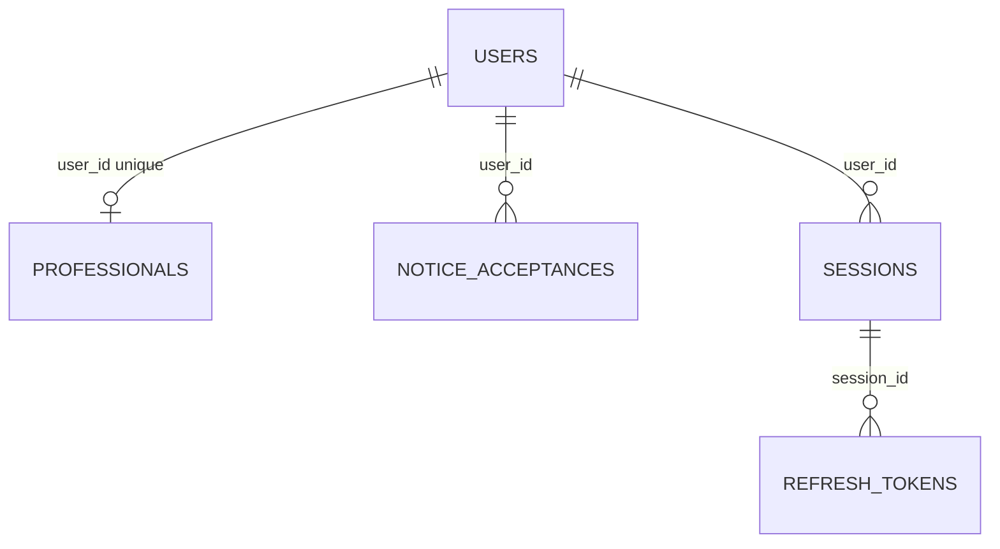

# Modelo de datos de identidad y acceso

Esta página describe el esquema aplicado por 202610190001_english_identifiers.sql en el proyecto compartido de Supabase el 19 de octubre de 2026. La migración inicial y la de provisión administrativa permanecen inmutables. La compatibilidad de API y Web publicados no quedó verificada: la solicitud HTTP a https://couchonefit-web.vercel.app/api/health devolvió 404. No ejecutes la API anterior contra este esquema. Publica las versiones correspondientes de API y Web en el mismo corte de mantenimiento. La aplicación móvil actual aún no consume la API de identidad ni de perfil.

El producto usa PostgreSQL mediante su propia autenticación de API; no usa Supabase Auth. El [esquema integrado](schemas/identity_access.sql) refleja el esquema de negocio resultante. El [glosario](../architecture/domain-glossary.md) es la referencia para los nombres de campos y valores.

## Relaciones

| Tabla | Campos | Reglas |
| --- | --- | --- |
| `private.users` | `id`, `username`, `email`, `password_hash`, `role`, `status`, `created_at` | Llave primaria UUID; usuario y correo únicos normalizados; roles `professional`, `client` o `admin`; estados `active` o `inactive`. Los hashes de contraseña usan Argon2id. |
| `private.professionals` | `id`, `user_id`, `user_role`, `full_name`, `phone`, `plan_interest` | Un perfil por cuenta; `user_role` siempre es `professional`; el plan opcional es `basic`, `pro` o `elite`. Un plan de interés no crea una suscripción. |
| `private.notice_acceptances` | `id`, `user_id`, `version`, `accepted_at` | Una aceptación por persona usuaria y versión del aviso. |
| `private.sessions` | `id`, `user_id`, `created_at`, `expires_at`, `revoked_at` | Vigencia absoluta de 30 días; la revocación invalida el acceso y los tokens de renovación. |
| `private.refresh_tokens` | `id`, `token_hash`, `session_id`, `created_at`, `used_at` | Guarda únicamente hashes SHA-256 de tokens; conserva los tokens usados para detectar intentos de repetición. |

Todas las llaves foráneas de cuentas, perfiles y sesiones usan `ON DELETE RESTRICT`. Desactivar una cuenta conserva su historial. Las tablas privadas tienen seguridad por filas y no se exponen mediante Supabase Data API.

## Roles de base de datos

| Rol | Propósito |
| --- | --- |
| `couchone_registration` | Registrar cuentas profesionales, perfiles y aceptación del aviso. |
| `couchone_authentication` | Hereda permisos de registro y administra sesiones y hashes de tokens de renovación. |
| `couchone_provision` | Preparar una cuenta administrativa una sola vez; nunca se concede al proceso de API en ejecución. |

Todos los roles de aplicación tienen `NOLOGIN`. La API autoriza cada solicitud con el rol persistido de la cuenta y su estado activo. Un dato del cliente o una declaración de JWT no puede conceder un rol.

## Contrato de API

El JSON de registro usa `fullName`, `username`, `email`, `emailConfirmation`, `password`, `passwordConfirmation`, `phone`, `planInterest`, `noticeVersion` y `acceptsNotice`. Las respuestas de sesión y perfil usan campos en inglés `camelCase`, como `userId`, `fullName`, `role`, `status`, `sessionId` y `expiresAt`. Los valores de rol, estado y plan son los descritos arriba. El español se conserva en las etiquetas de interfaz y los mensajes de error dirigidos a la persona usuaria.

El repositorio de API usa los mismos términos que PostgreSQL y no crea alias SQL para traducir nombres. Web envía directamente este contrato. Cuando se implemente identidad o perfil en móvil, se usará este glosario.

## Migración y operación

`202610190001_english_identifiers.sql` renombra el esquema privado, las tablas, columnas, restricciones, índices, políticas, roles de aplicación, valores persistidos e identificadores del historial de migraciones. Conserva las filas existentes, los UUID, los hashes de contraseñas y tokens de renovación, y las marcas de tiempo. Los archivos SQL inicial y de provisión administrativa permanecen sin cambios.

El ejecutor de migraciones puede leer la tabla aplicada anteriormente `migraciones.historial` y la cambia a `migrations.history` dentro de la misma transacción de esta migración. Las bases de datos nuevas empiezan con los nombres del historial en inglés. Consulta la [guía de operación de base de datos](README.md) para conocer las condiciones del entorno compartido y del corte coordinado.
