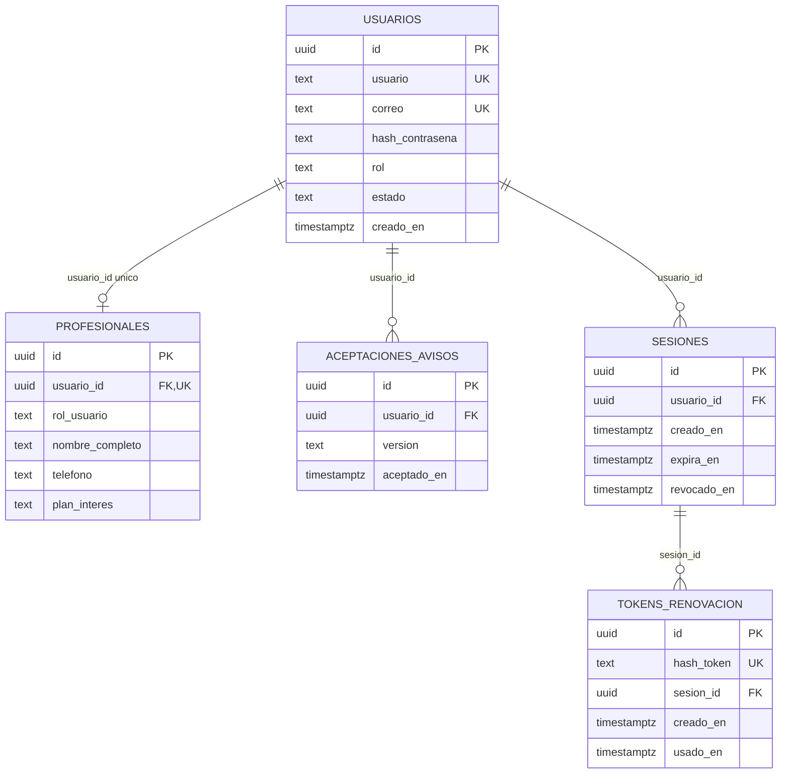

# Modelo de datos y funciones — identidad y acceso

Modelo de HU-001/002 creado por `202610150001_inicial_identidad_acceso.sql`, ampliado por HU-003 con `202610160001_provision_administrador.sql` (provisión, sin tablas nuevas). PostgreSQL en Supabase, autenticación propia en API. Las tablas de cartera, invitaciones, rutinas y suscripciones se incorporarán en sus módulos; no existen por aparecer como ejemplos en las convenciones.

## Creación y evolución

La [migración inicial](migrations/202610150001_inicial_identidad_acceso.sql) crea directamente las cinco tablas, relaciones, restricciones, índices, roles y políticas descritos aquí. Se consolidó antes de su primera aplicación en el proyecto. No contiene renombrados ni transformaciones de estructuras anteriores.

El [esquema integrado](schemas/identidad_acceso.sql) presenta la definición completa vigente de negocio. Al añadir funcionalidades, actualizar ese archivo y añadir nuevas migraciones, sin modificar SQL ya aplicado. [Uso y validación de schemas](schemas/README.md).

## Relaciones



Una cuenta profesional tiene exactamente un perfil al completar HU-001; la transacción de API garantiza que se inserten ambos y la aceptación. La BD impide múltiples perfiles por usuario y prohíbe vincular un perfil a una cuenta cliente/admin. Las cuentas de otros roles no requieren un perfil profesional. Una cuenta puede tener varias sesiones y versiones aceptadas; una sesión puede tener varios hashes, de los cuales los anteriores quedan marcados como usados.

## Diccionario de tablas

Todos los `id` son UUID no nulos con `gen_random_uuid()` y PK propia. Las FK usan `ON DELETE RESTRICT`: una baja ordinaria cambia estado, no borra historial.

### `privado.usuarios`

| Columna | Tipo / nulabilidad | Regla / propósito |
| --- | --- | --- |
| `id` | uuid, requerido, PK | Identidad permanente. Se usa como `sub` JWT y FK de los demás registros. |
| `usuario` | text, requerido | ASCII `[a-z0-9._]`, 3–30; API trim/lower, CHECK e índice normalizado único. |
| `correo` | text, requerido | Trim/lower, máximo 254, forma de correo comprobada; índice normalizado único. Confirmación solo en formulario/API. |
| `hash_contrasena` | text, requerido | PHC Argon2id; CHECK de prefijo, hash/verify en API. Nunca se devuelve ni se guarda contraseña en claro. |
| `rol` | text, requerido | `profesional`, `cliente`, `administrador`. No lo elige el payload de registro. |
| `estado` | text, requerido, default `activo` | `activo` o `inactivo`; cada consulta privada comprueba estado vigente. |
| `creado_en` | timestamptz, requerido, default now | Fecha de alta del servidor. |

`uk_usuarios_id_rol` permite la FK compuesta del perfil. `uk_usuarios_usuario_normalizado` y `uk_usuarios_correo_normalizado` son índices únicos sobre `lower(btrim(...))`, que resuelven también solicitudes concurrentes. No existe unicidad de correo/usuario basada únicamente en un precheck de API.

### `privado.profesionales`

| Columna | Tipo / nulabilidad | Regla / propósito |
| --- | --- | --- |
| `id` | uuid, requerido, PK | Identidad del perfil, distinta de la identidad de acceso. |
| `usuario_id` | uuid, requerido, FK/UNIQUE | Una cuenta tiene como máximo un perfil profesional. |
| `rol_usuario` | text, requerido, default `profesional` | CHECK fijo y FK `(usuario_id,rol_usuario) → usuarios(id,rol)` aseguran el rol correcto. Campo técnico, no editable desde el registro. |
| `nombre_completo` | text, requerido | 3–120 caracteres tras trim. |
| `telefono` | text, nullable | 10–15 dígitos. Ausente se guarda como NULL, no como número ni cadena vacía. |
| `plan_interes` | text, nullable | `basico`, `pro`, `elite`. Preferencia de registro, no suscripción ni capacidad concedida. |

No se crean campos de especialidad, consultorio o biografía sin una funcionalidad que los use. Se añadirán con una nueva migración y compatibilidad de registros existentes.

### `privado.aceptaciones_avisos`

| Columna | Tipo / nulabilidad | Regla / propósito |
| --- | --- | --- |
| `id` | uuid, requerido, PK | Identidad de la aceptación. |
| `usuario_id` | uuid, requerido, FK | Cuenta que confirmó la información. |
| `version` | text, requerido | Versión exacta presentada; versión actual `2026-10-15.1`. |
| `aceptado_en` | timestamptz, requerido, default now | Fecha del servidor, no una fecha enviada por Web. |

`uk_aceptaciones_avisos_usuario_version` impide repetir la misma aceptación. Cada aceptación registra su versión y fecha del servidor. La confirmación informativa actual no representa aceptación de una política de privacidad todavía pendiente de definición completa.

### `privado.sesiones`

| Columna | Tipo / nulabilidad | Regla / propósito |
| --- | --- | --- |
| `id` | uuid, requerido, PK | Identificador `sid` del JWT, generado al crear la sesión. |
| `usuario_id` | uuid, requerido, FK | Cuenta propietaria de la sesión. |
| `creado_en` | timestamptz, requerido, default now | Inicio del límite absoluto. |
| `expira_en` | timestamptz, requerido, default now + 30 días | CHECK posterior a creación. No se prolonga con refresh. |
| `revocado_en` | timestamptz, nullable | No NULL invalida sesión, incluyendo access firmado aún no vencido. |

Índice `idx_sesiones_usuario_id` para localizar sesiones de una cuenta. La autorización compara `expira_en > clock_timestamp()`; una sesión vencida no gana validez por tener un JWT correcto.

### `privado.tokens_renovacion`

| Columna | Tipo / nulabilidad | Regla / propósito |
| --- | --- | --- |
| `id` | uuid, requerido, PK | Identidad técnica del registro del token. |
| `hash_token` | text, requerido, UNIQUE | SHA-256 hexadecimal de 64 caracteres; nunca el refresh en claro. |
| `sesion_id` | uuid, requerido, FK | Familia revocable: la sesión determina su vencimiento absoluto. |
| `creado_en` | timestamptz, requerido, default now | Emisión del registro. |
| `usado_en` | timestamptz, nullable | Al rotar se marca el anterior; reutilizarlo revoca la familia. |

Índice `idx_tokens_renovacion_sesion_id` para los registros de una sesión. No se añade una FK a “token reemplazo”: la familia se identifica por `sesion_id` y cada hash tiene su estado de uso. La ausencia de `usado_en` no basta para autorizar si la sesión/cuenta están bloqueadas.

### `migraciones.historial`

| Columna | Tipo / nulabilidad | Regla / propósito |
| --- | --- | --- |
| `id` | uuid, requerido, PK | Identidad técnica. |
| `nombre` | text, requerido, UNIQUE | Archivo aplicado, con orden temporal. |
| `suma_verificacion` | text, requerido | SHA-256 del contenido exacto del archivo SQL aplicado. |
| `aplicado_en` | timestamptz, requerido, default now | Fecha de aplicación registrada por el servidor. |

El ejecutor crea este historial, comprueba SHA-256 y aplica los archivos pendientes en orden bajo bloqueo y transacción. Repetir no reaplica SQL; un checksum alterado o una migración registrada ausente detienen la ejecución. No se borra historial para continuar.

## Funciones de aplicación y límites transaccionales

No hay funciones SQL/RPC de negocio almacenadas en el esquema. Las funciones siguientes son TypeScript y ejecutan SQL parametrizado mediante `pg`; los bloques `DO` de migraciones son anónimos y solo se ejecutan durante el cambio de esquema.

| Función y archivo en `apps/api/src/features/auth/` | Entrada → resultado | BD / transacción / fallo |
| --- | --- | --- |
| `validateRegistration` — `validators/registration.ts` | unknown → `Registration` camelCase | Sin SQL. Normaliza identificadores, valida confirmaciones, contraseña Unicode, teléfono, plan y aviso; rechaza campos extra/rol. 400 ante inválidos. |
| `registerProfessional` — `services/registration.ts` | Pool + payload → `{account}` | Valida, genera Argon2id, llama al repositorio. 23505 se traduce a 409 sin identificar la cuenta; infraestructura a 503 seguro. |
| `insertProfessional` — `repositories/registration.ts` | Pool + registro + hash → usuario UUID | Una conexión: BEGIN → usuario → perfil → aceptación → COMMIT; cualquier fallo hace ROLLBACK y libera conexión. La API fija rol profesional. |
| `findLoginAccount` — `repositories/session.ts` | Pool + identificador normalizado → cuenta interna o undefined | Selecciona columna correo/usuario desde una lista fija; parámetros para el valor. Devuelve hash solo al servicio, no al navegador. |
| `loginAccount` — `services/session.ts` | Pool + `{identificador,contrasena}` → datos de sesión y cuenta pública | Verifica hash/rol/estado, vuelve a consultar cuenta/perfil; BEGIN → sesión → hash refresh → firma access → COMMIT. Fallo revierte y no emite cookies. |
| `currentSession` — `repositories/session.ts` | Pool + usuario UUID + sid → identidad vigente o undefined | JOIN usuarios/sesiones y LEFT JOIN profesionales con rol/estado/vigencia/revocación; solo el profesional requiere perfil. No confía en un claim de rol. |
| `authenticate` — `services/session.ts` | Pool + access → identidad de sesión | Verifica JWT y consulta BD. Si la identidad dejó de ser válida, marca la sesión como revocada; devuelve 401 sin datos privados. |
| `professionalProfile` — `repositories/session.ts` | Pool + identidad comprobada → perfil propio | Filtra de nuevo por usuario y sesión vigentes. La FK usada se toma de la sesión, no de query/body. Devuelve `id` de perfil y `accountId` de usuario. |
| `refreshAccount` — `services/session.ts` | Pool + refresh → siguiente sesión o null | BEGIN, SELECT FOR UPDATE de sesión/token, validación; marca uso, inserta nuevo hash y firma. Replay/cuenta inválida revoca y confirma esa revocación antes de devolver 401. No mueve `expira_en`. |
| `logoutAccount` — `services/session.ts` | Pool + cookies → void | Revoca sesión localizada por hash de refresh; si solo hay access, verifica firma y usa usuario/sid. Borrado de cookies solo tras éxito del servidor. |
| `signAccess` / `verifyAccess` — `services/tokens.ts` | IDs → JWT; JWT → IDs verificados | Sin SQL; HS256 allowlist, `iss/aud/sub/sid/iat/exp`, duración 15 min, clave solo servidor ≥32 bytes. |
| `randomToken` / `tokenHash` — `services/tokens.ts` | aleatoriedad → base64url; token → SHA-256 | CSPRNG 32 bytes. BD recibe solo hash refresh. |
| `csrfToken` / `requireCsrf` — `middleware/session-http.ts` | request/response → token informativo o autorización | Cookie CSRF HttpOnly; compara Origin permitido y token de cabecera en tiempo constante. Sin tablas de CSRF. |
| `requireSession` / `requireProfessional` / `requireAdmin` — `middleware/session.ts` | request → identidad comprobada y autorización | Autentica y restringe por rol persistido; 401 sin sesión válida y 403 ante rol incorrecto. |

Web usa `login`, `readSession`, `sessionRequest`, `logout` y `authorizedReturn` en `apps/web/src/features/auth/services/session.ts`. Las lecturas privadas pueden renovar una vez, con promesa compartida y Web Locks entre pestañas cuando existen. Los contratos propios usan camelCase (`csrfToken`, `fullName`, `accountId`, `nombreCompleto`); las cookies y claims estándar conservan su nombre por compatibilidad.

Ejemplos de mapeo explícito en repositorios:

```sql
SELECT hash_contrasena AS "passwordHash", rol AS role, estado AS status
FROM privado.usuarios WHERE lower(btrim(correo)) = $1;

SELECT p.id, p.usuario_id AS "accountId", p.nombre_completo AS "fullName"
FROM privado.profesionales p WHERE p.usuario_id = $1;
```

El servicio compara valores persistidos `profesional`/`administrador` y `activo`; `publicAccount` serializa roles HTTP `professional`/`admin` y estado `active`. No acepta esos privilegios desde el payload del visitante. Las filas SQL inspeccionadas directamente por tests pueden usar nombres BD, mientras los objetos de la aplicación usan camelCase.

## Permisos y aislamiento

`privado` y `migraciones` no están expuestos por Data API; PUBLIC no tiene acceso. Las cinco tablas de negocio tienen RLS. El historial técnico queda en esquema sin USAGE público; el runtime no tiene acceso ni permisos DDL sobre él.

| Rol técnico NOLOGIN | Permisos |
| --- | --- |
| `couchone_registro` | SELECT/INSERT de usuarios profesionales, perfiles y aceptaciones; INSERT de usuario limitado a rol profesional y estado activo. Sin UPDATE/DELETE de cuentas. |
| `couchone_autenticacion` | Hereda registro; SELECT de cuentas para autenticar; SELECT/INSERT/UPDATE de sesiones y hashes refresh. No cambia roles, estado o credenciales. |
| `couchone_provision` | Solo operadores: SELECT de identificadores/rol/estado e INSERT de cuentas administrativas activas; sin lectura de hash, UPDATE/DELETE ni acceso a perfiles/sesiones. Nunca conceder al runtime. |

Las políticas se llaman `insertar_usuarios_profesionales`, `consultar_usuarios_profesionales`, `consultar_usuarios_acceso`, `insertar_profesionales`, `consultar_profesionales`, `insertar_aceptaciones_avisos`, `consultar_aceptaciones_avisos`, `gestionar_sesiones`, `gestionar_tokens_renovacion`; HU-003 añade `insertar_administradores_controlados` y `consultar_administradores_controlados`. Se aplican a roles internos de servidor, no al usuario final de una sesión JWT; la autorización de ese usuario la hace la API y su consulta filtrada. No se presenta este permiso de servidor como aislamiento multiusuario de una futura cartera.

El runtime dedicado recibe `GRANT couchone_autenticacion TO couchone_api;`. La inicial crea los roles españoles o reutiliza los existentes en el clúster. Comprueba que no haya atributos elevados ni membresías inesperadas al aprovisionar roles.

## Despliegue, reversión y comprobación

1. Preparar una base vacía del entorno correcto y comprobar credenciales de migración; el runtime se configura por separado.
2. Aplicar `npm run db:migrate` con `DATABASE_URL` del usuario de migraciones. La transacción conserva el estado previo completo si algún paso falla.
3. Desplegar API/Web del mismo incremento, con DTO camelCase. Verificar login, perfil, refresh y logout con usuario runtime restringido.
4. Antes del COMMIT, ROLLBACK es automático. Después de un COMMIT exitoso, no borrar historial ni editar SQL aplicado para “volver atrás”: preparar una nueva migración inversa revisada o restaurar el respaldo durante una ventana controlada. Este cambio no entrega ni ejecuta una reversión destructiva automática.
5. Comprobar `migraciones.historial` con un archivo/checksum inicial y las cinco tablas bajo `privado`. No ejecutar además el snapshot de `schemas` en la misma base.

Las pruebas cubren instalación limpia, repetición sin reaplicar, rechazo de checksums alterados e historial incompatible. Comparan el catálogo de una base migrada con otra creada desde el esquema integrado: columnas, restricciones, índices, RLS, políticas y permisos. Las suites funcionales verifican registro/login, unicidad, rollback y acceso restringido. La ejecución local no acredita aplicación remota ni despliegue. Contratos: [HU-001](../epicas/ep-01-identidad-y-acceso/hu-001/README.md), [HU-002](../epicas/ep-01-identidad-y-acceso/hu-002/README.md).


## Evidencia de esta actualización local

Consolidación: 24 pruebas API/PostgreSQL correctas en una base local nueva, incluida equivalencia entre migración y esquema integrado, repetición y rechazo de historial/checksum alterados. API y Web compilan; lint Web correcto. En la validación funcional previa, navegador Edge comprobó formulario camelCase de registro, login, perfil propio, refresh, dos pestañas, logout, baja, retorno seguro y anchos responsive. Revisión de enlaces Markdown del repositorio: cero enlaces locales rotos. La validación local original no incluyó cambios remotos. Posteriormente, el 15 de octubre de 2026, se aplicó la inicial en el único proyecto CouchOneFit compartido por desarrollo y producción: [estado remoto verificado](README.md#aplicación-remota-verificada--15-de-octubre-de-2026). El despliegue de API/Web sigue pendiente.
