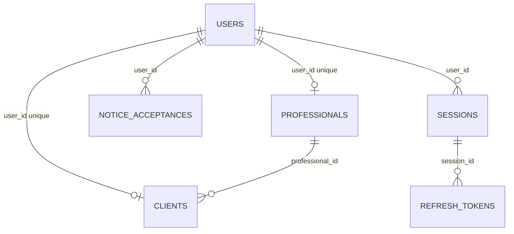

# Modelo de datos de identidad y acceso

Esta página describe el esquema integrado de identidad, acceso, SaaS y expediente inicial. La migración inicial y las migraciones ya aplicadas permanecen inmutables; HU-015 añade una migración incremental nueva. La verificación histórica de compatibilidad de API/Web registró un 404 en la URL consultada; no certifica el estado de despliegue actual. No ejecutes una versión anterior de la API contra este esquema. Publica versiones compatibles de API y Web junto con las migraciones requeridas. La aplicación móvil consume actualmente la API de identidad, sesión y perfil, además de activación y recuperación.

El producto usa PostgreSQL mediante su propia autenticación de API; no usa Supabase Auth. El [esquema integrado](schemas/identity_access.sql) refleja el esquema de negocio resultante. El [glosario](../architecture/domain-glossary.md) es la referencia para los nombres de campos y valores.

## Relaciones

| Tabla                        | Campos                                                                                       | Reglas                                                                                                                                                                                 |
| ---------------------------- | -------------------------------------------------------------------------------------------- | -------------------------------------------------------------------------------------------------------------------------------------------------------------------------------------- |
| `private.users`              | `id`, `username`, `email`, `password_hash`, `role`, `status`, `created_at`                   | Llave primaria UUID; usuario y correo únicos normalizados; roles `professional`, `client` o `admin`; estados `active` o `inactive`. Los hashes de contraseña usan Argon2id.            |
| `private.professionals`      | `id`, `user_id`, `user_role`, `full_name`, `phone`, `plan_interest`                          | Un perfil por cuenta; `user_role` siempre es `professional`; el plan opcional es `basic`, `pro` o `elite`. Un plan de interés no crea una suscripción.                                 |
| `private.clients`            | `id`, `professional_id`, `user_id`, `user_role`, `full_name`, `goal`, `birth_date`, `height_cm`, `base_weight_kg`, `base_body_fat_percentage`, `waist_cm`, `hip_cm`, `status`, `created_at` | Expediente del cliente creado por su profesional; `user_id` es único y anulable hasta activar la cuenta; `user_role` siempre es `client` con FK compuesta a `private.users(id, role)`. |
| `private.notice_acceptances` | `id`, `user_id`, `version`, `accepted_at`                                                    | Una aceptación por persona usuaria y versión del aviso.                                                                                                                                |
| `private.sessions`           | `id`, `user_id`, `created_at`, `expires_at`, `revoked_at`                                    | Vigencia absoluta de 30 días desde el login (`DEC-002`); la revocación (`revoked_at`) invalida de inmediato los JWT vigentes (`sid`) y toda la familia de tokens de renovación.        |
| `private.refresh_tokens`     | `id`, `token_hash`, `session_id`, `created_at`, `used_at`                                    | Guarda únicamente hashes SHA-256 de tokens de un solo uso; conserva los tokens consumidos (`used_at`) para detectar replay y revocar la sesión completa.                               |

Todas las llaves foráneas de cuentas, perfiles y sesiones usan `ON DELETE RESTRICT`. Desactivar una cuenta (`status = 'inactive'`) conserva su historial y revoca todas sus sesiones activas y tokens de renovación pendientes sin reactivarlos si la cuenta vuelve a `active`; inactivar un profesional no desactiva en cascada las cuentas de sus clientes vinculados (`TT-004-5`), y la última cuenta `admin` activa está protegida contra inactivación (`DEC-004`). Cuenta, expediente y suscripción deben conservar estados independientes según DEC-004. El helper actual `updateAccountStatus` todavía sincroniza también `clients.status` al cambiar una cuenta cliente; debe corregirse antes de integrarlo con la baja/reactivación definitiva de expedientes. Las tablas privadas tienen seguridad por filas y no se exponen mediante Supabase Data API.

## Expediente inicial — HU-015

`private.clients` conserva el expediente único del profesional; HU-015 no crea una cuenta de cliente ni una segunda tabla de perfil. Para altas nuevas, la API exige `birth_date`, `height_cm` y `base_weight_kg`; acepta como base opcional `base_body_fat_percentage`, `waist_cm`, `hip_cm` y `goal`. Las unidades persistidas son `cm`, `kg` y `%`, con precisión de 0,1 cuando el valor está presente. `birth_date` identifica a una persona adulta y se guarda como fecha de calendario.

Las columnas se mantienen anulables únicamente para conservar expedientes creados antes de HU-015. Esos expedientes siguen siendo registros históricos mínimos, no expedientes completos de HU-015; la migración no inventa fecha, medidas ni objetivo. `base_body_fat_percentage` es una medición base, no un resultado de cálculo, y `base_weight_kg` no sustituye evaluaciones, check-ins ni mediciones históricas.

**TT-010, exposición confirmada y corrección acotada:** la política heredada `select_clients USING (true)` exponía también todas estas columnas nuevas al rol técnico; una comprobación sintética local confirmó la lectura entre profesionales. Las migraciones nuevas `202610280001` y `202610280002` sustituyen esa lectura por `select_owned_clients`, con cuenta activa y propiedad profesional o vinculación cliente. Los consumidores usan contexto transaccional autenticado; las excepciones operativas devuelven metadatos o agregados mediante funciones restringidas. No se otorga lectura general al runtime ni se cambia SQL histórico. [Diseño y verificación](../epicas/ep-03-cartera-y-expediente/hu-015/tt-010-client-read-isolation.md). La revisión independiente y el alcance transversal restante de TT-010/D0 permanecen abiertos.

## Roles de base de datos

| Rol                       | Propósito                                                                                         |
| ------------------------- | ------------------------------------------------------------------------------------------------- |
| `couchone_registration`   | Registrar cuentas profesionales, perfiles y aceptación del aviso.                                 |
| `couchone_authentication` | Hereda permisos de registro y administra sesiones y hashes de tokens de renovación.               |
| `couchone_provision`      | Preparar una cuenta administrativa una sola vez; nunca se concede al proceso de API en ejecución. |

Todos los roles de aplicación tienen `NOLOGIN`. La API autoriza cada solicitud con el rol persistido de la cuenta y su estado activo. Un dato del cliente o una declaración de JWT no puede conceder un rol.

## Contrato de API

El JSON de registro usa `fullName`, `username`, `email`, `emailConfirmation`, `password`, `passwordConfirmation`, `phone`, `planInterest`, `noticeVersion` y `acceptsNotice`. Las respuestas de sesión y perfil usan campos en inglés `camelCase`, como `userId`, `fullName`, `role`, `status`, `sessionId` y `expiresAt`. Los valores de rol, estado y plan son los descritos arriba. El español se conserva en las etiquetas de interfaz y los mensajes de error dirigidos a la persona usuaria.

El repositorio de API usa los mismos términos que PostgreSQL y no crea alias SQL para traducir nombres. Web y móvil consumen los contratos vigentes de su superficie; las cookies Web y los tokens Bearer móviles no se intercambian como un único formato de respuesta.

## Migración y operación

`202610190001_english_identifiers.sql` renombra el esquema privado, las tablas, columnas, restricciones, índices, políticas, roles de aplicación, valores persistidos e identificadores del historial de migraciones. Conserva las filas existentes, los UUID, los hashes de contraseñas y tokens de renovación, y las marcas de tiempo. Los archivos SQL inicial y de provisión administrativa permanecen sin cambios.

El ejecutor de migraciones puede leer la tabla aplicada anteriormente `migraciones.historial` y la cambia a `migrations.history` dentro de la misma transacción de esta migración. Las bases de datos nuevas empiezan con los nombres del historial en inglés. Consulta la [guía de operación de base de datos](README.md) para conocer las condiciones del entorno compartido y del corte coordinado.
