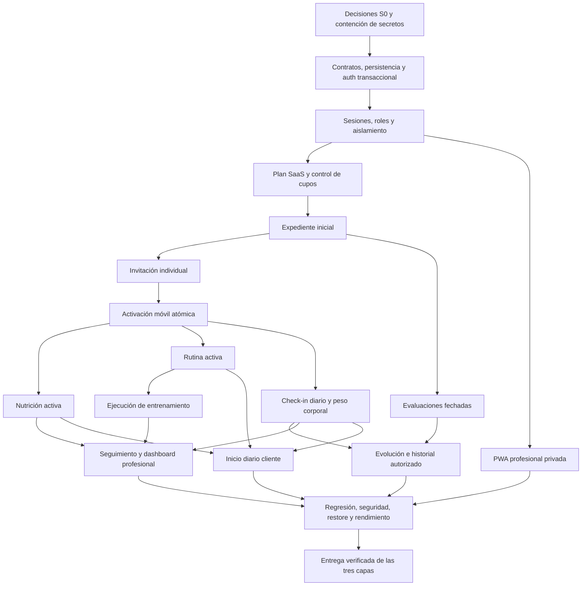

# CouchOne Fit — Plan de trabajo

**Corte del análisis técnico e inventario histórico:** 8 de octubre de 2026.
**Revisión documental:** 14 de octubre de 2026; incorpora acuerdos 10/14-oct y cierra DEC-001–016 por **delegación explícita del usuario**, no por ratificación inferida del equipo; propuestas 10/11-oct archivadas en §3.5. No nueva auditoría técnica.
**Repositorio:** `anglfer/CouchOneFit`.
**Snapshot:** `main`, commit `ecfd607cdc0bc19c0a5f8fbe94844f6181ad0463`, del 7 de octubre de 2026.
**Equipo para esta planificación:** Ferxxo, Pukzil, Franela Whaite y Omar.
**Fuente de alcance:** hoja **V2** del Excel proporcionado, acuerdos explícitos de `docs/requirements/README.md` y acuerdos del usuario del **10 y 14 de octubre de 2026** (§2.1). Las propuestas del equipo no equivalen a aprobaciones.
**Naturaleza del entregable:** análisis y planificación; no implementación del producto.

| Nombre completo                | Etiqueta de asignación | Rol en el equipo                                                                                                                     |
| ------------------------------ | ---------------------- | ------------------------------------------------------------------------------------------------------------------------------------ |
| Angel Fernando Oñate Reyes     | Ferxxo                 | Product Owner, líder técnico y desarrollador principal; prioridades, alcance, aceptación y coordinación técnica.                     |
| Itzel Yutzil Sanches Lopez     | Pukzil                 | Desarrollo de nutrición/antropometría/historial, plataforma HTTP, calidad y distribución móvil; revisión independiente de seguridad. |
| Franchela Maythe Balleza Solis | Franela Whaite         | Desarrollo de cartera/expediente, modelo y contratos, PWA, despliegue API/Web y recuperación; colaboración en activación.            |
| Michel Omar Nava Oliva         | Omar                   | Desarrollo de SaaS/administración, dashboard/inicio móvil, portal y privacidad; pruebas, CI, permisos, medición y soporte.           |

Ferxxo aprueba alcance/producto por la delegación expresamente autorizada y coordina implementación; revisión técnica independiente, nunca su propio PR. No se atribuye propiedad legal de empresa/datos: las responsabilidades y la política de datos del producto se documentan en DEC-011/015.

> Backlog del alcance documentado del producto, no sistema terminado. DEC-001–016 resueltas por delegación usuario 14-oct; reglas funcionales definidas; política de privacidad y retención por completar. Contratos/modelo, originales y fixtures HU-023, accesos cloud, firma, horas/fecha oficial y aprobación para datos reales requieren evidencia externa o técnica; no se acreditan por cerrar una decisión.

## Índice

1. [Conclusión y estado real](#1-conclusión-y-estado-real)
2. [Fuentes, cobertura y verificaciones](#2-fuentes-cobertura-y-verificaciones)
3. [Correcciones, contradicciones y decisiones](#3-correcciones-contradicciones-y-decisiones)
4. [Arquitectura, módulos, épicas y reglas](#4-arquitectura-módulos-épicas-y-reglas)
5. [Definition of Ready y Definition of Done](#5-definition-of-ready-y-definition-of-done)
6. [Historias y tareas por feature](#6-historias-y-tareas-por-feature)
7. [Tareas técnicas transversales](#7-tareas-técnicas-transversales)
8. [Backlog maestro y trazabilidad](#8-backlog-maestro-y-trazabilidad)
9. [Dependencias y paralelismo](#9-dependencias-y-paralelismo)
10. [Sprints y revisiones](#10-sprints-y-revisiones)
11. [Estrategia de pruebas](#11-estrategia-de-pruebas)
12. [CI/CD, calidad y despliegue](#12-cicd-calidad-y-despliegue)
13. [Matriz por integrante](#13-matriz-por-integrante)
14. [Roadmap y condiciones de entrega](#14-roadmap-y-condiciones-de-entrega)
15. [Evidencias y limitaciones](#15-evidencias-y-limitaciones)

---

## 1. Conclusión y estado real

**El proyecto tiene una base técnica utilizable y una landing demostrativa funcional; todavía no tiene un sistema de negocio integrado.** No procede rehacer la landing, cambiar React/Express/Flutter ni introducir microservicios. Falta implementar el dominio, persistencia, acceso seguro e integración de ambas aplicaciones.

| Área / funcionalidad                                                | Estado observado                          | Evidencia y trabajo restante                                                                                                                         |
| ------------------------------------------------------------------- | ----------------------------------------- | ---------------------------------------------------------------------------------------------------------------------------------------------------- |
| Monorepo y convenciones por feature                                 | Implementado como estructura              | Carpetas, manifiestos, README de features y `CONTRIBUTING.md`; mantenerlos.                                                                          |
| API Express y compilación TypeScript                                | Implementado básico                       | `apps/api/src/app.ts`, `server.ts`, `config/index.ts`; build local satisfactorio.                                                                    |
| `/api/health`                                                       | Implementado                              | Devuelve 200 local; no comprueba PostgreSQL, Auth, Storage ni migraciones.                                                                           |
| CORS y contrato de errores API                                      | Requiere corrección                       | CORS importado pero no aplicado; preflight sin cabeceras CORS; JSON inválido responde 500 y 404 responde HTML.                                       |
| Conexión de negocio API → PostgreSQL                                | Pendiente                                 | Variables de Supabase cargadas, pero sin cliente/driver, repositorios ni consultas.                                                                  |
| Esquema de negocio, migraciones, RLS                                | Pendiente, comprobado remotamente         | Proyecto Supabase activo, PostgreSQL 17; 0 tablas propias observadas, 0 políticas en `public`, 0 migraciones al cierre.                              |
| Storage de progreso (histórico 8-oct)                               | No implementado                           | 0 buckets observados; al 14-oct fotos excluidas V2, sin trabajo Storage activo (DEC-010).                                                            |
| Landing pública y vista del producto                                      | Implementado                              | `features/marketing`: contenido, FAQ, navegación, diálogo y simulación con estado local. Conservar.                                                  |
| Registro/login, panel profesional y administración Web              | Pendiente                                 | Solo `/` y página 404; el diálogo informa que acceso/registro/contratación no están disponibles.                                                     |
| Planes y seguimiento mostrados en landing                           | Demostración, no funcionalidad de negocio | Datos de ejemplo en `ProductPreview.tsx`; no consultas a API ni persistencia.                                                                         |
| Cliente HTTP Web                                                    | Parcial                                   | `apiClient` existe, no se usa en la landing; cabeceras combinadas pueden ser sobrescritas por `options`.                                             |
| PWA profesional                                                     | Parcial / requiere corrección             | Se genera SW/manifest, pero se registra inmediatamente en portada y su scope/start URL son `/`. No hay app profesional instalable real.              |
| App Flutter                                                         | Implementado solo como base               | Una pantalla de logo/texto y un smoke test; sin navegación funcional, formularios, sesiones ni HTTP.                                                 |
| Configuración API móvil                                             | Parcial                                   | Constantes no utilizadas; `localhost` fijo en debug/profile no cubre emulador/dispositivo.                                                           |
| Android / iOS / Windows                                             | Scaffold                                  | Android sin permiso Internet en manifest principal y firma release debug; iOS sin equipo de distribución definido; Windows no es entrega confirmada. |
| Autenticación, autorización, aislamiento de carteras                | Pendiente                                 | No basta el health, la presencia de variables o carpetas para acreditarlos.                                                                          |
| Clientes, expedientes, evaluaciones, nutrición, rutinas y check-ins | Pendiente                                 | No hay endpoints ni modelos de negocio en API, ni pantallas de negocio en Web/móvil.                                                                 |
| Suscripciones/cupos/administrador                                   | Pendiente                                 | V2 exige administración y límites, no cobro recurrente integrado.                                                                                    |
| Calidad automatizada                                                | Parcial                                   | Scripts de Web, build API y análisis/test básico Flutter; API/Web sin suite funcional de tests.                                                      |
| CI versionado                                                       | Pendiente                                 | No existe `.github/workflows` en este snapshot.                                                                                                      |
| Protección de ramas / settings cloud                                | No verificado                             | La regla de PR está documentada; no se acreditaron checks obligatorios configurados en GitHub.                                                       |
| Seguridad de secretos                                               | Requiere corrección P0                    | Valor con patrón de clave secreta en `.env.example` API y documentación de BD. Su vigencia no se ha probado; tratar como expuesto.                   |
| API pública desplegada                                              | Requiere investigación                    | Dos comprobaciones puntuales del health público devolvieron 503; no se determinó la causa.                                                           |

### No confundir estos estados

- **Implementado:** existe y, cuando se indica, fue ejecutado. No significa que todo el módulo esté cerrado.
- **Parcial:** existe infraestructura o parte del comportamiento, falta completar integración/seguridad/aceptación.
- **Pendiente:** exigido por alcance confirmado y sin implementación.
- **No definido:** falta una decisión necesaria; no se suplanta con una suposición.
- **Requiere corrección:** hay un comportamiento incorrecto o una inconsistencia verificable.

No se publica un porcentaje de avance: contar carpetas, líneas de CSS o una pantalla de marca no mide funcionalidades completadas.

**Actualización de alcance, no implementación (10/14-oct-2026):** series reales/check-in/peso y adherencia Web confirmados; propietarios preservados. HU-023 incluida con gate técnico originales/fixtures; HU-009 y HU-041 pasan a base P1/3 SP cada una; HU-025 pospuesta y HU-038 fuera V2. DEC-001–016 cerradas §3.3/3.4: **271 SP activos, 13 excluidos, 284 históricos**. Auditoría técnica mantiene corte 8-oct; esta edición solo alinea cuatro documentos existentes.

---

## 2. Fuentes, cobertura y verificaciones

### 2.1 Jerarquía de fuentes

1. Excel entregado: `REQUERIMIENTOS - COUCHONEFIT.xlsx`, hoja **V2**.
2. Acuerdos complementarios explícitos de `docs/requirements/README.md`: credenciales, correo con confirmación, expediente preexistente, canje atómico, consumo/eliminación del código y baja lógica.
3. Catálogo modular de `docs/requirements/*`: comprobado contra el Excel.
4. Arquitectura y despliegue: decisiones técnicas existentes, no evidencia automática de implementación.
5. README raíz y por aplicación: contexto; las ampliaciones no recogidas claramente en V2 se elevan a decisión.
6. Código/configuración y ejecución: fuente del **estado real**, no del alcance aprobado.

**Acuerdo complementario del usuario en chat — 10 de octubre de 2026:** confirma carga/peso, unidad, repeticiones realmente realizadas y estado de realización por cada serie en HU-031; check-in diario HU-032 con entrada de peso corporal y evento histórico HU-037; Web HU-033 con detalle de ejecución, peso separado, gráficas/histórico y adherencia. Confirma también el reparto de §13. Complementa V2 sin modificar su contenido histórico ni sus **139 IDs**, sin crear nuevos RF/RDF. No aprueba fotos, fórmulas, offline ni reglas finas de DEC-006/008. Esta fuente se registra aquí; no se afirma haber comprobado documentos actuales fuera de este plan.

**Fuente aportada por usuario — 14-oct-2026:** propuestas 10/11-oct y hallazgos sobre Issues 6/7/11 cerrados con textos incompletos, sin inferir aprobación ni reconstruirlos/consultarlos de nuevo. **Delegación explícita posterior de hoy:** autoriza adoptar decisiones pendientes con criterio y editar documentación: §3.3/3.4 son vigentes y §3.5 archivo supersedido. HU-023 incluida gate técnico; HU-025 pospuesta excepción RDF0605/0606; HU-038 excluida. Rutas/SQL/DTO/modelos ilustrativos, no contratos/DDL definitivos ni implementación.

**Datos del Excel:** 20 098 bytes; SHA-256 `0d9b9af33b33810d252300d0aa2d8744822f4e273eff0f6eb899174d94e07497`.

Se leyó el contenido XML completo de ambas hojas, no solo el rango anunciado por el visor: **V1 llega a la fila 146 y V2 a la 148**. Las filas finales de V2 incluyen `RS21`–`RS24` y están cubiertas. La hoja vigente contiene **139 IDs**:

| Categoría      | Cantidad |
| -------------- | -------: |
| RF generales   |       10 |
| RDF detallados |       53 |
| RC generales   |        7 |
| RDC detallados |       28 |
| RNF            |       20 |
| RS             |       21 |
| Total          |      139 |

Los textos/IDs detallados del Excel coinciden con los documentos locales. V2 modifica `RC01`, `RDC0102`, `RDC0103`, reasigna `RDC0104` a creación de credenciales y agrega `RDC0105`/`RDC0106`. La prohibición de reutilizar el código corresponde a **RDC0106**, no al significado antiguo de RDC0104.

**No existen en V2 `RDF0806`, `RS03`, `RS09` ni `RS13`.** Los saltos de numeración no autorizan inventar esos requisitos.

### 2.2 Cobertura del repositorio

Inventario Git: **167 archivos versionados**, distribuidos así:

| Área             | Archivos | Revisión                                                                                                                                    |
| ---------------- | -------: | ------------------------------------------------------------------------------------------------------------------------------------------- |
| Raíz + `.vscode` |        5 | README, colaboración, ignores y editor.                                                                                                     |
| API              |       14 | Todo código/configuración propio, plantilla de entorno, documentación y lockfile relevante.                                                 |
| Web              |       42 | Todos TS/TSX/CSS, rutas, servicios, HTML, manifest/SW configurado, estilos, DESIGN, configs, deployment y assets clasificados.              |
| Móvil            |       93 | Dart/test, manifiestos, Gradle/Kotlin, proyecto Xcode completo, Swift/storyboards, CMake y runner Windows; assets y generados clasificados. |
| `docs`           |       13 | Todos los documentos y marcadores; `docs/api` solo contiene `.gitkeep`.                                                                     |

Se inspeccionaron también configuraciones locales relevantes y generados para distinguirlos de producto. No se auditaron uno por uno fuentes de SDK, `node_modules`, cachés, binarios ni objetos Git: no son implementación propia. Los lockfiles se usaron para identificar versiones/resolución, no como sustituto de ejecutar tests.

La consulta de referencias remotas encontró solo **`main`**, con el mismo commit, y ningún tag. No había cambios locales al iniciar ni al terminar las validaciones. No se ha certificado la existencia/ausencia de trabajo fuera del repositorio o documentos adicionales no entregados.

### 2.3 Línea base ejecutada

Herramientas observadas: Node `24.21.0`, npm `12.1.0`, Flutter `3.47.5`, Dart `3.13.4`. Son el entorno probado, no una obligación automática de actualizar todos los equipos al último release.

| Verificación                                  | Resultado                                                         | Interpretación                                                                                                      |
| --------------------------------------------- | ----------------------------------------------------------------- | ------------------------------------------------------------------------------------------------------------------- |
| `npm --prefix apps/api run build`             | Pasa                                                              | API compila; no demuestra funcionalidad de negocio.                                                                 |
| `npm --prefix apps/web run lint`              | Pasa                                                              | Oxlint no reportó errores en esta ejecución.                                                                        |
| `npm --prefix apps/web run build`             | Pasa                                                              | Typecheck/build y generación de SW/manifest.                                                                        |
| `npm --prefix apps/web run format:check`      | Falla                                                             | Dos archivos: `marketing.css` y `MarketingPage.tsx`; corregir sin rediseñar.                                        |
| `flutter analyze --no-pub` en móvil           | Pasa                                                              | Sin problemas del analizador Dart; no valida compilación Android/iOS.                                               |
| `flutter test --no-pub test/widget_test.dart` | Pasa, 1 test                                                      | Solo monta app y comprueba el texto de marca.                                                                       |
| Auditoría npm API                             | 0 hallazgos                                                       | Observación puntual; no prueba que toda la aplicación sea segura.                                                   |
| Auditoría npm Web                             | 1 alta                                                            | `source-map-js` 1.2.1, dependencia de desarrollo; evaluar y actualizar resolución compatible.                       |
| Diagnósticos del editor                       | Sin errores                                                       | No sustituye CI ni pruebas de negocio.                                                                              |
| HTTP API local                                | Health 200; CORS ausente; JSON inválido 500; desconocida 404 HTML | Defectos reproducidos, no inferidos.                                                                                |
| Navegador Web local                           | Render, vista del producto, diálogo, menú/Escape y 404 comprobados              | Interacciones puntuales; algunas acciones usaron clic forzado de automatización, no certificación de accesibilidad. |
| Vista Web de 390 px                           | Sin desbordamiento horizontal observado                           | No equivale a matriz responsive completa.                                                                           |
| SW en portada                                 | Controlador presente                                              | Confirma necesidad de acotar registro/alcance privado.                                                              |
| Catálogo Supabase                             | 0 tablas de negocio, 0 políticas `public`, 0 buckets              | No existen avances de esquema que migrar/conservar.                                                                 |
| Migraciones Supabase al cierre                | Vacío                                                             | Comprobado mediante lectura final.                                                                                  |
| Advisors Supabase                             | Sin avisos                                                        | Con esquema vacío no demuestra aislamiento.                                                                         |
| Health remoto                                 | 503 en las dos comprobaciones                                     | Disponibilidad de producción no acreditada; investigar en TT-016.                                                   |

No se ejecutó build APK/AAB, build iOS/macOS, instalación nativa, suite E2E del producto, test de restauración ni carga. No se instalaron paquetes ni se aplicaron fixes de dependencias.

---

## 3. Correcciones, contradicciones y decisiones

### 3.1 Hallazgos que se convierten en trabajo

| Hallazgo                                  | Evidencia                                                  | Resolución planificada                                                                                                   |
| ----------------------------------------- | ---------------------------------------------------------- | ------------------------------------------------------------------------------------------------------------------------ |
| Clave secreta expuesta                    | `apps/api/.env.example:8`, `docs/database/README.md:25,61` | TT-001: revocar/rotar, retirar valores, revisar exposición histórica y artefactos. No reutilizar ni reproducir la clave. |
| CORS no aplicado                          | `apps/api/src/app.ts:2,8–9`, `config/index.ts:8`           | TT-002: middleware y allowlist por entorno; test de preflight/origen denegado.                                           |
| Puerto local desalineado                  | Ejemplo API 5173 vs Vite 5000                              | TT-002/TT-008: configurar origen real.                                                                                   |
| Error de cliente clasificado 500          | `app.ts:21–28`; JSON inválido reproducido                  | TT-002: preservar 400/413, contrato JSON 404 y 500 sanitizado.                                                           |
| Supabase “conectado” solo documentalmente | `config/index.ts:9–14`                                     | TT-003/TT-016: conexión real, transacciones y readiness.                                                                 |
| Un único health no acredita sistema       | `app.ts:12–18`                                             | Mantener liveness; agregar comprobación de dependencia sin exponer detalles.                                             |
| Helper Web sobrescribe headers            | `apps/web/src/services/api.ts:10–16`                       | TT-002: normalizar `Headers`, aplicar auth elegida y conservar cabeceras.                                                |
| PWA invade marketing                      | `main.tsx:6`, `vite.config.ts:26–27`                       | HU-040: registro/manifest/SW/navegación privados, limpieza de SW anterior. Cambiar solo manifest no basta.               |
| Formato Web falla                         | Dos archivos identificados                                 | TT-005: formato mínimo; no reescribir componentes funcionales.                                                           |
| Dependencia Web con aviso alto            | Lockfile y audit: `source-map-js` 1.2.1                    | TT-005: corregir sin `--force`, rerun audit/build; no afirmar vulnerabilidad runtime sin analizar la ruta.               |
| SDK móvil anunciado demasiado antiguo     | Pubspec/README frente a lock Dart ≥3.11                    | TT-008: SDK fijado y documentación alineada.                                                                             |
| URL móvil local no configurable           | `api_config.dart:5–8`                                      | TT-002/TT-008: emulador/dispositivo/staging/release explícitos.                                                          |
| Internet release Android ausente          | Manifest principal frente a debug/profile                  | TT-018: manifest fusionado y llamada HTTPS desde APK.                                                                    |
| Firma release Android debug               | `android/app/build.gradle.kts:32–36`                       | TT-018: firma de distribución y custodia externa al repo.                                                                |
| Kotlin/AGP efectivos no comprobados       | Plugins/flags Gradle; app Kotlin                           | TT-018: build real antes de afirmar compatibilidad o migrar versiones.                                                   |
| Iconos nativos de Flutter                 | Assets Android/iOS                                         | TT-018: identidad nativa reutilizando el logo del proyecto.                                                              |
| README raíz sin Omar                      | Lista histórica de 3 integrantes                           | TT-019: incorporar equipo de 4 conforme al encargo; no asignar trabajo por la lista antigua.                             |

### 3.2 Contradicciones que no deben propagarse

- **Express actual es 4.22.3**, resuelto desde manifiesto Express 4; no es Express 5. No se planifica una migración de major sin necesidad.
- El README mantiene hosting/diseño como pendientes, aunque existe estrategia Render/Vercel/Supabase y `DESIGN.md`. Conservar lo elegido; completar configuración/verificación y ajustar documentación.
- UI-001 del 16-oct-2026 alinea los temas según sistema y actualiza la paleta pública/privada. Revisar contraste y tamaños de detalles dentro de TT-013.
- En el corte de auditoría del 8 de octubre de 2026, el README Web mencionaba JWT antes de resolver proveedor/sesión. DEC-002, resuelta el 2026-10-09, fija auth propio/JWT/refresh rotativo; conservar el hallazgo histórico no reabre esa decisión.
- “API central” no garantiza aislamiento por sí sola; una cuenta privilegiada que omite RLS no prueba RS02/RS19. Hay que validar identidad/propiedad en API y en el contexto de acceso BD seleccionado.
- “Backups automáticos en Supabase Free” no es un mecanismo de recuperación demostrado. La documentación oficial recomienda exportaciones/off-site para Free; los objetos Storage necesitan respaldo separado. Ver S-01.
- Los 30–45 segundos de cold start documentados no son un SLA: Render documenta aproximadamente un minuto y no recomienda Free para producción. Ver S-02.
- El corte histórico S-03 sobre Vercel Hobby no acredita elegibilidad actual. DEC-014 fija producto SaaS; humano autorizado debe verificar límites/capacidad de colaboración antes de promover, sin compras automáticas.
- `RDC0106` admite invalidar el código, pero el acuerdo complementario concreta eliminar su registro temporal tras éxito. No confundirlo con borrado físico de cuentas.
- Histórico 8-oct: peso/fotos/parámetros por conciliar. Acuerdos 10/14-oct incluyen peso/series y excluyen fotos; DEC-006/008 resueltas fijan reglas. Carga del ejercicio no equivale a peso corporal.
- “En tiempo real” no significa WebSocket/notificaciones: RNF13 se concreta en read-after-COMMIT y polling foreground de DEC-013, sin mantener infraestructura despierta.

### 3.3 Registro de decisiones — resueltas para V2

**Fuente y fecha de cierre: delegación explícita del usuario, 14 de octubre de 2026.** Se adoptan las reglas de §3.4 con criterio de producto/técnico; no se atribuye ratificación al equipo, revisión a Maythe, certificación médica/legal, ejecución de tests ni cambios cloud. DEC-001 conserva su núcleo histórico del 8-oct y DEC-002 el del 9-oct, refinados/supersedidos donde se indica. Las propuestas del 10/11-oct son antecedentes, no aprobaciones. Ninguna elección de producto queda pendiente; los propietarios implementarán y otros integrantes revisarán, nunca el autor de su propio PR.

| ID      | Estado vigente al 14-oct-2026 / regla adoptada                                                                                                                               | Propietario / contraste                        | Validación y dependencias                                       |
| ------- | ---------------------------------------------------------------------------------------------------------------------------------------------------------------------------- | ---------------------------------------------- | --------------------------------------------------------------- |
| DEC-001 | **RESUELTA:** identificadores normalizados, contraseña 15–128 Unicode sin composición, Argon2id y bootstrap controlado.                                                      | Ferxxo / Omar; Pukzil seguridad                | HU-001/003/006/008/011; TT-003/004/009                          |
| DEC-002 | **RESUELTA:** auth API/PostgreSQL, JWT 15 min, refresh rotativo absoluto 30 días, `sid`, proxy Web mismo origen y recuperación HU-009 base P1/3 SP.                          | Ferxxo / Franela Whaite/Omar; Pukzil seguridad | HU-001–009; TT-002/004/010/012                                  |
| DEC-003 | **RESUELTA:** invitación 32 bytes, hash SHA-256, TTL 7 días, canje anónimo atómico y DELETE temporal; SQL `node-postgres` sin ORM.                                           | Franela Whaite / Ferxxo; Omar concurrencia     | HU-007/008/013; TT-003/009/010                                  |
| DEC-004 | **RESUELTA:** matriz de cuentas/expedientes/suscripciones; clientes mantienen lectura propia autorizada sin escrituras ante bloqueo operativo; último admin protegido.       | Ferxxo / Franela Whaite y Omar                 | HU-005/012/013/018; TT-004-5/010                                |
| DEC-005 | **RESUELTA:** Básico 10, Pro 30, Élite ilimitado explícito, precios 299/599/999 MXN por acuerdo 15-oct; CTA a registro, sin cobro ni activación de suscripción. Cambios admin auditados; exceso bloquea nuevos consumidores. | Omar / Pukzil; Ferxxo producto                 | HU-010–014/039; carreras de cupo                                |
| DEC-006 | **RESUELTA:** diccionario de captura completo, adultos, métricas kg/cm/mm, intensidad RPE de prescripción, nutrición manual y peso diario opcional.               | Pukzil / propietarios HU; Ferxxo producto      | HU-015/017/021/024/028/031/032/037; TT-009                      |
| DEC-007 | **RESUELTA:** Jackson–Pollock 3 + Siri elegido; HU-023 incluida P1/3 SP con gate técnico de originales/casos patrón; HU-025 pospuesta.                                       | Pukzil / revisión independiente                | HU-023 Bloq hasta Ready técnico; RDF0605/0606 excepción         |
| DEC-008 | **RESUELTA:** zona IANA, hoy y dos fechas locales anteriores, edición auditada, sesión borrador/final y adherencia observada con cobertura separada.                         | Ferxxo / Omar y Pukzil                         | HU-031–035/037; relojes, concurrencia y ejemplos §3.4           |
| DEC-009 | **RESUELTA:** categorías por cliente default off, historial sin grant global, agregado 200 filtrado/dedicado 403; revocación próxima consulta.                               | Pukzil / Franela Whaite                        | HU-020/022/036; tests de todas las proyecciones                 |
| DEC-010 | **RESUELTA:** peso corporal y ejecución por serie incluidos; no fotos, HU-038 fuera V2, sin Storage/medios.                                                                  | Franela Whaite / Omar y Ferxxo                 | HU-031/032/033/037; exclusión HU-038                            |
| DEC-011 | **ACTUALIZADA:** baja lógica conserva historial; retención por categoría y eliminación autorizada pendientes de política. Sin purgas ligadas a la entrega. | Franela Whaite / Omar; Ferxxo producto | HU-018/041; TT-011/015 |
| DEC-012 | **RESUELTA:** React/Vite PWA y APK Android firmado; API mínima 24 como política, emuladores 24/36; no AAB/tiendas/iOS/Windows nativo.                                        | Franela Whaite / Pukzil; Omar firma            | TT-008/013/018; builds/matriz aún no ejecutados                 |
| DEC-013 | **RESUELTA:** objetivos warm/cold/frescura y restore medibles; disponibilidad observada sin SLA 99% contractual ni keep-alive.                                                 | Ferxxo / Pukzil y Omar                         | TT-014–017/021; objetivos no resultados                         |
| DEC-014 | **RESUELTA:** producto SaaS, presupuesto incremental 0, servicios existentes condicionados a límites/accesos humanos; precios y CTA a registro (15-oct), sin pasarela/cargo real; proxy `/api`. | Ferxxo / equipo                                | TT-016–018; HU-039; sin contratación/configuración realizada    |
| DEC-015 | **ACTUALIZADA:** información de registro versionada y confirmación atómica; política de privacidad completa por definir. | Omar / Ferxxo | HU-001/008/041 |
| DEC-016 | **RESUELTA PARA V2:** cuatro sprints quincenales 19-oct–13-dic, incrementos S0–S7 ordenados, WIP 1 y reserva 30%; horas/fecha oficial gates externos.              | Equipo; coordina Ferxxo                        | §10/13; primer replaneamiento 1-nov; no compromiso de capacidad |

**Alternativas evaluadas históricamente para DEC-002:** (a) Auth administrado con mecanismo transaccional seguro y (b) credenciales/sesiones gestionadas por API con hash seguro y transacción PostgreSQL. La decisión resuelta el 2026-10-09 seleccionó la segunda opción; este registro no la reabre. Una secuencia “crear usuario remoto → insertar vínculo → borrar código” sin recuperación demostrada no satisfacía el acuerdo; no insertar manualmente en tablas internas de un proveedor para simular soporte transaccional.

No se requiere OAuth, MFA, login social, correo de verificación, pago integrado, chat o notificaciones para cerrar V2. Confirmar el correo repetido es validación del formulario, **no** verificación por enlace.

“Login avanzado” se refiere exclusivamente a la seguridad ya definida: JWT, rotación y revocación de sesiones, RBAC, aislamiento y rate limit. No significa MFA ni login social aprobados, ni nuevas métricas de negocio.

### 3.4 Resoluciones detalladas vigentes — delegación explícita del usuario, 14-oct-2026

Estas reglas sustituyen las propuestas abiertas del archivo §3.5 y las redacciones anteriores de HU/TT. Son decisiones documentales, no implementación. Contratos, nombres de rutas, DTO y DDL ilustrativos deben concretarse en TT-003/009; no son endpoints ni migraciones existentes. Las validaciones siguientes son **trabajo requerido**, no pruebas ejecutadas.

#### DEC-001 — Registro, normalización y credenciales

- Usuario ASCII `[a-z0-9._]`, 3–30 caracteres después de `trim` y lower; sin `@` para separar login por correo. Correo obligatorio y confirmación por campo; `trim` + lower de todo el correo es política de esta aplicación, con unicidad mediante índice expresional de normalización (no `UNIQUE(lower(...))` dentro de tabla). No verificación SMTP.
- Contraseña 15–128 caracteres Unicode contados como puntos de código, sin composición obligatoria, sin `trim`, normalización ni truncamiento. **Supersede expresamente mínimo 8/composición del borrador por el acceso sin MFA.** Argon2id con salt, mínimo 19 MiB, `t=2`, `p=1`, benchmark en infraestructura objetivo y rate limit; no alternativa bcrypt seleccionada.
- Nombre profesional 3–120; cliente 2–150; teléfono opcional, texto de 10–15 dígitos, nunca número aritmético. Primer admin por seed local controlado sin secreto versionado; admins posteriores solo por admin autorizado. Bootstrap concurrente protegido; sin autoalta pública.
- **Razón/alternativas:** evita colisión correo/usuario, contraseñas alteradas y secretos publicados; se descartan composición artificial, bcrypt y cuentas maestras. **Validación:** duplicados concurrentes/case/espacios, Unicode y límites, contraseña idéntica entrada/hash, escalamiento y bootstrap concurrente; Pukzil revisa seguridad, nunca autor.

#### DEC-002 — Sesión, topología y recuperación incluida

- Se conserva elección histórica API/Express + PostgreSQL del 9-oct: JWT access 15 min, refresh rotativo hash-only y vencimiento **absoluto 30 días desde login**, sin prolongación indefinida. JWT HS256 permitido con secreto custodiado y algoritmo allowlist; verificar `iss`, `aud`, `exp`, `sub`, `sid`. Cada request privado consulta sesión/cuenta en BD fail-closed; rol vigente lo determina servidor, no claim antiguo. Logout/baja revocan inmediatamente incluso access no vencido. Replay refresh revoca familia; Web/móvil serializan refresh concurrentes.
- Web llama `/api` mismo origen vía proxy Vercel→Render HTTPS, conserva prefijo `/api` y paths. Cookies host-only, sin `Domain`, `HttpOnly`, `Secure`, `SameSite=Strict`; privados `no-store` y sin cache CDN/SW. Mutaciones con Origin allowlist **y** token CSRF. Vite usa proxy con misma topología; excepción local HTTP sin datos reales permite cookie sin Secure, producción siempre HTTPS. Móvil directo Render TLS con Bearer en almacenamiento seguro.
- **HU-009 incluida base P1/3 SP:** reset separado de invitación, CSPRNG 32 bytes/hash, TTL servidor 30 min, una vigencia por cuenta, entrega manual autorizada. Profesional solo cliente propio; admin profesionales/admins autorizados. Corroborar identidad fuera de banda por relación conocida, nunca solo correo/ID; denegar sin corroboración. Cliente introduce nueva clave: profesional/admin no la conoce. Reset no crea cuenta/vínculo, revoca todas las sesiones y consume token en transacción. Último admin: emergencia por comando local controlado del custodio, no puerta pública.
- **Razón/alternativas:** conserva atomicidad y revocación; descarta Supabase Auth, cookie cross-site `None`, access válido tras logout, SMTP y recuperación por saber correo. **Validación:** replay access/refresh, límite absoluto, fallo BD, refresh concurrente serializado, cookie/CSRF por proxy, reset ajeno/vencido/reusado y ausencia de nueva cuenta; TT-004/010/012.

#### DEC-003 — Invitación, reserva y SQL

- CSPRNG 32 bytes (256 bits), base64url sin padding 43 caracteres; persistir solo SHA-256, TTL servidor 7 días exactos (`expires_at <= now` inválido). Emitir solo para expediente activo no vinculado, profesional activo/suscripción activa. Copiar manualmente; sin SMTP ni deep link obligatorio.
- Una pendiente por expediente: reemplazo/revocación transaccionales con lock de expediente. Canje anónimo en **única conexión/transacción**: lock expediente/invitación/suscripción en orden estable, verificar estados/vínculo/expiración, crear cuenta y vínculo, DELETE temporal/hash tras éxito, COMMIT y después sesión. Fallo revierte todo; auditoría sin token ni hash. Cupo reservado por expediente activo: canjear/invitar no cuenta dos veces ni falla al límite reservado.
- Limpieza diaria de expiradas; revocadas/expiradas de pruebas se eliminan a los 7 días desde su fin, nunca tokens en logs. Aplican además los límites de purga DEC-011.
- TT-003 selecciona **`node-postgres` (`pg`), SQL parametrizado y migraciones SQL versionadas**, sin ORM añadido. Rol ordinario/grants/RLS con contexto confiable derivado de sesión y `SET LOCAL` dentro de transacción; no contexto arbitrario del cliente ni roles públicos de acceso directo. No privilegio DDL en handlers.
- **Razón/alternativas:** evita cuentas huérfanas, replay y doble reserva; descarta estado `consumed` permanente, secuencia remota no atómica y ORM innecesario. **Validación:** carrera reemplazo/canje/suspensión, fallo por etapa, última plaza ya reservada, exactly-one vínculo y cero fila/hash tras éxito; HU-007/008/013, TT-003/010.

#### DEC-004 — Matriz explícita de estados

| Situación                                                                                         | Regla vigente                                                                                                                                                                                                                      |
| ------------------------------------------------------------------------------------------------- | ---------------------------------------------------------------------------------------------------------------------------------------------------------------------------------------------------------------------------------- |
| Profesional activo + suscripción activa                                                           | Operación normal solo rol/ownership/cupo; nada irrestricto.                                                                                                                                                                        |
| Profesional activo sin plan                                                                       | Solo perfil/suscripción y panel vacío sin datos de ejemplo; sin operaciones de negocio/invitaciones.                                                                                                                                      |
| Profesional activo + suscripción suspendida                                                       | Solo perfil/suscripción; sin operaciones de negocio.                                                                                                                                                                               |
| Profesional inactivo                                                                              | No login, revocar sesiones; no cascada de baja de cuentas cliente.                                                                                                                                                                 |
| Cliente con cuenta activa ante profesional inactivo, suscripción suspendida o expediente inactivo | Lectura propia de perfil y rutinas/alimentación ya publicadas e historial autorizado; no check-in/peso/series ni activación. No borrar/despublicar planes.                                                                         |
| Cliente con cuenta inactiva                                                                       | No login, revocar sesiones; historial preservado dentro de DEC-011.                                                                                                                                                                |
| Profesional sobre su expediente                                                                   | Estado activo/inactivo independiente de cuenta cliente; dar de baja cuenta exige acción explícita autorizada. Reactivar expediente requiere profesional/sub activos y cupo. Reactivar cuenta no activa expediente automáticamente. |
| Administrador                                                                                     | Gestiona estado de profesional/admin, no expedientes; último admin activo no puede ser dado de baja/degradado. Bootstrap concurrente protegido.                                                                                    |

Sin autoeliminación UI. **Razón/alternativas:** separa operación, identidad y contratación sin perder información; descarta baja en cascada y congelación/borrado de planes. **Validación:** matriz completa con sesiones abiertas, rol dueño/ajeno, reactivación separada, último admin concurrente; HU-005/012/018, TT-004-5/010.

#### DEC-005 — Catálogo de planes y cupo

- Básico 10, Pro 30 y Élite ilimitado: flag explícito + límite nullable, nunca sentinel 0. Restante limitado `max(0, limite-usados)` y exceso aparte; ilimitado restante `null`, etiqueta “ilimitado”. Sin plan no confiere cupo.
- **Acuerdo del usuario 25-oct-2026 (vigente):** el profesional contrata y sube de nivel mediante checkout simulado; cobra el precio completo del plan elegido y comienza un mes calendario nuevo desde aprobación, sin prorrateo. Administrador solo consulta suscripciones: no asigna/cambia plan, estado ni vigencia. Mantiene catálogo HU-010. Aprobación y activación auditadas y atómicas; rechazo/error/cancelación no cambian plan. El downgrade de autoservicio queda fuera de este incremento; se conserva tratamiento de exceso ante datos históricos o reducción de catálogo. Errores de cupo: 409 `CUPO_AGOTADO`; 403 `PLAN_REQUIRED`/`SUBSCRIPTION_SUSPENDED`.
- **Actualización explícita del usuario 15-oct-2026:** publicar precios Básico 299 MXN, Pro 599 MXN y Élite 999 MXN. «Contratar plan» lleva al registro con interés preseleccionado y «Contáctanos» al mismo formulario sin plan; reemplaza el recorrido anterior de contratación previo. No solicita datos bancarios ni registra cargos o activa suscripciones. Cuenta activa sin plan/cupo; login en HU-002. Perfil ampliable mediante migraciones nuevas.
- **Razón/alternativas:** catálogo de planes y registro previo a la contratación, sin expulsión de clientes; descarta downgrade diferido, 0=ilimitado y pagos reales. **Validación:** N−1/N/N+1, carreras, downgrade, ilimitado/null/restante, CTA a registro con precio/interés correcto y sin datos bancarios/cargos/activación; HU-010–014/039.

#### DEC-006 — Diccionario de captura cerrado

El alcance actual contempla población **adulta de 18 años o más**. `fecha_nacimiento` requerida, fecha válida no futura; edad en años cumplidos a la fecha de evaluación. Selector opcional exclusivo del método `masculino`/`femenino`/`no_aplica`, no sexo binario obligatorio del perfil. API documental camelCase; DTO/casts BD definitivos en TT-009. Números finitos, NULL ≠ 0, sin coerción de vacío/booleano; límites son **software evolucionable, no normalidad clínica ni prescripción**.

| Campo                      | Unidad, límites, precisión y obligatoriedad vigentes                                                                                                                                                                                                        |
| -------------------------- | ----------------------------------------------------------------------------------------------------------------------------------------------------------------------------------------------------------------------------------------------------------- |
| Peso base alta / altura    | kg 30–300 / cm 100–250, precisión 0,1; ambos requeridos.                                                                                                                                                                                                    |
| Peso check-in              | kg 30–300, 0,1; **opcional**, también sin planes; evento único HU-037.                                                                                                                                                                                      |
| Grasa medida               | % 2–60, 0,1; opcional, distinta del resultado calculado.                                                                                                                                                                                                    |
| Cintura / cadera           | cm 40–250 / 50–250, 0,1; opcionales.                                                                                                                                                                                                                        |
| Pliegue individual         | mm 1–80, 0,1; cada captura opcional, tres del método requeridos para calcular. Puntos varones pecho/abdomen/muslo; mujeres tríceps/suprailiaco/muslo sujetos a cotejo original DEC-007.                                                                     |
| Sueño / estrés / energía   | Horas 0–24 paso 0,5; escalas 1–5 de bajo a alto (estrés 1 bajo/5 alto; energía 1 baja/5 alta); opcionales.                                                                                                                                                  |
| Comentario e instrucciones | Texto máximo 500 caracteres; opcional salvo indicación profesional necesaria para su estructura.                                                                                                                                                            |
| Cumplimiento nutricional   | Opcional; enum español snake_case `completado`, `parcial`, `no_cumplido`, `no_aplica`; no booleano con descanso. Check-in exige al menos un campo real, no registro vacío.                                                                                  |
| Prescripción entrenamiento | Series 1–20 y reps objetivo 1–100 requeridas; intensidad **RPE 1–10 paso 0,5**, solo prescripción; carga objetivo opcional. Días/orden/ejercicio/instrucciones, entrenamiento vs descanso explícitos.                                                       |
| Serie real                 | Reps 0–1000 enteras; carga kg 0–1000, 0,1; estado `realizada`/`no_realizada`. Realizada exige reps ≥1 y carga: externa >0, corporal exactamente 0. No realizada: reps 0 explícito, carga NULL. Ausente no es 0; sin series adicionales ni RPE de ejecución. |
| Nutrición manual           | Comidas ordenadas, alimento nombre texto, cantidad >0 y ≤10000 precisión 0,1, unidades `g`, `ml`, `unidad`, `porcion`; estas últimas son excepción alimentaria, no antropométrica. Instrucciones ≤500; horario opcional, sin catálogo externo.              |
| Objetivos nutricionales    | Calorías 0–10000 y macros g 0–1000, opcionales; límites software sin prescripción ni conciliación automática de macros.                                                                                                                                     |

Solo kg/cm/mm/horas/% en antropometría/seguimiento; no conversión lb. **Razón/alternativas:** permite captura parcial significativa con contratos inequívocos; pospone RIR/%1RM, fórmulas nutricionales y catálogo externo sin requisitos nuevos; RPE satisface intensidad V2. **Validación:** fronteras/precisión/opcionales, nacimiento/edad, cero vs NULL, corporal/externa, vacío y estructura manual; HU-015/017/021/024/028/031/032/037, TT-009.

#### DEC-007 — Método elegido, evidencia técnica aún requerida

Elegido Jackson–Pollock 3 pliegues + Siri para HU-023 incluida P1/3 SP. Poblaciones del estudio: varones 18–61, mujeres 18–55 (referencias PubMed §12.4 aportadas; abstracts no verifican ecuación completa ni certifican uso clínico; cautela del abstract femenino para mayores de 40). Antes de Ready, Pukzil debe cotejar **transcripción exacta, coeficientes, puntos anatómicos y unidades con originales primarios completos**, versionar método y preparar fixtures/casos patrón reproducibles con revisión independiente. Las ecuaciones archivadas §3.5 son **transcripción sugerida no corroborada**, no fórmula autorizada por leer abstracts.

Faltantes/fuera de dominio/no finitos, densidad `DC <= 0` o grasa `<=0`/`>=100`: no resultado y motivo; guardas técnicas, no criterio de plausibilidad clínica. Intermedios sin redondear; 1 decimal solo UI; guardar versión, entradas y resultado sin recalcular historia. Uso clínico real bloqueado DEC-015. HU-025 **pospuesta**, RDF0605/0606 excepción conocida; editor manual vigente.

**Razón/alternativas:** conserva método propuesto por equipo sin inventar pruebas; descarta fórmula improvisada/alternativa automática y sugerencia nutricional V2. **Validación:** gate originales/fixtures/faltantes/fronteras/versionado HU-023-QA1 aún pendiente de ejecución, no pregunta de producto.

#### DEC-008 — Tiempo, edición, sesiones y adherencia

- Zona IANA cliente default `America/Mexico_City`, administrada por profesional; corrección auditada prospectiva, nunca reinterpreta historia. Guardar instante UTC más fecha local/zona snapshot; reloj servidor. Ventana **hoy y dos fechas de calendario locales anteriores**, no 48 horas deslizantes; sustituye explícitamente ambigüedad histórica “48 h”. Sin fechas futuras. Correcciones dentro de igual ventana con timestamp/revisiones/versiones, no nuevo check-in.
- Un check-in cliente/fecha local; misma idempotency key+payload devuelve éxito original, distinto payload 409; update concurrente por versión 409. Peso opcional y al menos un campo real incluso sin planes. Ventana idéntica para corrección de sesión.
- Sesión `borrador`/`finalizada`, una por cliente/fecha local/slot rutina (V2 **un único slot por día**), además de referencia versión/día programado: cambio de versión en misma fecha no abre segunda sesión. Descanso no crea entrenamiento completado; borrador no cuenta finalizado. Finalizar exige estado explícito de todas las series prescritas, incluso no realizadas; corrección auditada/versionada, sin sobrescribir prescripción publicada previa.
- Adherencia **observada** separada de cobertura: entrenamiento solo días aplicables con sesión finalizada; todas series realizadas→completado peso 1, algunas→parcial 0,5, ninguna→no_cumplido 0. No evalúa alcanzar reps objetivo, reps reales son contexto. Borrador/sin sesión = sin dato, no incumplimiento. Nutrición estados explícitos: completado 1/parcial 0,5/no_cumplido 0.
- Denominador observado = días aplicables con estado explícito; aplicabilidad por plan histórico vigente/programación. Excluir descanso/sin plan; `no_aplica` se valida solo por ausencia de plan/descanso, no puede eludir día prescrito. Cobertura = días registrados/aplicables; denominador 0→NULL/no aplica. Porcentajes redondeados a entero; **sin promedio global** de componentes.
- Ejemplos requeridos: entrenamiento 5 programados, 4 éxitos y 1 ausente→observado 100%, cobertura 80%. Nutrición 7 aplicables, 5 éxitos, 1 no_cumplido, 1 ausente→83% (5/6), cobertura 86% (6/7). Reciente=creado/actualizado ≤24 h; pendiente=cliente activo elegible sin check-in de fecha local actual, no función “revisado”.
- **Razón/alternativas:** evita castigar faltantes y doblar sesión/fecha; descarta ausencia=false, ventana horaria deslizante y score global. **Validación:** medianoche/DST/cambio zona, idempotencia/timeouts/version409, finalización/descanso/planes históricos y ambos ejemplos; HU-031–035/037.

#### DEC-009 — Visibilidad sin filtraciones

Flags individuales por cliente default off: progreso de peso, medidas, check-ins, historial de entrenamiento, adherencia nutricional, calculados y evolución. Historial **no es grant global**: puede limitar profundidad temporal adicional sin habilitar categorías. Último valor de categoría habilitada vs historia habilitada se distingue; evolución requiere permiso de categoría y de entradas utilizadas para no filtrar ocultas por derivación. Perfil base/peso inicial y planes activos conservan consulta base.

Agregado devuelve 200 omitiendo categorías prohibidas; recurso dedicado 403 sin payload. UI recibe metadata de configuración autorizada, nunca registros ocultos/cache privada. Revocación siguiente request y limpieza de estado, sin afirmar borrado de descargas/screenshots. Escrituras independientes de permisos de lectura y restringidas por DEC-004.

**Razón/alternativas:** mínimo privilegio en todas las proyecciones; descarta permiso global y ocultamiento solo UI. **Validación:** endpoints dedicados/agregados/derivados, último vs historia, revocación y escrituras con flag off; HU-020/022/036, TT-010.

#### DEC-010 — Seguimiento sin medios

Peso diario y series reales incluidos por acuerdos 10/14-oct; **no fotos V2**, HU-038 archivada con 8 SP excluidos, sin buckets/endpoints/cámara/galería/restore de medios. **Razón/alternativas:** limita alcance al registro confirmado; descarta inclusión opcional o condicional de fotos. **Validación:** trazabilidad HU-031/032/033/037 y ausencia de trabajo activo HU-038; incorporación futura exige nueva decisión.

#### DEC-011 — Conservación y eliminación de datos

La baja de cuentas y expedientes es lógica y conserva sus relaciones e historial. La conservación operativa y la atención de solicitudes de eliminación deben definirse por tipo de dato y responsable; no se fija un plazo legal sin una política aprobada. No ejecutar purgas de cuentas o carteras por la fecha de entrega del proyecto. Los datos de pruebas se mantienen aislados y se limpian después de sus ejecuciones.

Los respaldos deben respetar la política de conservación y eliminación, con restauración que no reintroduzca datos eliminados. Se mantiene el respaldo operativo de 7 días de DEC-013; el plazo definitivo por categoría de dato queda pendiente de política. Solicitudes asistidas por contacto conocido, sin exportación/transferencia/anominización automatizada añadida por este cambio. **Validación:** TT-011/015 prueban baja lógica, aislamiento de pruebas, eliminación autorizada y restauración; HU-018/041. Esta definición documental no acredita una política legal ni un proceso desplegado.

#### DEC-012 — Plataformas y distribución

React/Vite Web/PWA (corrección del término histórico “APW”, no React Native). Flutter **APK Android release firmado** por Omar bajo Pukzil; key externa a Git. No AAB/tiendas, Windows nativo ni iOS como entregables: futuro separado, no promesa condicional. API mínima Android **24 elegida como política**, sujeta a gate de compatibilidad dependency/build sin afirmar soporte actual; target/compile distintos. Verificación requerida emuladores API24 y API36, físico no prometido. Web Chrome/Edge/Firefox estables al momento de prueba Windows, responsive 320/390/768/1280 y teclado; PWA matriz de capacidades según tests efectivos, no todos navegadores instalables por decreto. Confirmar pubspec/locks existentes sin upgrading.

**Razón/alternativas:** alcance verificable con entorno disponible; descarta App Bundle, tiendas, iOS y migración de stack. **Validación:** TT-008/013/018 build firmado, instalación/update/TLS, matriz real y limitaciones registradas.

#### DEC-013 — Objetivos operativos, no SLA

- Warm p95 lecturas 800 ms/escrituras 1500 ms; 15 concurrentes, 5 rps durante 5 min, ≥500 muestras **por tipo** con mezcla reportada; extender ensayo hasta cumplir cada muestra. Fixture 8 profesionales/56 clientes y 100000 filas con tamaño objetivo ≤500 MB a medir, no cap impuesto. Crecimiento 200 **eventos diarios**, excluye filas hijas series/metadatos del conteo y debe medir su multiplicación.
- Lectura inmediata tras COMMIT sin stale eventual; dashboard polling foreground intervalo 60 s + latencia, nada en background/keep-awake; móvil refresco manual warm objetivo 5 s. Servidor warm timeout15 s/cliente20 s; bootstrap65 s solo arranque fuera handler warm, sin retries ciegos de escritura.
- Cold ≤60 s objetivo empírico en 5 muestras tras 20 min reposo separado de warm, no SLA Free; si infraestructura no cumple, documentar advertencia/limitación y decisión de promoción, no fingir garantía. Disponibilidad mensual **observada/reportada**, sin mínimo 99% contractual (99% queda propuesta histórica/futuro pagado). revisión programada exige health **y readiness funcional**, no semanas de uptime. Sin monitor continuo cada5min ni keepalive: solo deployment o ventanas de revisión autorizadas, separado de cold tests.
- Backup diario03:00 `America/Mexico_City`, cifrado off-site 7 días; Omar ejecuta bajo Franela Whaite, reconoce alerta de fallo/gap y aplica fallback manual antes y después de la revisión. RPO≤24h desde último éxito/RTO≤4h requieren restore medido de roles/datos/constraints/versiones/relaciones. Fallo backup sin copia válida bloquea despliegue; no backups Free asumidos. Purga DEC-011 limita conservación.
- **Razón/alternativas:** evidencia de rendimiento/recuperación sin evadir reposo ni inventar SLA; descarta 200 filas/día y health aislado. **Validación:** TT-015/021 ejecutan muestras, crecimiento, consistencia, timeout, restore y reportan mensual con cadencia/errores; no resultados existentes.

#### DEC-014 — Uso y cuentas cloud

**Actualización vigente 25-oct-2026:** se incluye checkout simulado dentro de la aplicación existente, sin proveedor externo, datos financieros reales ni cobros. El profesional contrata/mejora por autoservicio tras autenticarse; aprobación activa un mes calendario nuevo y registra importe completo, comprobante e historial. Administrador solo consulta suscripciones. Los párrafos siguientes describen el acuerdo anterior de 15-oct, sustituido en lo relativo a checkout/activación; se mantienen infraestructura, presupuesto y protección de secretos.

CouchOne Fit es un producto SaaS con catálogo de planes y registro. El flujo actual no procesa pagos; presupuesto de infraestructura incremental **0** para esta fase. El recorrido actual HU-001/039 selecciona interés de plan y crea cuenta, sin datos bancarios, proveedor/pasarela, cargo, persistencia de suscripción o activación real. Conservar Vercel/Render/Supabase existentes; límites y permisos requieren verificación humana autorizada, no contratación/provisión de servicios cloud ni colaboradores acreditados por este texto. Cuenta Vercel propietario operativo Ferxxo; delegación mínima solo si capacidad real de colaboradores lo permite, nunca compartir keys. Sin compra dominio; Web proxy mismo origen `/api` HTTPS→Render conserva paths/cookies/request, sin cache de contenido privado ni `Set-Cookie`, host-only/strip Domain; no secreto frontend. Móvil Render TLS directo.

**Razón/alternativas:** preserva stack/topología y presupuesto; el módulo de pagos y la activación de suscripciones tienen su propio alcance. Evitar cookies cross-site y provisión cloud sin revisión. **Validación:** HU-039-QA1 completa el recorrido de catálogo a registro y comprueba cero datos bancarios/cargos/suscripciones persistidas; TT-016/017 prueban proxy/cookies/no-cache/CSRF y humano verifica accesos/límites cloud; verificar costos, accesos y operación antes de cada despliegue.

#### DEC-015 — Información de registro y privacidad

El registro presenta información clara sobre los datos de cuenta que guarda CouchOne Fit, su finalidad de identificación/acceso y el alcance de elegir un plan. Versión vigente `2026-10-15.1`; la confirmación y fecha se guardan atómicamente con el alta HU-001/008. Las versiones previas ya aceptadas conservan su identificador y fecha, sin reescribir registros históricos.

HU-041 mantiene el trabajo de información y privacidad consistente entre Web/móvil. Omar redacta y Ferxxo revisa producto; no se atribuye revisión legal realizada. La política de privacidad completa requiere definir responsable, contacto, finalidades, conservación y mecanismos para ejercer derechos; estos datos no se inventan. La confirmación informativa actual no se presenta como aceptación de una política inexistente ni como renuncia de derechos. **Validación:** HU-041-QA1 texto coherente, versionado y atomicidad antes del primer uso.

#### DEC-016 — Calendario operativo y capacidad externa

**Resuelta para V2:** cuatro sprints quincenales operativos 19-oct–1-nov, 2–15-nov, 16–29-nov, 30-nov–13-dic-2026 (§10). S0–S7 son incrementos con IDs estables/dependencias, no ocho quincenas ni numeración de entregas oficial inventada. Orden: fundamentos/identidad→activación/prescripción manual→registros/historial/integración→estabilización/release. 13-dic es **TARGET**, no compromiso/fecha oficial.

WIP1 por dueño; reservar 30% reuniones/PO/revisión/imprevistos; capacidad efectiva = horas brutas confirmadas ×0,7, **sin convertir SP en horas**. Fer6,5/Omar12 teóricas con periodo aún externo, May/Yutzil sin confirmación, no afirmar que 84 SP caben allí. Reporte asíncrono semanal y primera revisión **1-nov**; si fundamento vertical llega tarde, replanificar mismos S0–S7 ordenados, no comprimir QA ni cambiar SP para simular balance. Propietarios permanecen, Ferxxo mayor carga.

**Razón/alternativas:** calendario utilizable con incertidumbre honesta; descarta ocho semanas comprometidas/velocidad inventada. **Validación:** §8/13 sumas271 activos/13 excluidos, readiness por flujo, confirmaciones humanas de horas/fecha oficial como gates externos, no preguntas de producto.

#### UI-001 — Diseño de panel profesional y aplicación móvil

**Actualizada expresamente por el usuario el 16 de octubre de 2026.** Sustituye la paleta y la restricción a tema claro del 14 de octubre. Marca: primario `#4037F7`, azul `#3046EB`, violeta `#6344DC`; degradado 135° con paradas 0/48/100%. Seis temas exactos (marketing, profesional y móvil, cada uno claro/oscuro), semánticos compartidos y criterios completos en [DESIGN.md](DESIGN.md).

Marketing: amplio, comercial y redondeado. Panel profesional: compacto, técnico, inspirado en Fluent, navegación izquierda y layout independiente de la landing; radios de controles 6 px y cards 8 px. Administración comparte identidad con separación de rol. Móvil: misma marca con radios de 10/12/16 px y controles táctiles. Web permite alternar claro/oscuro con un botón en la cabecera y conserva la elección local; sin elección usa la preferencia del dispositivo. Flutter inicia con el tema del dispositivo y permite alternarlo con el botón de la cabecera durante la sesión. Web incorpora tokens, modos y estructura interna en las pantallas existentes; Flutter incorpora temas a su pantalla inicial. Los módulos de negocio, gráficas y navegación móvil previstos siguen sujetos a sus HU. [Marketing DESIGN](apps/web/DESIGN.md) conserva la guía de composición pública y adopta la nueva paleta.

La imagen no incorpora citas/agenda, chat, notificaciones, rachas, reportes nuevos, imágenes de alimentos/ejercicios ni fotos de progreso. Toda pantalla conserva las reglas de fechas, adherencia/cobertura, permisos, cupo y estados de DEC-004/006/008/009. **Razón:** coherencia de marca Web/móvil con composición diferenciada para marketing y herramienta interna. **Validación requerida:** cada HU aplica el diseño; TT-013 comprueba responsive, contraste por combinación, foco/teclado, escalado y estados carga/vacío/error/éxito. Temas y estructura visual aplicados a las pantallas existentes; los módulos de negocio pendientes no se consideran implementados. No altera IDs DEC-001–016, HU, responsables ni SP.

### 3.5 Archivo histórico supersedido — propuestas revisadas el 14 de octubre de 2026

**NO VIGENTE:** el contenido siguiente conserva íntegramente la revisión anterior y sus preguntas como evidencia histórica de propuestas 10/11-oct. Toda redacción “pendiente”, “propuesta”, rangos, 48 h, precios, opcionales y preguntas de este archivo queda reemplazada por §3.3/3.4 mediante delegación explícita usuario 14-oct; no implica trabajo condicional, aprobación equipo ni nuevas decisiones abiertas. La transcripción de fórmulas sigue sugerida hasta cotejo original técnico.

**Estatus y evidencia:** propuestas del equipo del 10/11-oct según fuente aportada por el usuario (§2.1), con textos incompletos de Issues 6/7/11 leídos/cerrados según esa fuente. No hay aprobación nueva inferida por cabeceras, cierre de Issue, este refinamiento ni autoría del borrador. No implementación ni auto-revisión técnica. Las condiciones siguientes corrigen contradicciones y delimitan lo que falta elegir; no reemplazan los 139 IDs ni convierten ejemplos en contratos definitivos.

#### DEC-001/002 — Núcleo resuelto; homologación y seguridad pendientes de evidencia

- Registro profesional: nombre completo **3–120**, usuario **3–30**, correo y confirmación **obligatorios**, teléfono opcional como **texto de 10–15 caracteres**, no número aritmético. El borrador de diccionario permite punto en usuario mientras la otra regla admite solo `_` además de alfanuméricos: homologación pendiente, no seleccionar silenciosamente una. Contraseña con composición/mínimo 8 frente a diccionario **8–128**: límites y composición por conciliar. **Nunca aplicar `trim` a contraseña** ni normalizarla como identificador. La confirmación de correo no es verificación SMTP.
- Conservar auth propio API/PostgreSQL, access JWT **15 min**, refresh **30 días**, rotativo y almacenado como hash; no token en claro en BD/logs. Validar firma, algoritmo permitido, expiración, `issuer` y `audience`. Para satisfacer logout inmediato, **cada operación privada con JWT consulta estado de sesión y cuenta** mediante `sid` o equivalente; revocar solo refresh deja access utilizable y no satisface HU-005. Fail-closed y pruebas con access aún no vencido tras logout/baja.
- Cookie Web `HttpOnly`/`Secure`, `SameSite=Strict` según núcleo histórico: solo viable si dominios son same-site o hay proxy adecuado. DEC-014 debe resolver topología/CORS/CSRF; no declarar sesión cross-site funcional ni cambiar automáticamente a `None`. Móvil conserva almacenamiento seguro/Bearer. Esta revisión no reabre proveedor ni hace autoaprobación técnica.
- Recuperación asistida HU-009 separada de invitación: propósito **reset**, identidad verificada por actor autorizado, misma cuenta/expediente, revocación según procedimiento; nunca nuevo registro ni reutilizar canje para resetear. Mecanismo acordado, procedimiento/entrega opcional por refinar.
- Unicidad normalizada mediante **índices únicos expresionales**, por ejemplo `CREATE UNIQUE INDEX ... ON auth_users (lower(usuario))`, y equivalente de correo: no `UNIQUE(lower(...))` dentro de la declaración de tabla. Ejemplo ilustrativo, sujeto a TT-003/009 y normalización aprobada.

**Para cerrar el refinamiento:** ¿qué alfabeto de usuario, composición/límite de contraseña y topología same-site se ratifican? ¿qué contrato de sesión/`sid` y reset demuestra revocación efectiva? Ferxxo conserva decisión/implementación; Franela Whaite/Omar aportan y Pukzil revisa seguridad independientemente.

#### DEC-003 — Invitación corregida, aún propuesta

- Generar **32 bytes CSPRNG = 256 bits**, codificación **base64url sin padding (43 caracteres)**; devolver valor solo para entrega autorizada y persistir **solo SHA-256**, nunca el token claro. TTL propuesto **7 días** con timestamps servidor; `expires_at <= now` es inválido, incluido el instante exacto de expiración.
- Máximo **una invitación vigente por expediente**; reemplazo y revocación en la misma transacción con bloqueo del expediente, evitando dos vigentes concurrentes. Código no es login ni credencial permanente.
- Canje **ANÓNIMO**, formulario de usuario/contraseña/confirmaciones/correo/código, sin login previo: cuenta nueva + vínculo al expediente existente + **DELETE de la fila temporal incluido su hash**. No conservar invitación `consumed` ni sustituir eliminación por cambio de estado. Auditoría separada registra evento/actor/recurso/resultado sin valor ni hash del token.
- Usar **un mismo cliente/conexión BD en toda la transacción**. Bloquear invitación y también expediente/estado y recurso de suscripción/cupo en orden estable; volver a validar expiración, propiedad, habilitación y reserva bajo bloqueo. Vínculo ilustrativo `UPDATE ... SET user_id = ... WHERE user_id IS NULL` debe afectar **exactamente 1 fila**. Fallo/0 filas/duplicado implica rollback de cuenta, vínculo y eliminación; emisión de sesión **solo después de COMMIT**.
- Expediente ya activo reserva una plaza: invitar/canjear **no consume segunda plaza**, se permite al llegar exactamente al límite ya reservado. Si el flujo activa expediente nuevo/inactivo, debe consumir cupo de HU-013 bajo el mismo control; nunca doble contabilizar ni omitir carrera con suspensión/reactivación/downgrade.

**Para ratificar:** TTL/formato, única vigente y política de reemplazo; contrato anónimo/eliminación y errores seguros. Franela Whaite conserva propuesta/generación; Ferxxo canje/API/sesión; Omar cupo/concurrencia y Pukzil seguridad como revisión independiente.

#### DEC-004/005 — Estados y cupo: conciliación propuesta, no acceso irrestricto

| Cuenta / suscripción                        | Tratamiento y estado de definición                                                                                                                                        |
| ------------------------------------------- | ------------------------------------------------------------------------------------------------------------------------------------------------------------------------- |
| Activa / activa                             | Acceso únicamente por rol, cartera, permiso y cupo; nunca total irrestricto.                                                                                              |
| Profesional activo / suspendida             | Propuesta: solo perfil/suscripción, sin operaciones de negocio. Cliente: lectura propia autorizada, sin nuevas escrituras; requiere ratificación conjunta.                |
| Profesional inactivo                        | Siempre revocar sesiones y denegar login; efecto exacto en acceso de sus clientes todavía ambiguo: elegir explícitamente, no asumir cascada de baja ni lectura mantenida. |
| Cliente expediente inactivo / cuenta activa | Diferenciar estado operativo de baja de cuenta; lecturas conforme DEC-004/009, sin inventar equivalencia.                                                                 |
| Cliente cuenta de baja                      | Profesional dueño administra baja autorizada; impedir login/replay, preservar expediente/historial según política.                                                        |
| Administrador                               | Gestión y protección del último admin pendientes; no conceder operativa profesional.                                                                                      |

No aprobar por omisión auto-solicitud/auto-baja profesional ni añadir pantalla. Omar puede preparar matriz y conciliación de DEC-004/008, pero Ferxxo conserva decisión y aprobación de producto; padres/ejecutores de §13 no cambian.

Catálogo **propuesto**, no publicable aún: Básico **10 clientes / 299 MXN**, Pro **30 / 599 MXN**, Élite **ilimitado / 999 MXN**. Cabecera «aprobado» de DEC-005 no resuelve los ajustes solicitados por el revisor. Ilimitado se representa **explícitamente**, nunca `0`, sentinel ni infinito en operaciones aritméticas; DTO/cálculo de restante por definir. Sin plan conserva cupo operativo 0 de DEC-001.

Admin ejecuta cambio de plan; profesional solicita mediante procedimiento por definir, sin nueva pantalla por defecto. **Momento de vigencia del downgrade pendiente**. Conciliación propuesta para exceso: bloquear **solo altas/reactivaciones que consumen cupo**, no prescripción, lectura ni desactivación; no borrar/inactivar arbitrariamente clientes ni congelar todo el negocio. Nuevo activo/reactivación se rechaza con `used >= limit`; invitación/canje de un activo ya contado no se rechaza por segunda reserva. Estado/suscripción/cupo se revalidan bajo bloqueo concurrente.

**Preguntas de cierre:** ¿lectura de clientes con suscripción suspendida y con profesional inactivo? ¿actores y reactivación de cada cuenta, último admin? ¿catálogo/precios aprobados, downgrade inmediato o diferido y regla de exceso ratificada? DEC-014 también debe confirmar publicación de precios y condiciones de uso.

#### DEC-006 — Diccionario parcial, rangos de captura TODOS PROPUESTOS

Estos son límites del borrador original aportado, **no rangos clínicos, ni validación aprobada, ni población elegible automáticamente**:

| Campo                    | Unidad / rango / precisión propuesta                                                                       |
| ------------------------ | ---------------------------------------------------------------------------------------------------------- |
| Peso corporal            | kg, **30–300**, paso/precisión **0,1**; cero prohibido.                                                    |
| Altura                   | cm, **100–250**.                                                                                           |
| Grasa                    | %, **2–60**; captura no equivale a resultado calculado validado.                                           |
| Cintura / cadera         | cm, **40–250 / 50–250**.                                                                                   |
| Pliegues                 | mm, **1–80**; puntos anatómicos/domain de fórmula por confirmar.                                           |
| Sueño                    | **HORAS**, **0–24**, precisión **0,5**, preserva RDC0602; no sustituir por escala de calidad.              |
| Estrés / energía         | escala **1–5**.                                                                                            |
| Series / repeticiones    | **1–20 / 1–100**.                                                                                          |
| Textos de seguimiento    | máximo propuesto **500** caracteres; refinar campo/obligatoriedad por HU.                                  |
| Nombre cliente / usuario | **2–150 / 3–30**; no confundir nombre cliente con nombre de registro 3–120; alfabeto usuario en conflicto. |

Correo obligatorio y login por usuario **o** correo ya resueltos. `NULL`/ausente no es 0; validar números finitos y decimales explícitamente, sin coerciones de vacío/texto/booleano a número. Peso cero prohibido; carga cero solo para modalidad autorizada de ejercicio corporal y unidad aprobada, no valor sustituto de ausente. Sesión guarda fecha/orden/versión y cada serie carga/unidad/reps reales/estado; check-in/evento de peso única fuente, atómicos si se envían juntos.

Sexo es entrada específica de fórmula cuando corresponda, **no obliga a clasificar binariamente a todos los clientes**; no presumir adultos. `fecha_nacimiento`/edad, obligatoriedad, origen y población elegible pendientes de aprobación. Intensidad **RPE, RIR o %1RM** es propuesta, no selección aprobada. Nutrición y estructura de rutina **excluidas de este borrador**: refinar HU-024/028, sin inventar campos ni dar Ready por el diccionario parcial.

**Para cerrar:** unidades/precisión/obligatorios por campo, alfabeto/contraseña homologados, carga cero, puntos de pliegues, edad/sexo/dominio y contratos de nutrición/rutina. Pukzil propone con dueños de HU; Ferxxo aprueba producto y revisión técnica independiente.

#### DEC-007 — HU-023 incluida pero BLOQUEADA; HU-025 pospuesta

Propuesta aportada **Jackson–Pollock de 3 pliegues + Siri**, con $S$ suma de pliegues en mm, edad en años y $DC$ densidad corporal:

$$DC_{hombres}=1.10938-0.0008267S+0.0000016S^2-0.0002574\,edad$$
$$DC_{mujeres}=1.0994921-0.0009929S+0.0000023S^2-0.0001392\,edad$$
$$\%grasa=495/DC-450$$

Dominios adultos propuestos **hombres 18–61, mujeres 18–55**. **Confirmar fuentes/estudios originales, ecuaciones, pliegues anatómicos y rangos de uso contra originales antes de desbloquear**, sin atribuir validación clínica a esta transcripción. Mostrar **1 decimal**, intermedios sin redondeo; guardar método/versión/entradas/resultado del evento, no recalcular historia con método nuevo. Datos insuficientes/no aplicables: no cálculo, no cero, no diagnóstico. Casos patrón y fronteras aprobados indispensables; DC/resultado inválido nunca se publica por mera ejecución aritmética.

HU-023 **P1 / Bloq / 3 SP**, inclusión de alcance no significa fórmula técnica aprobada ni historia totalmente desbloqueada. HU-025 **POSPUESTA V2 / 5 SP excluidos**: propuesta del equipo incorporada como excepción conocida **RDF0605/0606**, IDs conservados, manual HU-024/026/027 vigente; no nuevas sugerencias/bibliotecas/plantillas ni dependencia activa de revisión automática.

**Para cerrar HU-023 Ready:** originales y dominio, entradas permitidas/edad/sexo y casos patrón verificables. La excepción HU-025 debe constar en aceptación/trazabilidad, no presentarse como implementada.

#### DEC-008 — Fechas, reintentos y adherencia todavía por elegir

- Rechazar como aprobación la propuesta **ausencia=false**: contradice regla compartida 12. Descanso/no aplica es categoría de aplicabilidad, no tercer valor de un booleano. Sin planes se puede registrar peso/check-in; sueño sigue horas.
- Propuesta: zona **IANA asociada al cliente** y reloj servidor, no reloj de dispositivo manipulable; definir edición/cambio de zona. Fecha `YYYY-MM-DD` por sí sola no demuestra ventana de **48 horas**: pendiente elegir instante/corte, zona y tratamiento de cambios de horario y atrasos.
- «Sin edición» es propuesta no cerrada: elegir si peso/check-in pueden corregirse antes de finalizar y cómo preservar trazabilidad. Borrador/parcial/finalización de sesión tampoco están aprobados automáticamente.
- Reintento idempotente con mismo identificador y payload devuelve éxito original o permite recuperarlo; mismo identificador con **payload diferente → 409**, no falso fallo ni duplicado por timeout después de COMMIT. Una modificación autorizada necesita contrato propio, no reutilización incompatible de clave.
- Dashboard propuesto: reciente = últimos **24 h**, **sin función de revisión**; pendiente = cliente activo sin check-in de hoy según zona. Distinguir atraso de ausencia de hoy; no inventar estado «revisado».
- Fórmula propuesta: únicamente datos **aplicables y explícitos**, **cobertura separada**, ausentes no incumplidos, descanso/sin plan fuera del denominador; denominador 0 → **no aplica / NULL**. Atribuir versión vigente en fecha de cada plan. Estados parciales y ponderación pendientes, no completar valores por defecto.
- Ejemplo **alternativo propuesto hasta aprobación**: 5 días programados, 4 cumplidos y 1 sin dato → cumplimiento **observado 100%** y cobertura **80%**; no 80% de cumplimiento asumido. No presentar esta alternativa como regla aprobada.
- Adherencia global sería función nueva, **requiere aprobación**: 0 componentes → NULL/no aplica; 1 → mostrar componente, no promedio con cero; ponderación si hay varios todavía pendiente.

**Para ratificar:** zona/48 h/corte, edición y finalización, obligatoriedad, idempotencia, reciente/pendiente, denominadores y cobertura/ponderación. Ferxxo conserva HU-031/032/033/037 y aprobación DEC-008; Omar prepara/consume dashboard, sin transferir propiedad ni inventar métricas.

#### DEC-009/011 — Consulta autorizada y conservación, no aprobaciones legales

Propuesta DEC-009: categorías por **cliente**, default **off**, sin interruptor global: peso, medidas, check-ins, sesiones, cumplimiento y evolución calculada; historial solo contiene categorías habilitadas. Revocar evolución también exige respetar permisos base de datos/historial que alimentan cálculo, sin bypass por endpoint/agregado. Filtrar **toda serialización API y próxima consulta**; no caché privada, ni promesa de borrar screenshots/copias ya capturadas por cliente. Perfil base y planes activos mantienen consulta establecida: no ocultarlos automáticamente; aclarar peso base versus progreso. Agregado **200 omitiendo ocultas** frente a recurso dedicado **403 sin payload** es contrato propuesto pendiente. Permiso de lectura nunca autoriza escritura.

DEC-011 sigue parcial, **sin aprobación legal**: todos los periodos de conservación pendientes; no conservar indefinidamente/forever ni hard delete automático. Auditar bajas y cambios de categorías; distinguir conservación operativa de retención de backups. No exportación/transferencia automatizada ni nuevas bibliotecas/plantillas aprobadas. Puede prepararse baja lógica técnica con matriz/contrato; **uso con datos reales bloqueado por DEC-015/legal**, separado de Ready técnica, sin declarar cumplimiento jurídico.

**Preguntas:** categorías y default, peso base/progreso, respuestas 200/403, revocación en todas las proyecciones; responsables/periodos/retención de backup y tratamiento de baja. DEC-014/015 permanecen pendientes, sin respuesta inventada.

#### DEC-012 — Entrega parcial propuesta

**APK único**, sin AAB ni tienda. Cobertura propuesta: emulador Android de Fernando, no pruebas físicas certificadas. iOS sin compromiso: necesitaría Mac/Xcode/firma y ejecución real; disponer de iPhones no basta. Windows nativo excluido. Web permanece **React/Vite**, no React Native Web; «APW» no definido, pedir aclaración sin reinterpretarlo como migración o PWA aprobada. **API 36** solo dispositivo de prueba propuesto; **minSDK pendiente**, no equivale a `targetSdk`/`compileSdk`. Firma release fuera de Git requerida para entregar, no certificado debug.

**Para ratificar:** matriz/navegadores, versión mínima/dispositivo y alcance real de iOS; significado de APW, custodia/firma/distribución APK. Pukzil conserva TT-018, Omar TT-018-2 ejecutor, Franela Whaite propuesta DEC-012.

#### DEC-013 — Objetivos medibles PROPUESTOS, sin garantía de infraestructura

| Área                  | Propuesta y condición de validación                                                                                                                                                                                                                                                         |
| --------------------- | ------------------------------------------------------------------------------------------------------------------------------------------------------------------------------------------------------------------------------------------------------------------------------------------- |
| Carga                 | **8 profesionales / 56 clientes / 15 concurrentes**, **1,5 rps**, pico **5 rps durante 5 min**; **≥500 solicitudes por tipo lectura/escritura**, reportar muestra de cada tipo, errores y mezcla/escenario; prolongar ensayo si no alcanza muestras, no inferirlas del pico agregado.       |
| Latencia warm         | p95 lectura **800 ms**, escritura **1500 ms**, medidos en entorno/fixture documentados; objetivos, no garantías.                                                                                                                                                                            |
| Volumen               | **200 registros/día**, **100 000 filas**, **<500 MB** propuestos: revisar sesiones/series/metadatos y crecimiento. 100k filas no prueba 500 MB ni se limita el cálculo a check-ins.                                                                                                         |
| Consistencia/frescura | API read-after-**COMMIT inmediata**: no permitir stale 1 s; **≤1 s** es objetivo de latencia de lectura, no consistencia eventual. Dashboard **60 s de intervalo + latencia** con advertencia en fondo (sin garantía 60 s de reloj). Móvil refresco manual objetivo **5 s desde consulta**. |
| Arranque              | Cold start **≤60 s**, **5 muestras** tras **20 min de reposo**; monitor no debe impedir reposo. Separar disponibilidad warm de arranque y definir liveness `/api/health` frente readiness de dependencias, no un health aislado como evidencia de todo.                                     |
| Timeouts              | Servidor warm **15 s**, clientes **20 s**; bootstrap **65 s solo arranque**, fuera de handler warm/flujo normal. Prueba controlada de operación warm >15 s (p. ej. 16 s) en entorno autorizado, **sin endpoint público de espera/prueba**; no retries ciegos de escritura.                  |
| Disponibilidad        | **99% mensual objetivo**, no SLA Free ni demostrado con 5 min. Conteo por muestras es aproximación con cadencia/ventana/errores reportados, no equivalencia perfecta muestras↔horas; separar reposo/arranque/warm y definir criterio health/readiness.                                      |
| Backup                | Diario **03:00 `America/Mexico_City`**, **7 copias**, cifradas externas; no backups administrados Free supuestos. Retención técnica propuesta no aprueba conservación legal.                                                                                                                |
| Recuperación          | **RPO ≤24 h** desde último backup **EXITOSO**, alerta de fallo/gap y reconocimiento/acción, no garantía por horario programado. **RTO 4 h** requiere ensayo restore de datos, roles, versiones, constraints y relaciones/conteos; no basta health/login.                                    |

**Para aprobar:** carga/mezcla y volumen real, infraestructura DEC-014, objetivos warm/cold/frescura, medición mensual, timeout/bootstrap, responsables/alertas y restore RPO/RTO. Ferxxo conserva DEC-013; Omar ejecuta medición TT-021 y backup TT-015-1/2 bajo Franela Whaite. Nada de este cuadro acredita pruebas ya realizadas.

#### DEC-016 — Calendario propuesto y capacidad pendiente

Cuatro bloques de dos semanas en §10, **19-oct a 13-dic-2026**, sujetos a aprobación de fecha oficial, numeración de entregas Sprint 1 y capacidad. S0–S7 siguen IDs de incrementos backlog. Fer **6,5 h** y Omar **12 h** son disponibilidades teóricas aportadas; confirmar unidad/periodo y disponibilidad de May/Yutzil. Restar reuniones, PO, revisión y margen; no convertir SP a horas/velocidad. S0/S1/S2 en el primer bloque es **riesgo crítico**, no afirmación de capacidad. QA inicia por HU, no espera a S6.

---

## 4. Arquitectura, módulos, épicas y reglas

### 4.1 Arquitectura a conservar

- **API:** Node + Express + TypeScript; feature → routes/controller → service → repository; validadores/DTO por feature. Controllers HTTP, negocio en services, SQL/persistencia en repositories.
- **Web:** React + Vite + TypeScript; feature con pages/components/hooks/services/types. Landing existente separada del espacio profesional y administración.
- **Móvil:** Flutter + Dart; feature con screens/widgets/services/models. No replicar el panel profesional en móvil cliente.
- **Persistencia:** PostgreSQL en Supabase; `node-postgres`/`pg`, SQL parametrizado, migraciones SQL versionadas, conexión única por transacción y contexto RLS confiable `SET LOCAL` (DEC-003). Sin ORM nuevo; pendiente implementación TT-003.
- **Datos:** una API y un origen de información. Los datos de ejemplo de la landing no son registros operativos.
- **Infraestructura:** Vercel Web con proxy `/api` mismo origen→Render HTTPS, móvil directo Render TLS y Supabase PostgreSQL; DEC-014 define la infraestructura del producto, accesos/límites por verificar. Sin Kubernetes/broker/Redis/microservicios.
- **REST recomendado:** mantener `/api` y el health existente; publicar OpenAPI y contratos antes de integrar. No añadir GraphQL/tRPC como segundo protocolo.

### 4.2 Sistema → módulos → épicas → features

| Tipo / módulo                                        | Épica | Profesional Web / administración                                                          | Cliente móvil                                                                       | HU / responsable                                                          |
| ---------------------------------------------------- | ----- | ----------------------------------------------------------------------------------------- | ----------------------------------------------------------------------------------- | ------------------------------------------------------------------------- |
| Negocio: identidad y vinculación                     | EP-01 | Registro/login profesional y admin, invitación                                            | Activación, sesión y credenciales propias                                           | HU-001/002/004/005/006/008/009 Ferxxo; HU-003 Omar; HU-007 Franela Whaite |
| Negocio: SaaS y administración                       | EP-02 | Catálogo, suscripción/cupo, uso global; admin separado del profesional                    | Solo efectos comunes del estado de acceso, no panel SaaS                            | HU-010–014 Omar                                                           |
| Negocio: cartera y expediente                        | EP-03 | Alta/listado/edición/estado y expediente consolidado                                      | Perfil propio solo lectura                                                          | HU-015–020 Franela Whaite; HU-018-API1 Omar                               |
| Negocio: antropometría                               | EP-04 | Evaluaciones/evolución y HU-023 incluida pero bloqueada por dominio                       | Evolución autorizada HU-036                                                         | HU-021–023 Pukzil                                                         |
| Negocio: nutrición                                   | EP-05 | Prescripción manual, versiones y activación; HU-025 pospuesta                             | Consulta de alimentación activa                                                     | HU-024/026/027 Pukzil; HU-025 archivada                                   |
| Negocio: entrenamiento                               | EP-06 | Series/reps prescritas, intensidad, instrucciones/orden; versiones y consulta de bitácora | Rutina activa y bitácora real por ejercicio/serie, carga/unidad/reps/realización    | HU-028–031 Ferxxo; consulta Web HU-033 Ferxxo                             |
| Negocio: seguimiento                                 | EP-07 | Check-ins, series, peso separado, gráficas/histórico y adherencia sin diagnóstico         | Captura única de peso diario; sin fotos V2                                          | HU-032/033/037 Ferxxo; HU-038 excluida                                    |
| Negocio: dashboard / inicio / historial (submódulos) | EP-07 | Dashboard integra adherencia de HU-033 y capacidad SaaS                                   | Inicio del día e historial propio autorizado, sin exigir planes para registrar peso | HU-034/035 Omar; HU-036 Pukzil                                            |
| Negocio: portal / PWA / privacidad                   | EP-08 | Landing/CTA/catálogo real, PWA privada y textos aprobados                                 | Textos solo según aprobación, no portal profesional móvil                           | HU-039/041 Omar; HU-040 Franela Whaite                                    |
| Transversal: plataforma                              | EP-00 | HTTP, persistencia, identidad técnica, contratos, tests, CI, entornos y aislamiento       | Clientes HTTP y contratos comunes                                                   | TT-001–010 según §8.4                                                     |
| Transversal: calidad y operación                     | EP-09 | Auditoría, seguridad, UX, E2E, restore, deploy, medición, soporte y aceptación            | Compatibilidad y distribución verificadas                                           | TT-011–021 según §8.4                                                     |

### 4.3 Modelo de datos propuesto para implementar, no existente

Los nombres son orientativos; TT-003 fijará nombres/DDL y los propietarios de features añadirán sus migraciones. No generar todas las tablas vacías por anticipado.

| Agregado                           | Relaciones e invariantes a implementar                                                                                                                                                                                          | Propietario funcional                                      |
| ---------------------------------- | ------------------------------------------------------------------------------------------------------------------------------------------------------------------------------------------------------------------------------- | ---------------------------------------------------------- |
| Identidades/cuentas/sesiones       | Rol controlado por servidor; estado; credenciales/hash según DEC-002; sesión revocable; profesional/cliente/admin separados.                                                                                                    | Ferxxo; Omar admin/permisos TT-010                         |
| Planes SaaS/suscripciones          | Profesional → suscripción → plan; límites vigentes; cambios no destruyen referencias históricas.                                                                                                                                | Omar catálogo/suscripción/cupo                             |
| Expedientes                        | Profesional 1:N clientes; expediente único; cuenta cliente 0..1 antes de activación, 1 después; ownership persistente.                                                                                                          | Franela Whaite                                             |
| Invitaciones                       | Profesional + expediente; temporal, impredecible, TTL acordado; máximo un canje; desaparición tras éxito.                                                                                                                       | Franela Whaite generación; Ferxxo canje atómico            |
| Evaluaciones                       | Expediente 1:N registros fechados; peso/medidas/pliegues separados del perfil y del check-in.                                                                                                                                   | Pukzil                                                     |
| Alimentación                       | Cliente → planes/versiones → comidas → alimentos/cantidades; una versión activa por cliente, historial preservado.                                                                                                              | Pukzil                                                     |
| Entrenamiento                      | Cliente → rutinas/versiones → días → ejercicios/series prescritas; una versión activa. Sesión fechada → versión → ejercicio → serie/orden con carga/unidad, reps reales y realización; historial real separado de prescripción. | Ferxxo                                                     |
| Seguimiento                        | Check-in diario por cliente/fecha y evento de peso corporal con origen/unidad, una fuente; reintentos/edición según DEC-008. Guardado conjunto atómico cuando un envío incluye ambos.                                           | Ferxxo registro/peso/adherencia; Omar dashboard consumidor |
| Visibilidad de progreso            | Permisos de consulta del propio historial, controlados por profesional y verificados en API.                                                                                                                                    | Pukzil                                                     |
| Auditoría                          | Actor, fecha, operación, recurso y resultado; sin passwords, códigos, tokens ni cuerpos sensibles.                                                                                                                              | Pukzil                                                     |
| Peso corporal móvil                | HU-037 confirmado: evento histórico distinto de evaluación/peso base y de carga del ejercicio; identidad/expediente y DEC-006/008, sin requerir HU-022, nutrición ni rutina. HU-022 consume el evento cuando existe.            | Ferxxo; Pukzil integra evolución                           |
| Fotos privadas (archivo, fuera V2) | HU-038 excluida por DEC-010 del 14-oct; no tablas, buckets, medios ni implementación en este modelo vigente.                                                                                                                    | Franela Whaite, propietario histórico; sin carga activa    |

Restricciones mínimas: FK, unicidades, checks acordados, índices por profesional/cliente/fecha, no cascadas destructivas de historial y migraciones reversibles o con plan de recuperación. La cuenta técnica ordinaria no debe ser superusuario ni depender de una secret key que omita RLS para acreditar permisos.

### 4.4 Reglas compartidas

1. El servidor deriva identidad, rol y profesional desde la sesión; no confía en un `professionalId`/rol enviado por el cliente.
2. Un profesional solo opera su cartera; un cliente consulta su expediente y crea únicamente registros permitidos; el admin administra el SaaS sin impersonar profesional.
3. Alta/reactivación que consume plaza respeta cupo concurrente; invitación/activación de expediente ya activo no consume segunda plaza ni falla por llegar exactamente al límite reservado. Revalidar estados/suscripción/cupo bajo bloqueo.
4. Activación = crear credenciales + vincular expediente existente + consumir código de forma todo-o-nada. Prevalidar no consume.
5. El código no es sesión, MFA ni vínculo permanente. No se conserva su valor temporal después del éxito ni se escribe en logs.
6. Baja de cuenta ≠ suspensión de suscripción ≠ eliminación de invitación. Historial y relaciones se conservan según política aprobada.
7. Los planes/rutinas anteriores no se sobrescriben; cambiar versión activa no reinterpreta sesiones/adherencia históricas contra una prescripción nueva.
8. Web/móvil manejan loading, vacío, error y éxito; los fallos de red no se presentan como guardado correcto.
9. No cachear respuestas privadas ni sesiones en la PWA por defecto. Instalable no significa sincronización offline ni escrituras offline: no están exigidas por V2.
10. Reintentos seguros, validación servidor y consistencia no dependen de deshabilitar un botón.
11. Peso corporal diario y carga/peso de ejercicio son magnitudes de registros distintos. Captura única HU-032-MOV1/HU-037-MOV1 compartida: no pantalla ni tabla paralela por guardar check-in/peso; HU-037 define almacenamiento/consulta de su evento. Un envío con ambos se confirma todo-o-nada; editar por DEC-008 conserva trazabilidad y nunca sobrescribe base/evaluaciones profesionales.
12. La bitácora registra lo realmente realizado, no cambia lo prescrito. Ausente no equivale a cero; carga cero puede ser válida en modalidad de peso corporal si el diccionario lo permite. Descanso no penaliza adherencia y falta de datos no equivale a incumplimiento; no emitir diagnósticos.

---

## 5. Definition of Ready y Definition of Done

### 5.1 Ready por historia

- Decisiones que la bloquean resueltas y requisitos asociados identificados.
- Dependencias mínimas disponibles o contrato aprobado para desarrollar UI con mock.
- DTO, permisos, validaciones, estados y ejemplo de respuesta acordados.
- Criterios comprobables y subtareas identificadas; responsable/revisor confirmados.
- Historia acotada a un incremento verificable; si supera la capacidad de sprint, dividir subtareas manteniendo el vínculo a la HU.

### 5.2 DoD común D0 — aplica a todas las HU

1. Todas sus tareas aplicables implementadas y revisadas; no quedan mocks en el flujo real.
2. API/BD/Web/móvil que correspondan integrados contra el mismo contrato y entorno.
3. Validación cliente para UX y validación servidor autoritativa; permisos/propiedad probados.
4. Manejo de errores, estados loading/empty/error/success y caducidad de sesión cuando aplique.
5. Criterios de aceptación y casos negativos automatizados en el nivel adecuado; prueba de integración de la feature.
6. Migración reproducible y conservación de historial demostradas cuando corresponda.
7. Build/lint/typecheck/analyze/tests de componentes afectados verdes; sin fallos críticos de la historia.
8. Revisión de código por otro integrante y corrección de observaciones antes de merge.
9. OpenAPI, diccionario de datos, README/decisiones actualizados solo donde cambian contrato/configuración/comportamiento.
10. Validación desde una app real: una pantalla sola o un endpoint aislado no cierra una feature vertical.

**DoD de cada historia:** D0 + criterios específicos + `QA1`. HU-025 pospuesta/HU-038 excluida no cumplen DoD por archivarse; HU-009/023/041 son base activa. HU-023 exige gate técnico, no nueva elección de producto.

### 5.3 Convención de subtareas convertibles a Issues

- `HU-XXX-BD1`, `API1`, `WEB1`, `MOV1`, `QA1` identifican trabajos individuales, no encabezados vagos.
- Toda subtarea hereda **responsable, prioridad, sprint y estado de su HU**; QA lo implementa el propietario y lo contrasta el revisor. Excepciones de colaboración se indican explícitamente.
- Cada fila de tareas tiene un resultado técnico concreto. La aceptación de la HU y la prueba indicada definen cómo verificarla.
- Orden interno por defecto: contrato → BD/invariantes y API; UI/modelos con contrato mock en paralelo; integración UI contra API después de API; QA final después de todas las capas. Las pruebas unitarias se escriben con cada capa, no solo al final.
- Una dependencia de implementación exige el contrato/artefacto mínimo consumible, no el cierre integral de una historia que comparte la misma demostración. Los hitos de integración y autorización de promoción se indican expresamente; no encadenar el cierre de dos padres entre sí. El gate de fin de sprint sí exige la evidencia de su incremento completo.
- `QA1` comprende la suite y evidencia de la feature, no “hacer pruebas” sin casos.
- Revisión propuesta: Ferxxo ↔ Pukzil y Franela Whaite ↔ Omar; cambiar pareja en historias críticas para una perspectiva independiente. HU-008: Omar revisa concurrencia/cupo y Pukzil seguridad de forma independiente; Franela Whaite colabora en BD/vínculo y ejecuta MOV1, sin sustituir esa revisión. TT-010/012 de Omar también necesitan otro revisor (Pukzil/Franela Whaite según cambio); TT-020 exige contraste técnico independiente de Omar/Pukzil; Ferxxo no autoaprueba PR.
- Una subtarea pretende caber en 0,5–2 días efectivos; dividirla si no cabe tras refinamiento. Puntos son relativos, no horas ni fechas prometidas.

### 5.4 Preparación mínima para programar — por incremento, no espera global

Resolver DEC no basta. Antes de implementar **cada HU/incremento** se necesita: contrato request/response/errores con ejemplo de pruebas; modelo/relaciones/unidades/restricciones; matriz rol/propiedad/estado; flujo de pantalla con validación y loading/empty/error/success; aceptación y tests verificables. Usar TT-003/009 para modelo/contratos, TT-008 para entorno y TT-006/007 para pruebas/CI: son trabajos existentes pendientes, no nuevos trámites ni una exigencia de esperar todo el sistema.

Los hallazgos aportados describen `docs/api` con `.gitkeep`, sin OpenAPI/DER completos ni flujos privados; no se reauditaron esos archivos. Las reglas de producto ya están en §3.4: TT-003/009 concreta contratos/modelo por incremento y tests, sin esperar todas las pantallas. No acredita implementación/cloud. HU-031/032/037 requieren reestimación técnica; HU-023 gate originales/fixtures y política de privacidad completa pendiente DEC-015.

Esta edición alinea README raíz, requisitos, arquitectura y despliegue con DEC resueltas, sin tocar `CONTRIBUTING.md` ni código. Revisión distribuida/contratos/conexión/migraciones/tests/CI siguen trabajo de implementación, no acreditados por documentación.

**Arranque S0 inmediato por dueño:** Ferxxo prepara contratos de auth/activación y refinamiento entrenamiento/check-in/peso; Omar harness/tests/CI y matriz de permisos; Franela Whaite schema mínimo/relaciones y contratos comunes; Pukzil baseline HTTP/calidad y entorno reproducible. Propuestas y fixtures pueden empezar antes de resolver todas las DEC; la persistencia/integración privada exige el fundamento mínimo consumible aprobado y revisado. UI con mock solo contra contrato aprobado, nunca entregada como funcional.

**Recomendaciones profesionales pendientes de validación, no alcance añadido:** antecedentes/lesiones/alergias/preferencias, biblioteca de ejercicios/plantillas, corrección de registros con observaciones y agenda. No están incluidas automáticamente, no crean HU/RF nuevos aprobados ni autorizan fórmulas médicas o proveedores adicionales.

---

## 6. Historias y tareas por feature

**Reglas vigentes de todas las HU/TT:** DEC-001–016 resueltas §3.4, no propuestas pendientes de ratificación. Auth API/PostgreSQL, Argon2id, JWT/sid/refresh absoluto rotativo, cookie proxy Web y Bearer móvil. HU-009 recuperación asistida y HU-041 aviso/confirmación son **base P1/3 SP**; sin SMTP. HU-023 gate técnico, HU-025/038 archivadas sin trabajo activo. Ready exige contratos/fixtures/revisión, no reabrir producto.

### EP-01 — Identidad y vinculación

#### HU-001 — Registrar una cuenta profesional

**Como:** profesional. **Quiero:** crear mi cuenta desde Web. **Para:** administrar mi cartera con una identidad propia.
**Descripción:** alta documentada en README raíz/portal; validar credenciales, crear identidad profesional y resolver estado inicial/plan sin otorgar administración.
**Referencias:** README raíz, RF01, RNF05, RS06/11; campos/proceso DEC-001/002.
**Responsable:** Ferxxo. **Capas:** API, Web, BD. **Depende de:** TT-003/004/009/010, DEC-001/002/005. **Bloquea a:** HU-002, HU-011 y alta de cartera.

**Aceptación:** dado un formulario válido, cuando se registra, entonces existe una única cuenta profesional; dado un identificador ocupado o datos inválidos, entonces no queda alta parcial; dado un payload con rol admin, entonces se rechaza/ignora el privilegio sin concederlo; errores de infraestructura no exponen detalles internos.

| Tarea       | Resultado concreto                                                                                                |
| ----------- | ----------------------------------------------------------------------------------------------------------------- |
| HU-001-BD1  | Unicidad/normalización de identificadores y relación cuenta–profesional conforme al proveedor elegido.            |
| HU-001-API1 | DTO, validador, servicio/repositorio y `POST /api/auth/professionals` con alta consistente y protección de abuso. |
| HU-001-WEB1 | Formulario de registro, confirmaciones acordadas, duplicado/carga/error/éxito y navegación al acceso.             |
| HU-001-QA1  | Tests de alta, duplicados concurrentes, datos inválidos, fallo transaccional y escalamiento de rol.               |

**DoD:** D0; verificar identidad profesional única y alta consistente. El recorrido de login se integra y comprueba en HU-002, sin bloquear el inicio de esta por su propia demostración; no contratar/cobrar en este flujo.

#### HU-002 — Iniciar sesión como profesional

**Como:** profesional. **Quiero:** autenticarme. **Para:** operar únicamente mi cuenta y cartera.
**Descripción:** validar identidad, rol/estado y crear sesión; las rutas privadas no se abren por navegación directa sin sesión.
**Referencias:** RF01, RDF0101/0102, RS01/04/05/06/07/15.
**Responsable:** Ferxxo. **Capas:** API, Web, BD. **Depende de:** HU-001, TT-004/010, DEC-004. **Bloquea a:** HU-015–019, editores profesionales y dashboard.

**Aceptación:** credenciales correctas y cuenta habilitada conceden sesión de la cuenta inequívoca; contraseña incorrecta, usuario inexistente o deshabilitado no conceden acceso ni revelan secretos; llamar API privada sin sesión devuelve error seguro; el cliente no puede utilizar este acceso para convertirse en profesional.

| Tarea       | Resultado concreto                                                                           |
| ----------- | -------------------------------------------------------------------------------------------- |
| HU-002-API1 | Login/session identity mediante proveedor/servicio acordado y `POST /api/auth/login`.        |
| HU-002-API2 | Comprobar estado/rol y aplicar limitación de intentos sin registrar contraseña.              |
| HU-002-WEB1 | Login y guardia de `/app/*`, retorno autorizado y mensajes de fallo/caducidad en español.    |
| HU-002-QA1  | Tests de login válido/inválido/inexistente/deshabilitado y llamada directa a rutas privadas. |

**DoD:** D0; identidad de sesión utilizada en consultas, no solo token guardado.

#### HU-003 — Acceder a administración sin asumir el rol profesional

**Como:** administrador. **Quiero:** acceder a mi área. **Para:** administrar profesionales, planes y suscripciones sin operar sus expedientes como propios.
**Descripción:** reutilizar autenticación común con autorización específica, sin otro sistema de login ni autoalta admin pública.
**Referencias:** RF10, RDF1004, RS24.
**Responsable:** Omar. **Capas:** API, Web, BD. **Depende de:** TT-004/010, DEC-001/002. **Bloquea a:** HU-010, HU-012, HU-014.

**Aceptación:** admin autenticado abre solo área administrativa; profesional/cliente no pueden llamar operaciones admin; admin no puede usar rutas operativas como si fuera dueño de clientes; la cuenta inicial se provisiona con un procedimiento controlado, sin contraseña versionada.

| Tarea       | Resultado concreto                                                                                   |
| ----------- | ---------------------------------------------------------------------------------------------------- |
| HU-003-BD1  | Provisión controlada del rol admin y sus grants/políticas; impedir autoasignación.                   |
| HU-003-API1 | Reutilizar login y añadir permiso admin a routers/servicios administrativos.                         |
| HU-003-WEB1 | Layout/rutas `/admin/*` y navegación excluyente según rol.                                           |
| HU-003-QA1  | Pruebas de matriz admin/profesional/cliente, payload con rol manipulado y acceso operativo indebido. |

**DoD:** D0; admin real disponible para probar SaaS y sin cuentas maestras hardcodeadas.

#### HU-004 — Acceder posteriormente como cliente

**Como:** cliente activado. **Quiero:** iniciar sesión en móvil con mis credenciales. **Para:** volver a mi expediente sin reutilizar el código.
**Descripción:** flujo posterior a activación, restauración segura de sesión y estado de cuenta.
**Referencias:** RC01, acuerdos, RS05/07.
**Responsable:** Ferxxo. **Capas:** API, Móvil, BD. **Depende de:** TT-004/010 y cuenta vinculada; para desarrollo se usa fixture, para DoD HU-008. **Bloquea a:** consultas/registros cliente.

**Aceptación:** cliente vinculado y activo entra a su perfil; nunca se vuelve a pedir código; sesión inválida/cuenta deshabilitada impiden acceso; profesional/admin no adquieren funciones cliente; reiniciar la app no recupera una sesión ya revocada.

| Tarea       | Resultado concreto                                                                                   |
| ----------- | ---------------------------------------------------------------------------------------------------- |
| HU-004-API1 | Reutilizar login y resolución de cuenta–expediente del rol cliente.                                  |
| HU-004-MOV1 | Login, almacenamiento de sesión acordado, router/guardia y restauración segura al iniciar.           |
| HU-004-MOV2 | Modelo de identidad y flujo de red/caducidad sin guardar contraseñas en preferencias.                |
| HU-004-QA1  | Tests con cuenta fixture y activación real, contraseña errónea, sesión revocada y expediente propio. |

**DoD:** D0; demostrar acceso posterior tras consumir invitación.

#### HU-005 — Cerrar sesión, expirar y renovar de forma segura

**Como:** usuario autenticado. **Quiero:** controlar el ciclo de mi sesión. **Para:** impedir uso después de cierre, expiración o inactivación.
**Descripción:** sesión común Web/móvil; renovación rotativa ya acordada DEC-002, nunca sesión permanente. Cada operación JWT valida estado de sesión/cuenta (`sid` o equivalente); revocar únicamente refresh no cumple logout inmediato.
**Referencias:** RDF0103, RS05/07, acuerdos de acceso.
**Responsable:** Ferxxo. **Capas:** API, Web, Móvil, BD. **Depende de:** TT-004, DEC-002/004. **Bloquea a:** DoD de rutas privadas y publicación.

**Aceptación:** logout revoca `sid` y access vigente falla próxima consulta; JWT y refresh vencidos/reusados denegados, replay refresh revoca familia, vencimiento absoluto30d desde login. Clientes serializan refresh y limpian estado sensible; fallo de red no acredita logout servidor hasta confirmación.

| Tarea       | Resultado concreto                                                                                                                                       |
| ----------- | -------------------------------------------------------------------------------------------------------------------------------------------------------- |
| HU-005-BD1  | Estado/revocación/TTL de sesiones conforme al proveedor elegido, incluidos cambios de cuenta.                                                            |
| HU-005-API1 | Logout/expiración/refresh rotativo; comprobar sesión/cuenta en cada operación JWT, firma/exp/issuer/audience y replay de access aún vigente tras logout. |
| HU-005-WEB1 | Acción cerrar, manejo de 401, limpieza de sesión/estado/caché privada y protección CSRF si se usan cookies.                                              |
| HU-005-MOV1 | Logout/restauración/caducidad y limpieza de almacenamiento seguro.                                                                                       |
| HU-005-QA1  | Reloj controlado, replay tras logout, cuenta inactiva y renovación concurrente/revocada cuando exista.                                                   |

**DoD:** D0; probar invalidación en servidor, no solo eliminación local del token.

#### HU-006 — Modificar las credenciales del cliente

**Como:** cliente. **Quiero:** cambiar usuario y contraseña. **Para:** administrar mi acceso de forma segura.
**Descripción:** no cambia datos base, rol, profesional ni expediente; política de reautenticación y sesiones según DEC-002.
**Referencias:** RDC0105, RS06/07/11.
**Responsable:** Ferxxo. **Capas:** API, Móvil, BD. **Depende de:** HU-004/005 y DEC-002. **Bloquea a:** cierre RC01.

**Aceptación:** cambio válido se refleja en el siguiente login; usuario ocupado/confirmación incorrecta no cambia credenciales; cliente no puede modificar otra cuenta; contraseña nunca aparece en respuesta/log y sesiones reaccionan según la política aprobada.

| Tarea       | Resultado concreto                                                                                       |
| ----------- | -------------------------------------------------------------------------------------------------------- |
| HU-006-API1 | `PATCH /api/me/credentials`, unicidad, verificación acordada y hash/actualización seguros.               |
| HU-006-MOV1 | Configuración de cuenta, confirmaciones, estados y guía de reingreso.                                    |
| HU-006-QA1  | Usuario duplicado, contraseña inválida, identidad manipulada y login con credenciales nuevas/anteriores. |

**DoD:** D0; no añade edición del expediente por cliente.

#### HU-007 — Generar una invitación individual para el expediente

**Como:** profesional. **Quiero:** generar/entregar un código para mi cliente. **Para:** vincularlo exactamente al expediente preparado.
**Descripción:** invitación DEC-003 resuelta: CSPRNG32bytes/base64url43/hash SHA-256/TTL7d servidor, entrega manual, reemplazo/revocación atómicos; solo expediente activo no vinculado/profesional y sub activos, sin segunda reserva.
**Referencias:** RDF0307, RDC0101, RS08, acuerdos.
**Responsable:** Franela Whaite. **Capas:** API, Web, BD. **Depende de:** HU-015, HU-013, TT-010, DEC-003. **Bloquea a:** HU-008.

**Aceptación:** expediente propio sin cuenta vinculada genera código asociado al profesional/expediente correcto; expediente ajeno o ya vinculado no genera acceso; reemplazo invalida el anterior conforme a política; no se divulgan códigos en listado público/logs.

| Tarea       | Resultado concreto                                                                                     |
| ----------- | ------------------------------------------------------------------------------------------------------ |
| HU-007-BD1  | Invitación temporal con asociación, unicidad, expiración/revocación y almacenamiento seguro acordado.  |
| HU-007-API1 | Generar/reemplazar en `POST /api/clients/:clientId/invitations`, con propiedad y estado.               |
| HU-007-WEB1 | Acción en expediente, mostrar/copiar/entregar código y expiración sin solicitar recaptura del cliente. |
| HU-007-QA1  | Tests de expediente ajeno/vinculado, reemplazo, validez y ausencia de código en logs.                  |

**DoD:** D0; invitación real asociada y validable en servidor sin consumirse. El canje real se integra en HU-008 después de disponer de este artefacto, no después de exigir el cierre de ambas historias entre sí.

#### HU-008 — Activar la cuenta móvil y vincularla atómicamente

**Como:** cliente invitado. **Quiero:** registrar credenciales y código. **Para:** acceder al expediente existente sin volver a capturar mis datos físicos.
**Descripción:** canje ANÓNIMO sin login previo; usuario/contraseña/correo/confirmaciones/código y confirmación aviso versionado DEC-015 obligatorios; cuenta + vínculo + aceptación + DELETE temporal/hash todo-o-nada según DEC-003 resuelta. Auditoría sin token/hash; sesión tras COMMIT.
**Referencias:** RC01, RDC0102/0103/0104/0106, RS08, acuerdos.
**Responsable:** Ferxxo. **Colaboración:** Franela Whaite en HU-008-BD1/vínculo y ejecutora de HU-008-MOV1; Ferxxo conserva transacción, API y sesión. **Contraste crítico independiente:** Omar concurrencia/cupo y Pukzil seguridad. **Capas:** API, Móvil, BD. **Depende de:** HU-007, TT-004/010, DEC-002/003/004. **Bloquea a:** uso real del cliente, HU-020/027/030/031/032/035/036/037.

**Aceptación:** datos/código válidos crean una sola cuenta vinculada y sesión de su expediente; datos inválidos, identificador ocupado o fallo intermedio no dejan cuenta huérfana ni pierden el código; prevalidación no consume; dos canjes simultáneos producen un solo éxito; después del éxito se elimina el registro temporal y cualquier replay falla; no se crea segundo expediente ni se solicita nombre/peso base.

| Tarea       | Resultado concreto                                                                                                                                                                                                                           |
| ----------- | -------------------------------------------------------------------------------------------------------------------------------------------------------------------------------------------------------------------------------------------- |
| HU-008-BD1  | Un cliente BD para toda la transacción; bloqueo de invitación, expediente/estado y suscripción/cupo; vínculo `WHERE user_id IS NULL` exige 1 fila, DELETE de invitación/hash y rollback conjunto. SQL ilustrativo a concretar en TT-003/009. |
| HU-008-API1 | DTO/validaciones/servicio de prevalidación mínima y `POST /api/auth/activation` sin exposición de expediente antes de autenticar.                                                                                                            |
| HU-008-API2 | Concurrencia/fallos/replay y expiración servidor (`expires <= now` inválido); no doble reserva de cupo, revalidar estados y emitir sesión solo después de COMMIT.                                                                            |
| HU-008-MOV1 | Pantalla de activación con todas las confirmaciones/código y loading/error/success; redirigir a expediente propio.                                                                                                                           |
| HU-008-QA1  | Integración real con dos solicitudes concurrentes, fallo inyectado en cada etapa, duplicados y cero invitaciones residuales tras éxito.                                                                                                      |

**DoD:** D0; no aceptar una vista del producto, secuencia sin atomicidad o mera invalidación en UI como cierre.

#### HU-009 — Recuperar acceso ante pérdida de sesión/dispositivo

**Como:** cliente o profesional. **Quiero:** un mecanismo aprobado para recuperar acceso. **Para:** no crear otra cuenta o expediente al cambiar/perder el dispositivo.
**Descripción:** **incluida base P1/3 SP** por delegación14-oct, reset separado CSPRNG32bytes/hash/TTL30min/una vigencia, verificación fuera de banda por relación conocida; nunca solo correo/ID, nueva cuenta o expediente. Profesional cliente propio; admin profesional/admin autorizado; custodio emergencia local último admin. Cliente fija clave desconocida al operador y revoca todas sesiones.
**Referencias:** DEC-002 resuelta y acuerdos requisitos, no SMTP/SMS.
**Responsable:** Ferxxo. **Capas:** API, Web, Móvil, BD. **Depende de:** HU-005, TT-004/010. **Bloquea a:** cierre del acceso seguro V2.

**Aceptación:** propietario legítimo recupera el mismo expediente; identidad no verificada no puede resetear otra cuenta; mecanismo anterior queda inválido/limitado según contrato; no enumera cuentas ni crea una segunda vinculación.

| Tarea       | Resultado concreto                                                                                                                                     |
| ----------- | ------------------------------------------------------------------------------------------------------------------------------------------------------ |
| HU-009-API1 | Implementar únicamente el mecanismo aprobado y sus permisos/expiración/revocación; si es procedimiento asistido, operaciones controladas y auditables. |
| HU-009-WEB1 | Acceso al flujo/procedimiento desde login sin mensajes que revelen existencia de cuentas.                                                              |
| HU-009-MOV1 | Recuperación/reingreso en nuevo dispositivo con el mismo expediente.                                                                                   |
| HU-009-QA1  | Recuperación legítima/ilegítima, mecanismo vencido/reusado y comprobación de identidad persistente.                                                    |

**DoD:** D0; demostrar reset legítimo, denegación sin identidad corroborada, TTL/replay/consumo/revocación y misma cuenta; no opcional ni recuperación automática por correo.

### EP-02 — SaaS y administración

#### HU-010 — Administrar el catálogo de planes SaaS

**Como:** administrador. **Quiero:** crear/modificar planes y límites. **Para:** ofrecer capacidades definidas por nivel.
**Descripción:** catálogo de planes Básico10/Pro30/Élite ilimitado flag+límite nullable, nunca0/sentinel/infinito; precios 299/599/999 MXN (acuerdo 15-oct), sin cobro por DEC-005/014. Cambios inmediatos auditados y confirmados; historia preservada.
**Referencias:** RDF0904. **Responsable:** Omar. **Capas:** API, Web, BD.
**Depende de:** HU-003, TT-003/010, DEC-005. **Bloquea a:** HU-011–013 y HU-039.

**Aceptación:** admin guarda un plan válido; límite negativo/no entero/duplicado inválido no se guarda; plan utilizado no se elimina destruyendo referencias; profesional/cliente no modifican catálogo.

| Tarea       | Resultado concreto                                                                      |
| ----------- | --------------------------------------------------------------------------------------- |
| HU-010-BD1  | Planes con restricciones y estrategia de cambios para suscripciones existentes.         |
| HU-010-API1 | Listar/crear/editar catálogo administrativo con validadores y permiso admin.            |
| HU-010-WEB1 | Tabla/editor de planes y errores de validación/conflicto/guardado.                      |
| HU-010-QA1  | Roles, límites inválidos, plan referenciado y cambios que impactan cupos según DEC-005. |

**DoD:** D0; catálogo aprobado, sin precios/cupos inventados.

#### HU-011 — Consultar el plan contratado y capacidad

**Como:** profesional. **Quiero:** conocer mi plan, estado y capacidad. **Para:** saber cuántos clientes activos puedo administrar.
**Referencias:** RDF0901, RDF0202. **Descripción:** resolver suscripción de la cuenta y cupo coherente con clientes activos.
**Responsable:** Omar. **Capas:** API, Web, BD. **Depende de:** HU-001/010, DEC-001/005. **Bloquea a:** HU-013/015 y dashboard.

**Aceptación:** suscripción válida muestra plan/límite/uso/restante correcto; sin plan asignado muestra estado acordado, no capacidad ilimitada; profesional no consulta el plan privado de otro; inactivos no cuentan como activos.

| Tarea       | Resultado concreto                                                       |
| ----------- | ------------------------------------------------------------------------ |
| HU-011-BD1  | Relación/estado de suscripción y asignación inicial conforme a decisión. |
| HU-011-API1 | `GET /api/me/subscription` con capacidad y reglas de fechas/estado.      |
| HU-011-WEB1 | Resumen de plan/cupo y estado sin suscripción.                           |
| HU-011-QA1  | Cálculo con 0/N clientes, inactivos, cuenta sin plan y lectura ajena.    |

**DoD:** D0; valor comprobado contra suscripción y recuento real de activos. HU-013 consume este cálculo y cierra el control concurrente sin convertirlo en dependencia circular de HU-011.

#### HU-012 — Contratar y mejorar la suscripción mediante pago simulado

**Acuerdo explícito usuario 25-oct-2026:** sustituye la gestión administrativa anterior. **Como:** profesional autenticado. **Quiero:** contratar o subir de nivel desde mi cuenta mediante checkout simulado. **Para:** habilitar/ampliar mi capacidad sin intervención del administrador.
**Referencias:** RF09/RF10, RDF0901/0903/1003 con acuerdo complementario vigente; DEC-004/005/014. **Responsable:** Omar. **Capas:** API, Web, BD.
**Depende de:** HU-001/002/010/011/005. No nuevos SP ni IDs RF/RDF inventados.

**Aceptación:** catálogo real y elegibilidad en servidor; cotización propietaria, precio completo MXN y mes calendario nuevo desde aprobación, sin prorrateo. Checkout identificado como simulación con tarjetas ficticias, procesamiento persistido, aprobación/rechazo/error/cancelación, comprobante e historial. Una aprobación cambia suscripción y audita en una transacción; doble clic/reintentos/recarga no duplican ni extienden dos veces. Fallo/rechazo/cancelación preservan estado anterior. No datos bancarios ni dinero reales. Admin solo consulta y no cambia plan/estado/vigencia, tampoco mediante HTTP directo o privilegios runtime ordinarios.

| Tarea | Resultado concreto |
| --- | --- |
| HU-012-BD1 | Operaciones simuladas con snapshots/importe/estado/idempotencia, activación auditada atómica, permisos de solo consulta administrativa. |
| HU-012-API1 | Cotización, confirmación, consulta, cancelación e historial propios; simulador de servidor sin proveedor externo, validación de precio/plan/estado. |
| HU-012-WEB1 | Mi suscripción, selección/checkout/procesamiento/resultado/comprobante e historial recuperable tras recarga. |
| HU-012-WEB2 | Directorio administrativo sin edición de suscripción; primera contratación disponible sin plan y actualización de cupo al aprobar. |
| HU-012-QA1 | Éxito/fallo/cancelación, cuota obsoleta/vencida, manipulación, ownership, permisos admin, concurrencia/idempotencia, rollback y recorrido en navegador. |

**DoD:** D0 y evidencia de simulación sin cargos reales; no administración móvil, downgrade propio ni facturación recurrente automática.
#### HU-013 — Impedir exceder el cupo incluso con concurrencia

**Como:** plataforma. **Quiero:** controlar clientes activos en el servidor. **Para:** cumplir el límite del plan sin depender de UI.
**Referencias:** RDF0902, RDF0202, RNF13. **Responsable:** Omar. **Capas:** API, Web, BD.
**Depende de:** HU-010/011, TT-003 y DEC-004/005. **Bloquea a:** HU-015/018 en producción.

**Aceptación:** alta/reactivación consumidora falla `used >= limit` con409 `CUPO_AGOTADO`; última plaza concurrente un éxito, desactivar libera sin borrar. Invitar/canjear activo reservado permite estar al límite sin doble reserva. Downgrade inmediato excedido bloquea solo nuevos consumidores, no lectura/prescripción/desactivación/invitación de activo; falta plan/suspensión403 según DEC-005. Ilimitado restanteNULL, limitados max0 y exceso separado.

| Tarea       | Resultado concreto                                                                                             |
| ----------- | -------------------------------------------------------------------------------------------------------------- |
| HU-013-BD1  | Estrategia de bloqueo/transacción y consulta de capacidad para evitar carrera.                                 |
| HU-013-API1 | Servicio reutilizado por alta/reactivación, suscripción y cambio de plan, con error de dominio uniforme.       |
| HU-013-WEB1 | Mostrar agotamiento/capacidad y error de conflicto real en formularios.                                        |
| HU-013-QA1  | Test concurrente de última plaza, alta/activación simultáneas e inactivación; comprobar filas, no solo status. |

**DoD:** D0; Franela Whaite integra el servicio en HU-015/018 con Omar como ejecutor de HU-018-API1, sin duplicar la lógica de cupos de Omar. Ferxxo define estándares/revisa y aprueba alcance; no programa suscripciones ni cupos.

#### HU-014 — Consultar profesionales y clientes utilizados

**Como:** administrador. **Quiero:** ver profesionales y uso por cuenta. **Para:** administrar la plataforma global.
**Referencias:** RDF1001/1002/1004. **Responsable:** Omar. **Capas:** API, Web, BD.
**Depende de:** HU-003/011/015/018. **Bloquea a:** cierre RF10.

**Aceptación:** lista muestra cuenta/estado/plan y recuentos correctos; filtros/paginación no mezclan ni duplican cuentas; profesional/cliente no consultan lista global; admin no recibe automáticamente datos antropométricos/nutricionales que no necesita.

| Tarea       | Resultado concreto                                                                              |
| ----------- | ----------------------------------------------------------------------------------------------- |
| HU-014-API1 | Consulta administrativa paginada de profesionales/uso con proyección de mínimos datos.          |
| HU-014-WEB1 | Listado/detalle SaaS conectado a suscripción, vacío/loading/error.                              |
| HU-014-QA1  | Recuentos activos/inactivos, páginas, rol denegado y ausencia de datos operativos innecesarios. |

**DoD:** D0; administración separada del expediente profesional.

### EP-03 — Cartera y expediente

#### HU-015 — Crear el cliente y su expediente inicial

**Como:** profesional. **Quiero:** registrar un cliente con datos base. **Para:** prepararlo antes de entregar el código.
**Referencias:** RDF0301/0306, RDF0401–0403. **Descripción:** expediente asociado al profesional, no cuenta de login cliente ni segundo expediente.
**Responsable:** Franela Whaite. **Capas:** API, Web, BD. **Depende de:** HU-002/011/013, TT-010, DEC-006. **Bloquea a:** HU-007/016–023/024/028.

**Aceptación:** datos válidos crean un expediente del profesional autenticado; obligatorios/rangos/unidades inválidos no guardan; cuenta sin permiso/cupo no puede registrar; campos de ownership enviados no cambian dueño; fallo no deja perfil incompleto.

| Tarea       | Resultado concreto                                                                            |
| ----------- | --------------------------------------------------------------------------------------------- |
| HU-015-BD1  | Expediente, relación profesional y restricciones del diccionario aprobado.                    |
| HU-015-API1 | `POST /api/clients`, DTO/service/repository con cupo de HU-013 y captura inicial consistente. |
| HU-015-WEB1 | Formulario de datos personales/físicos/objetivo, validaciones y confirmación de guardado.     |
| HU-015-QA1  | Alta válida/ inválida/sin cupo/ownership manipulado y fallo de persistencia.                  |

**DoD:** D0; expediente utilizable por invitación sin crear credenciales del cliente a su nombre.

#### HU-016 — Listar y buscar la cartera propia

**Como:** profesional. **Quiero:** listar/buscar clientes activos e inactivos. **Para:** localizar sus expedientes.
**Referencias:** RDF0302/0303. **Responsable:** Franela Whaite. **Capas:** API, Web, BD.
**Depende de:** HU-015 y TT-010. **Bloquea a:** navegación de expedientes y seguimiento.

**Aceptación:** búsqueda/status devuelve solo cartera propia; ningún resultado muestra otro profesional; vacío/error se distinguen; filtros/páginas mantienen orden y no pierden registros.

| Tarea       | Resultado concreto                                                                              |
| ----------- | ----------------------------------------------------------------------------------------------- |
| HU-016-API1 | `GET /api/clients` con búsqueda/status/paginación/orden e índices necesarios.                   |
| HU-016-WEB1 | Tabla/listado, filtros, búsqueda y navegación al cliente seleccionado.                          |
| HU-016-QA1  | Dos carteras, caracteres especiales, filtros activo/inactivo, cero resultados y páginas límite. |

**DoD:** D0; consulta parametrizada y sin resultados filtrados únicamente en navegador.

#### HU-017 — Editar perfil, objetivo y medidas base

**Como:** profesional. **Quiero:** actualizar datos del expediente. **Para:** mantenerlo correcto sin eliminar el historial.
**Referencias:** RDF0304/0306, RDF0401/0402/0403. **Responsable:** Franela Whaite. **Capas:** API, Web, BD.
**Depende de:** HU-015/016 y DEC-006. **Bloquea a:** datos de evolución/sugerencias correctos.

**Aceptación:** actualización válida afecta solo el cliente propio; no borra evaluaciones/planes/registros; cliente no modifica datos base mediante payload; actualización inválida/no autorizada no guarda; conflictos no sobrescriben silenciosamente.

| Tarea       | Resultado concreto                                                                                                |
| ----------- | ----------------------------------------------------------------------------------------------------------------- |
| HU-017-API1 | `PATCH /api/clients/:clientId`, whitelist de campos y control de actualización/propiedad.                         |
| HU-017-WEB1 | Editor con datos existentes, errores por campo y conflicto; objetivo/medidas diferenciados de evaluación fechada. |
| HU-017-QA1  | Edición válida/inválida/ajena, intento móvil y conservación de registros históricos.                              |

**DoD:** D0; no usar el formulario para reescribir mediciones históricas.

#### HU-018 — Activar o dar de baja lógicamente al cliente

**Como:** profesional. **Quiero:** administrar estado del cliente. **Para:** organizar cartera/cupo conservando su historial.
**Referencias:** RDF0305, acuerdos. **Responsable:** Franela Whaite. **Ejecutor de HU-018-API1:** Omar, bajo su coordinación y reutilizando cupo de Omar y revocación de Ferxxo. **Capas:** API, Web, BD; móvil usa estado de sesión común.
**Depende de:** HU-013/015/005 y matriz DEC-004; DEC-011/015 condicionan política y uso real, no toda preparación técnica de baja lógica. **Bloquea a:** recuentos definitivos/cierre de cartera; legal pendiente para datos reales.

**Aceptación:** cambiar el estado operativo del expediente conserva relaciones/historial y aplica los efectos de acceso aprobados en DEC-004; no se presupone que cada inactivación operativa sea también baja de la cuenta. Si la operación da de baja la cuenta, se impide su login conforme al acuerdo general. Reactivación respeta cupo/suscripción; sesiones abiertas reaccionan según matriz; reintentos no duplican efectos y cliente ajeno no cambia estado.

| Tarea       | Resultado concreto                                                                                                                                 |
| ----------- | -------------------------------------------------------------------------------------------------------------------------------------------------- |
| HU-018-API1 | Operación de estado que distingue expediente/cuenta/suscripción, aplica cupo y efectos aprobados de revocación, con auditoría y sin DELETE físico. |
| HU-018-WEB1 | Acción confirmada de activar/inactivar y reflejo en listado/cupo/expediente.                                                                       |
| HU-018-QA1  | Historial intacto, efectos de estado DEC-004, login bloqueado si hay baja de cuenta, reactivación sin cupo, sesión abierta y cartera ajena.        |

**DoD:** D0; no confundir baja con suspensión SaaS ni con borrado de invitación.

#### HU-019 — Consultar expediente profesional consolidado

**Como:** profesional. **Quiero:** ver perfil, planes, evaluaciones y progreso juntos. **Para:** decidir el seguimiento con contexto.
**Referencias:** RDF0404, RNF07/13/18. **Responsable:** Franela Whaite. **Capas:** API, Web, BD.
**Depende de:** HU-017/021/022/026/030/033. **Bloquea a:** demostración profesional integrada.

**Aceptación:** expediente propio muestra datos coherentes de módulos; sin evaluaciones/plan/check-in muestra vacío, no datos de ejemplo; fallo de una consulta no presenta información de otro cliente; versiones/historial no se pierden al activar otro plan.

| Tarea       | Resultado concreto                                                                                                                                                                                                |
| ----------- | ----------------------------------------------------------------------------------------------------------------------------------------------------------------------------------------------------------------- |
| HU-019-API1 | Contrato consolidado reutilizando servicios: origen/fecha/unidad del peso corporal HU-037 separado de evaluación/base profesional y carga por serie; sin duplicar reglas ni sobrescribir registros profesionales. |
| HU-019-WEB1 | Pestañas/secciones de expediente enlazadas a módulos existentes y manejo de carga/vacíos/errores.                                                                                                                 |
| HU-019-QA1  | Fixture completo y vacío, cambio de cliente, versión activa e intento de acceso ajeno.                                                                                                                            |

**DoD:** D0; primera vista se puede construir antes con contrato mock, pero no cerrar hasta integrar todos sus módulos.

#### HU-020 — Consultar el perfil propio preparado por el profesional

**Como:** cliente. **Quiero:** visualizar mis datos, objetivo y progreso habilitado. **Para:** conocer mi punto de partida sin recapturarlo.
**Referencias:** RC02, RDC0201–0204. **Responsable:** Franela Whaite. **Capas:** API, Móvil, BD.
**Depende de:** HU-008/004/017, TT-010 y DEC-009 para el perfil base; la sección de progreso se integra después de los artefactos de HU-036. **Bloquea a:** consulta cliente integrada; no bloquea construir el historial autorizado una vez existe identidad/expediente.

**Aceptación:** después de activar se muestra el mismo expediente; cliente no necesita introducir datos base; no puede leer otro perfil alterando IDs; información no autorizada no se devuelve; estados vacío/error son claros.

| Tarea       | Resultado concreto                                                                            |
| ----------- | --------------------------------------------------------------------------------------------- |
| HU-020-API1 | `GET /api/me/record` con proyección y permisos de progreso acordados.                         |
| HU-020-MOV1 | Pantalla/modelo de perfil solo lectura y objetivo/progreso habilitado.                        |
| HU-020-QA1  | Registro → activación → lectura sin recaptura, filtrado de progreso y dos clientes distintos. |

**DoD:** D0; no comparte el editor profesional ni devuelve datos ocultos para filtrarlos en móvil.

### EP-04 — Antropometría

#### HU-021 — Registrar una evaluación antropométrica fechada

**Como:** profesional. **Quiero:** registrar peso, medidas y pliegues utilizados. **Para:** conservar una evaluación del cliente en una fecha.
**Referencias:** RDF0501/0502/0503. **Responsable:** Pukzil. **Capas:** API, Web, BD.
**Depende de:** HU-015/017, TT-010 y DEC-006. **Bloquea a:** HU-022/023 y evolución consolidada.

**Aceptación:** evaluación válida guarda fecha del servidor/asociación correcta; campos opcionales no generan valores inventados; medidas/pliegues inválidos se rechazan; cada nueva evaluación conserva anteriores; otro profesional/cliente no puede registrarla.

| Tarea       | Resultado concreto                                                                             |
| ----------- | ---------------------------------------------------------------------------------------------- |
| HU-021-BD1  | Evaluaciones/mediciones fechadas, unidades/precisión y relación no destructiva con expediente. |
| HU-021-API1 | Alta/listado de evaluaciones con DTO, validación y fecha consistente.                          |
| HU-021-WEB1 | Formulario por campos definidos y consulta de resultados guardados.                            |
| HU-021-QA1  | Fecha, unidades, opcionales, valores inválidos y evaluación nueva sin sobrescritura.           |

**DoD:** D0; no reemplaza todos los registros por el último peso.

#### HU-022 — Consultar la evolución antropométrica y peso histórico

**Como:** profesional. **Quiero:** comparar evaluaciones en el tiempo. **Para:** observar cambios en peso/medidas.
**Referencias:** RDF0505, RDF0802/0807. **Responsable:** Pukzil. **Capas:** API, Web, BD.
**Depende de:** HU-021, DEC-006/009. **Bloquea a:** HU-019/034/036.

**Aceptación:** evolución ordenada por fecha con unidades correctas; cero/un registro no produce un gráfico falso; cambios de perfil/planes no alteran mediciones históricas; cliente/otro profesional no obtienen serie no autorizada.

| Tarea       | Resultado concreto                                                                            |
| ----------- | --------------------------------------------------------------------------------------------- |
| HU-022-API1 | Consulta histórica paginada/por periodo de peso y medidas, identificando origen de cada dato. |
| HU-022-WEB1 | Tabla/gráfico accesible con unidades, periodos y estados sin datos.                           |
| HU-022-QA1  | Orden, periodos, huecos, precisión/unidades, aislamiento y datos históricos preservados.      |

**DoD:** D0; consumir eventos confirmados de HU-037 cuando existan, diferenciando origen/fecha/unidad sin duplicar peso ni alterar evaluaciones profesionales. HU-037 no depende de HU-022; una evolución sin eventos móviles sigue siendo válida.

#### HU-023 — Calcular grasa corporal estimada con fórmula aprobada

**Como:** profesional. **Quiero:** una estimación reproducible cuando corresponda. **Para:** complementar la evaluación con un cálculo identificable.
**Referencias:** RDF0504 («podrá» histórico), propuesta de inclusión incorporada en revisión del 14-oct-2026. **Responsable:** Pukzil. **Capas:** API, Web, BD. **Estado vigente:** P1, **Bloq**, **3 SP base**.
**Depende de:** HU-021, entradas DEC-006 y dominio/casos patrón DEC-007. **Bloquea a:** cierre RDF0504; no registrar medidas. Incluida no significa totalmente desbloqueada ni fórmula aprobada.

**Aceptación:** entradas suficientes y aplicables devuelven resultado/fórmula/versión; datos ausentes o fuera del dominio no producen cero ni recomendación de ejemplo; recalcular no cambia retrospectivamente resultados guardados; permisos del expediente se respetan.

| Tarea       | Resultado concreto                                                                                              |
| ----------- | --------------------------------------------------------------------------------------------------------------- |
| HU-023-API1 | Cálculo puro con validación de dominio, versión y redondeo aprobados; guardar resultado vinculado a evaluación. |
| HU-023-WEB1 | Mostrar estimación, método y motivos de indisponibilidad diferenciados de medición real.                        |
| HU-023-QA1  | Casos patrón aprobados por dominio, fronteras/faltantes y precisión reproducible.                               |

**DoD:** D0 + cotejo exacto con originales completos y fixtures/casos patrón reproducibles del método **elegido** Jackson–Pollock3/Siri (§3.4). Un decimal solo UI, intermedios/resultado sin redondeo prematuro, versión/entradas guardadas, historia no recalculada; motivos de no resultado/guardas técnicas, no diagnóstico. No declarar Ready por inclusión ni ecuaciones verificadas desde abstracts.

### EP-05 — Nutrición

#### HU-024 — Crear y editar la estructura de un plan alimenticio

**Como:** profesional. **Quiero:** definir comidas, alimentos, cantidades e instrucciones. **Para:** prescribir alimentación individualizada.
**Referencias:** RDF0601–0604. **Responsable:** Pukzil. **Capas:** API, Web, BD.
**Depende de:** HU-015/017, TT-010 y DEC-006. **Bloquea a:** HU-025/026/027.

**Aceptación:** plan válido guarda estructura ordenada del cliente; comidas/cantidades/objetivos inválidos se rechazan; calorías/macros son opcionales si el profesional no los requiere; borrador no aparece como activo móvil; cliente/otro profesional no editan prescripción.

| Tarea       | Resultado concreto                                                                                       |
| ----------- | -------------------------------------------------------------------------------------------------------- |
| HU-024-BD1  | Agregado plan/versión, comidas, alimentos/preparaciones, cantidad/unidad e instrucciones.                |
| HU-024-API1 | DTO/validación y servicio/repositorio de creación/edición de borrador propio.                            |
| HU-024-WEB1 | Editor de comidas/alimentos/porciones/indicaciones y objetivos con reordenamiento claro.                 |
| HU-024-QA1  | Estructura completa, cantidades inválidas, campos opcionales, ownership y borrador invisible al cliente. |

**DoD:** D0; no requiere catálogo externo de alimentos ni cálculo automático no aprobado.

#### HU-025 — Sugerencia nutricional — POSPUESTA V2 (archivo)

**ID y propietario histórico:** HU-025, Pukzil; **5 SP excluidos** del trabajo vigente. Propuesta del equipo incorporada en revisión del 14-oct; excepción conocida **RDF0605/0606**, no requisito borrado ni implementación. No tareas API/Web/QA activas ni dependencia de HU-026; prescripción manual HU-024/026/027 continúa.

**Aceptación futura archivada, no ejecutable en V2:** solo una futura decisión con fórmula/dominio/casos patrón aprobados permitiría sugerir, revisar/modificar profesionalmente y asignar sin activación automática ni pérdida de versiones. No IA, proveedor ni biblioteca/plantilla implícitos. No cumple DoD por posposición; registrar excepción al aceptar V2.

#### HU-026 — Versionar y activar un plan alimenticio

**Como:** profesional. **Quiero:** conservar versiones y elegir una activa. **Para:** actualizar alimentación sin perder el historial.
**Referencias:** RDF0607/0608, RNF18. **Responsable:** Pukzil. **Capas:** API, Web, BD.
**Depende de:** HU-024 manual; HU-025 pospuesta no bloquea ni se usa. **Bloquea a:** HU-027, adherencia alimenticia e inicio diario.

**Aceptación:** nueva planificación conserva versiones previas; activar solo cambia selección autorizada; dos activaciones concurrentes dejan una versión activa consistente; versión inválida/de otro cliente no puede activarse; datos de adherencia histórica apuntan al plan de su fecha.

| Tarea       | Resultado concreto                                                                                       |
| ----------- | -------------------------------------------------------------------------------------------------------- |
| HU-026-BD1  | Restricción de versión activa y vínculo histórico, sin actualizar destructivamente versiones publicadas. |
| HU-026-API1 | Crear versión/activar en transacción y contratos de lectura histórica/activa.                            |
| HU-026-WEB1 | Lista/versionado/activación confirmada, estado activa/borrador/histórica.                                |
| HU-026-QA1  | Dos versiones, concurrencia, versión ajena/incorrecta y adherencia histórica inalterada.                 |

**DoD:** D0; HU-027 recibe versión seleccionada después de la activación real.

#### HU-027 — Consultar alimentación activa desde móvil

**Como:** cliente. **Quiero:** consultar comidas, cantidades e instrucciones vigentes. **Para:** seguir lo asignado por mi profesional.
**Referencias:** RC04, RDC0401–0403. **Responsable:** Pukzil. **Capas:** API, Móvil, BD.
**Depende de:** HU-004/008/026. **Bloquea a:** HU-035 y integración de nutrición.

**Aceptación:** se devuelve únicamente el plan activo propio; borradores/versiones no activas no aparecen en esta consulta; sin plan muestra estado vacío; cliente no puede modificar alimentos/cantidades; al cambiar versión se actualiza según frescura acordada sin mostrar datos ajenos.

| Tarea       | Resultado concreto                                                                            |
| ----------- | --------------------------------------------------------------------------------------------- |
| HU-027-API1 | `GET /api/me/nutrition-plan` con versión/estructura proyectada para cliente.                  |
| HU-027-MOV1 | Modelos y pantallas de plan/comidas/cantidades/indicaciones, loading/empty/error.             |
| HU-027-QA1  | Web crea/activa → móvil consulta, cambio de versión, sin plan y manipulación de cliente/plan. |

**DoD:** D0; API real, no la maqueta alimenticia de marketing.

### EP-06 — Entrenamiento

#### HU-028 — Programar una rutina con ejercicios y parámetros

**Como:** profesional. **Quiero:** configurar días de entrenamiento/descanso y ejercicios. **Para:** prescribir una rutina estructurada.
**Referencias:** RDF0701–0705. **Responsable:** Ferxxo. **Capas:** API, Web, BD.
**Depende de:** HU-015/017, TT-010 y DEC-006. **Bloquea a:** HU-029/030/031.

**Aceptación:** programación válida guarda días/ejercicios/series y repeticiones prescritas, intensidad, instrucciones y orden; carga objetivo solo si se define, no obligatoria por defecto. Días de descanso no se confunden con rutina vacía; parámetros inválidos según DEC-006 se rechazan; borrador no aparece en móvil; otro profesional/cliente no edita. La prescripción permanece separada de reps/carga realmente realizadas y del peso corporal diario.

| Tarea       | Resultado concreto                                                                            |
| ----------- | --------------------------------------------------------------------------------------------- |
| HU-028-BD1  | Rutina/versiones/días/ejercicios y parámetros con unidades y orden.                           |
| HU-028-API1 | DTO/validación y creación/edición de borrador de rutina propia.                               |
| HU-028-WEB1 | Editor de programación y ejercicios/parámetros; no exige catálogo/media externa no definidos. |
| HU-028-QA1  | Días descanso, parámetros inválidos, orden, ownership y borrador no publicado.                |

**DoD:** D0; intensidad RPE1–10 paso0,5 elegida DEC-006 para prescripción V2; RIR/%1RM pospuestos, carga objetivo opcional; no se deriva regla de la landing.

#### HU-029 — Modificar rutinas conservando versiones

**Como:** profesional. **Quiero:** ajustar una rutina sin borrar versiones anteriores. **Para:** mantener trazabilidad de la prescripción.
**Referencias:** RDF0706, RNF18. **Responsable:** Ferxxo. **Capas:** API, Web, BD.
**Depende de:** HU-028. **Bloquea a:** HU-030/031 y cierre historial entrenamiento.

**Aceptación:** modificación crea/guarda versión según contrato; anterior continúa consultable; no reescribe ejercicios de sesiones realizadas; versión de otra cartera no puede editarse; conflictos de edición no pierden cambios silenciosamente.

| Tarea       | Resultado concreto                                                                                    |
| ----------- | ----------------------------------------------------------------------------------------------------- |
| HU-029-API1 | Guardar nueva versión y consultar historial, con regla para borradores frente a versiones publicadas. |
| HU-029-WEB1 | Navegación/duplicación de versión para edición y advertencia de estado/conflicto.                     |
| HU-029-QA1  | V1→V2, sesión ligada a V1 intacta, edición ajena y conflicto concurrente.                             |

**DoD:** D0; no sobrescritura destructiva bajo el nombre de “editar rutina”.

#### HU-030 — Activar rutina y consultarla en móvil

**Como:** profesional y cliente. **Quiero:** publicar/consultar una rutina activa. **Para:** ejecutar la misma prescripción en ambas aplicaciones.
**Referencias:** RDF0707, RC05, RDC0501–0504. **Responsable:** Ferxxo. **Capas:** API, Web, Móvil, BD.
**Depende de:** HU-028/029/004/008. **Bloquea a:** HU-031/035.

**Aceptación:** activación propia deja una versión activa; móvil muestra programación, descanso, ejercicios y parámetros exactos; dos activaciones no dejan múltiples activas; cliente no modifica prescripción; sin rutina o fallo de red no aparece una rutina de ejemplo.

| Tarea       | Resultado concreto                                                                   |
| ----------- | ------------------------------------------------------------------------------------ |
| HU-030-BD1  | Invariante de rutina activa y referencia a versión publicada.                        |
| HU-030-API1 | Activación transaccional y `GET /api/me/training-plan` protegido.                    |
| HU-030-WEB1 | Acción/estado de activación en editor profesional.                                   |
| HU-030-MOV1 | Modelos/pantallas programación y detalle de ejercicios con descanso/empty/error.     |
| HU-030-QA1  | Web activa → móvil consulta, cambio concurrente, parámetros/unidades y acceso ajeno. |

**DoD:** D0; no exigir consulta histórico de rutinas al cliente fuera de permisos aprobados.

#### HU-031 — Registrar la realización del entrenamiento por serie

**Como:** cliente. **Quiero:** registrar carga/peso con unidad, repeticiones realmente realizadas y estado de realización de cada serie. **Para:** informar mi ejecución real sin modificar lo prescrito.
**Referencias:** RDC0505, RDF0804 y acuerdos10/14-oct; DEC-006/008/010 resueltas, no ratificación pendiente.
**Responsable:** Ferxxo. **Capas:** API, Móvil, BD; Web consulta en HU-033. **Depende de:** HU-030 y reglas finas DEC-006/008, no de volver a aprobar la inclusión. **Bloquea a:** seguimiento entrenamiento/dashboard.

**Aceptación:** sesión conserva cliente/fecha local/UTC/zona/versión/día/ejercicio/serie/orden. Una sesión por cliente/fecha/slot único incluso cambio versión. Borrador no cuenta finalizada; finalizar requiere todas series explícitas. Realizada reps1–1000 y carga externa>0 o corporal0; no_realizada reps0/cargaNULL, ausencia distinta de cero. Updates versión409/idempotentes sin duplicar; corrección hoy/dos fechas anteriores auditada, sin alterar prescripción. Consulta profesional HU-033, sin offline/RPE ejecución/series extra.

| Tarea       | Resultado concreto                                                                                                                                                                                     |
| ----------- | ------------------------------------------------------------------------------------------------------------------------------------------------------------------------------------------------------ |
| HU-031-BD1  | Sesión → versión prescrita → ejercicio → serie/orden, datos reales separados; unicidad/idempotencia y actualizaciones sin duplicación, historial conservado.                                           |
| HU-031-API1 | DTO ilustrativo y `POST /api/me/training-sessions` sugerido; contrato TT-009 aplica borrador/finalizada, estados de serie, fecha/ownership, idempotencia y versión409 DEC-006/008.                     |
| HU-031-MOV1 | Bitácora por ejercicio/serie con campos reales diferenciados de prescripción, ausencia/cero distinguibles, guardado/reintento seguro; flujo parcial/finalizar según regla aprobada.                    |
| HU-031-QA1  | Serie repetida/actualizada sin duplicación, concurrencia, V1 intacta, carga cero permitida frente a ausente, unidades/reps/realización y campos prohibidos; consulta profesional e integración HU-033. |

**DoD:** D0; detalle por serie confirmado implementado e integrado en Web, no basta cumplimiento binario. Reestimar técnicamente SP heredados antes de compromiso. No añadir timer, RPE, descansos medidos, notificaciones ni offline como funciones aprobadas.

### EP-07 — Seguimiento integrado

#### HU-032 — Registrar el check-in diario

**Como:** cliente. **Quiero:** registrar diariamente peso corporal y sueño, estrés, energía, cumplimiento y comentario según campos habilitados. **Para:** dar contexto diario al profesional sin editar mis datos base.
**Referencias:** RC06, RDC0601–0605 y acuerdo complementario del **10 de octubre de 2026**. **Responsable:** Ferxxo. **Capas:** API, Móvil, BD.
**Depende de:** HU-004/008 y contratos TT-009 conforme DEC-006/008 resueltas; evento HU-037 para peso. Adherencia consume HU-026/030/031 según aplicabilidad; captura no exige planes pero sí habilitación DEC-004. **Bloquea a:** HU-033/034/035/036.

**Aceptación:** un check-in cliente/fecha local, hoy/dos fechas anteriores sin futura, correcciones versionadas/auditadas. Peso opcional30–300kg0,1 en única captura/evento HU-037, al menos un campo real, sin planes permitido si DEC-004 habilita. Sueño horas/escala/enum DEC-006; idempotency same key/payload éxito original, diferente409, update versión409. Envío con peso/check-in atómico sin modificar base/evaluación ni duplicar evento; no éxito antes COMMIT ni identidad ajena.

| Tarea       | Resultado concreto                                                                                                                                                                                       |
| ----------- | -------------------------------------------------------------------------------------------------------------------------------------------------------------------------------------------------------- |
| HU-032-BD1  | Check-in diario/valores/cumplimiento y vínculo a prescripción cuando corresponda; referencia al evento HU-037 sin tabla de peso duplicada.                                                               |
| HU-032-API1 | Registrar/consultar propio, composición atómica check-in + evento HU-037 si se envían juntos; validación y edición/idempotencia DEC-008.                                                                 |
| HU-032-MOV1 | Único formulario diario: entrada compartida de peso corporal HU-037-MOV1 y campos habilitados; validación/loading/error/success/reintento, sin pantalla paralela de peso.                                |
| HU-032-QA1  | Campos/escalas/faltantes, fecha/zona, duplicados, fallo de cada parte con rollback conjunto, edición aprobada, sin planes, timeout/sin conexión sin falso éxito ni escritura offline asumida, ownership. |

**DoD:** D0; check-in diario y evento de peso persistidos/consultables con fuente única y permisos reales, no simulación. Reestimar ampliación antes de compromiso; HU-033 integra la vista Web sin bloquear el inicio por su cierre.

#### HU-033 — Consultar check-ins y adherencia de mis clientes

**Como:** profesional. **Quiero:** revisar check-ins, detalle de ejecución por ejercicio/serie, peso corporal separado y cumplimiento alimenticio. **Para:** orientar seguimiento con indicadores, gráficas e histórico, sin diagnóstico automático.
**Referencias:** RDF0801/0803/0804/0805/0807. **Responsable:** Ferxxo. **Capas:** API, Web, BD.
**Depende de:** HU-031/032/037/016 y reglas DEC-008; evolución/gráficas reutilizan HU-022 cuando exista su artefacto. **Bloquea a:** HU-019/034 y integración del seguimiento.

**Aceptación:** consulta cliente/periodo respeta cartera y muestra sueño/estrés/energía/comentarios reales; detalle por ejercicio/serie con carga/unidad/reps realizadas/estado y versión prescrita. Peso corporal histórico con origen/unidad separado de carga por serie y de evaluación/base profesional; reutiliza gráficas/histórico existentes sin duplicar fuentes. Adherencia usa denominador/versión aprobados: “sin dato” no es “incumplido”, descanso no penaliza. Indicadores no diagnostican; filtros/versiones no reescriben registros ni exponen otra cartera.

| Tarea       | Resultado concreto                                                                                                                                                        |
| ----------- | ------------------------------------------------------------------------------------------------------------------------------------------------------------------------- |
| HU-033-API1 | Check-ins/sesiones con detalle de cada serie, eventos de peso corporal y adherencia por cliente/periodo según DEC-008; servicio reutilizable por dashboard de Omar.       |
| HU-033-WEB1 | Página de seguimiento cronológica con detalle ejercicio/serie/reps/carga, peso corporal separado e indicadores; gráficas/histórico reutilizados y tabla accesible.        |
| HU-033-QA1  | Adherencia aprobada, sin datos/descanso sin penalización, cambio de versión, serie real y origen/unidad de peso, periodos/aislamiento y registros profesionales intactos. |

**DoD:** D0; no añade estado de “revisado” o mensajes al cliente si no se aprueban como alcance.

#### HU-034 — Consultar el dashboard profesional real

**Como:** profesional. **Quiero:** ver activos, cupo, check-ins recientes/pendientes e indicadores. **Para:** priorizar mi seguimiento.
**Referencias:** RF02, RDF0201–0205. **Responsable:** Omar. **Capas:** API, Web, BD.
**Depende de:** HU-011/018/022/033, DEC-008. **Bloquea a:** recorrido profesional completo.

**Aceptación:** activos y capacidad coinciden con cartera/subscripción; reciente/pendiente usa definición acordada, no confunde “sin check-in” con “pendiente de revisión”; dashboard vacío no usa usuarios de ejemplo; ningún agregado incluye otra cartera; errores de módulo no muestran cifras falsas.

| Tarea       | Resultado concreto                                                                                                       |
| ----------- | ------------------------------------------------------------------------------------------------------------------------ |
| HU-034-API1 | Agregados de dashboard con consultas/índices y proyecciones limitadas, sin duplicar cálculos de cupo/adherencia.         |
| HU-034-WEB1 | Dashboard real y navegación a cliente/periodo usando los componentes apropiados, sin usar datos de ejemplo como registros operativos. |
| HU-034-QA1  | Recuentos, límite, cambio de fecha, clientes inactivos, definiciones recientes/pendientes y dos carteras.                |

**DoD:** D0; fixtures reproducibles y consistencia con módulos de origen. Omar reutiliza servicio/indicadores de adherencia HU-033 de Ferxxo y su propia capacidad HU-011/013; no duplica cálculos. La transferencia compensa carga, no mueve los indicadores/adherencia Web de HU-033 ni asigna programación SaaS a Ferxxo.

#### HU-035 — Consultar el resumen del día en móvil

**Como:** cliente. **Quiero:** ver entrenamiento, alimentación y seguimiento del día. **Para:** saber qué consultar/registrar.
**Referencias:** RC03, RDC0301–0303. **Responsable:** Omar. **Capas:** API, Móvil, BD.
**Depende de:** HU-027/030/032, DEC-008. **Bloquea a:** recorrido cliente completo.

**Aceptación:** día/descanso/plan/check-in coinciden con módulos; sin plan/rutina muestra mensajes independientes claros; cambio de zona/día se calcula según contrato; registro de check-in refresca estado solo después de guardar; no obtiene información de otro cliente.

| Tarea       | Resultado concreto                                                                                                                                                                               |
| ----------- | ------------------------------------------------------------------------------------------------------------------------------------------------------------------------------------------------ |
| HU-035-API1 | `GET /api/me/day` agrega servicios existentes, fecha y estado/origen de peso corporal HU-037 cuando exista; sin reescribir base/evaluaciones. Peso/check-in disponibles sin nutrición ni rutina. |
| HU-035-MOV1 | Pantalla inicio y navegación a rutina/comidas/check-in, errores y vacíos independientes.                                                                                                         |
| HU-035-QA1  | Entrenamiento/descanso, ausencia de planes, cambio de día y envío de check-in reflejado.                                                                                                         |

**DoD:** D0; no reproduce datos de ejemplo del teléfono en marketing.

#### HU-036 — Habilitar y consultar historial propio autorizado

**Como:** profesional y cliente. **Quiero:** habilitar/consultar evolución propia. **Para:** compartir seguimiento sin exponer más información de la permitida.
**Referencias:** RC07, RDC0701/0702, RDC0204, RS23. **Responsable:** Pukzil. **Capas:** API, Web, Móvil, BD.
**Depende de:** identidad/expediente de HU-008/004/017, TT-010, HU-022/031/032 y DEC-009; no depende del cierre completo de HU-020. **Bloquea a:** integración de progreso de HU-020 y cierre RC02/RC07.

**Aceptación:** cliente solo recibe categorías/periodos habilitados; profesional modifica visibilidad de su cliente, no de otra cartera; retirar permiso se aplica en servidor y próxima consulta/estado cliente sin persistir caché privada; historial conserva versiones/orígenes/fechas; vacío y prohibición no se confunden.

| Tarea       | Resultado concreto                                                                                                                                                                              |
| ----------- | ----------------------------------------------------------------------------------------------------------------------------------------------------------------------------------------------- |
| HU-036-BD1  | Configuración mínima de visibilidad aprobada y relación con expediente.                                                                                                                         |
| HU-036-API1 | Actualizar permiso y `GET /api/me/history` con filtro servidor/periodos, origen/unidades de peso corporal HU-037 y evaluaciones profesionales separados de carga por serie; conservar historia. |
| HU-036-WEB1 | Control de información habilitada en expediente profesional.                                                                                                                                    |
| HU-036-MOV1 | Historial/gráficos y datos alternativos accesibles solo con información autorizada.                                                                                                             |
| HU-036-QA1  | Dos clientes, categorías ocultas, retirada de permiso, consulta directa y versiones históricas.                                                                                                 |

**DoD:** D0; seguridad comprobada en respuesta/API, no solo ocultando pestañas.

El contrato de historial consume el evento confirmado HU-037 cuando existe, con su origen/unidad y permisos, sin crear otra fuente de peso ni modificar registros profesionales.

#### HU-037 — Registrar peso corporal diario separado del perfil base — confirmado

**Como:** cliente. **Quiero:** ingresar diariamente mi peso corporal desde el check-in. **Para:** aportar seguimiento sin cambiar evaluación/base profesional.
**Fuente:** README raíz como antecedente y acuerdo complementario del **10 de octubre de 2026**; no se altera RC06 V2 ni se inventa un RDF. **Responsable:** Ferxxo. **Capas:** API, Móvil, BD; Web consume en HU-022/033. **Planificación:** P1, Pend, base S4.
**Depende de:** identidad/expediente vinculado HU-004/008 y reglas DEC-006/008, no de HU-020/022, nutrición ni rutina. **Bloquea a:** integración del evento en seguimiento/historial; HU-022 consume HU-037 cuando existe, nunca al revés.

**Aceptación:** evento guarda UTC/fecha local/zona snapshot/unidad/origen/cliente, peso opcional30–300kg0,1; no modifica base/evaluación ni carga por serie. Misma entrada HU-032-MOV1/fuente sin pantalla/tabla duplicada; envío conjunto atómico, reintento sin duplicar y corrección versionada en ventana DEC-008. Sin planes permitido bajo DEC-004; consulta histórica con permisos DEC-009, no otra identidad.

| Tarea       | Resultado concreto                                                                                                                                                                                 |
| ----------- | -------------------------------------------------------------------------------------------------------------------------------------------------------------------------------------------------- |
| HU-037-BD1  | Propiedad funcional del evento histórico de peso corporal: fecha/origen/unidad/cliente, restricciones/idempotencia y relación con check-in sin sobrescribir base ni duplicar tabla.                |
| HU-037-API1 | Almacenamiento y consulta histórica autorizados; servicio consumido por composición HU-032 y evolución HU-022/033/036. Contrato de unidad/origen y atomicidad conjunta; sin dependencia de HU-022. |
| HU-037-MOV1 | Modelo/validación de peso integrado en la única captura HU-032-MOV1; no formulario/pantalla duplicados ni captura ligada a rutina/nutrición.                                                       |
| HU-037-QA1  | Base/evaluación intactas, una fuente/evento, reintento/edición diaria aprobada, unidades/origen/ownership, sin planes y fallo conjunto con rollback; lectura histórica y gráfica integrada.        |

**DoD:** D0; alcance base confirmado integrado, sin reclasificar como condicional. SP heredado provisional sujeto a reestimación técnica; no acredita por sí solo esfuerzo ampliado equivalente.

#### HU-038 — Fotografías de progreso — FUERA V2 (archivo)

**ID/propietario histórico:** HU-038, Franela Whaite; **8 SP excluidos**. Antecedente README/Storage conservado solo para trazabilidad; acuerdo usuario/equipo **14-oct-2026**, DEC-010 resuelta: **NO FOTOS V2**. No implementada ni condicional, sin tareas activas, endpoints, buckets, galerías, cámara/fototeca, pruebas de medios ni dependencia de TT-015. No declarar DoD cumplido por excluirla. Cualquier trabajo futuro requiere **nueva decisión de alcance**, no una ratificación automática de este backlog.

### EP-08 — Portal y PWA

#### HU-039 — Convertir el portal existente en acceso real al producto

**Acuerdo vigente 25-oct-2026:** el visitante conserva registro/login e interés de plan. Tras autenticarse, el profesional accede a Mi suscripción y checkout simulado de HU-012. Registrarse sigue sin activar el plan; solo la aprobación del pago simulado lo activa. Catálogo privado de contratación persistido, sin pasarela ni dinero reales. Sustituye las prohibiciones anteriores de simulación/activación en el recorrido autenticado.

**Como:** visitante/profesional. **Quiero:** conocer planes/capacidad y acceder al registro/login. **Para:** entrar al producto disponible con información clara sobre las funciones disponibles.
**Fuente:** README raíz/portal y RF09. **Responsable:** Omar. **Capas:** API, Web, BD para catálogo.
**Depende de:** HU-001/002/010/011 y contratos DEC-005/014 resueltos. **Bloquea a:** entrega portal público con catálogo/precios y recorrido de registro verificable.

**Aceptación:** se conserva landing/demostración identificada; planes muestran Básico10/Pro30/Élite ilimitado y solo campos aprobados; cada opción publica su referencia 299/599/999 MXN y lleva al registro con plan de interés preseleccionado; «Contáctanos» abre registro sin plan. La creación de cuenta no realiza pago ni activa una suscripción; la UI explica ese límite (acuerdo 15-oct). El CTA de acceso sigue informando que el login real está en desarrollo.

| Tarea       | Resultado concreto                                                                                      |
| ----------- | ------------------------------------------------------------------------------------------------------- |
| HU-039-API1 | Proyección pública del catálogo sin información privada de suscripciones/usuarios.                      |
| HU-039-WEB1 | Enlazar CTA e incorporar planes/cupos aprobados preservando narrativa/demos existentes.                 |
| HU-039-QA1  | Anclas/FAQ/vista del producto conservadas, precios aprobados y CTA al registro con plan correcto, sin datos bancarios, cargos ni suscripción persistida. |

**DoD:** D0; no rediseñar lo que ya funciona ni añadir lista de espera/contacto sin requerimiento.

#### HU-040 — Instalar la aplicación profesional sin cachear datos privados

**Como:** profesional. **Quiero:** instalar la PWA y usar navegación privada responsive. **Para:** acceder cómodamente a mi trabajo.
**Referencias:** RNF03/04/12 y separación Web documentada. **Responsable:** Franela Whaite. **Capas:** Web, Infraestructura; API solo controles ya comunes.
**Depende de:** HU-002/005, TT-008 y al menos una vista privada HU-016. **Bloquea a:** cierre PWA y publicación Web.

**Aceptación:** instalación abre `/app/` y exige sesión; landing no registra SW nuevo de alcance global; icons/manifest/SW están bien servidos; refresh/deep link no da 404; actualización no pierde un formulario sin decisión UX; logout no permite ver expediente desde caché; sin conexión muestra estado/fallback seguro, no confirma escrituras inexistentes.

| Tarea       | Resultado concreto                                                                                                         |
| ----------- | -------------------------------------------------------------------------------------------------------------------------- |
| HU-040-WEB1 | Delimitar manifest/start URL/scope, registro y alcance efectivo del SW, incluidos reemplazo/limpieza del SW raíz anterior. |
| HU-040-WEB2 | Icons instalables/identidad, estrategia de update y navegación fallback solo donde corresponde.                            |
| HU-040-WEB3 | No cachear respuestas privadas/tokens por defecto; probar cierre/cambio de cuenta/offline y limpieza.                      |
| HU-040-QA1  | Instalación en matriz compatible, deep links, logout/cambio de cuenta, offline/update y no interferencia con landing.      |

**DoD:** D0; manifest existente no basta para declarar PWA profesional terminada.

#### HU-041 — Informar privacidad y condiciones aprobadas

**Como:** usuario del sistema. **Quiero:** conocer tratamiento de mis datos y condiciones. **Para:** usar el producto con información clara.
**Fuente:** RS23, DEC-011/014/015 resueltas por delegación14-oct. **Responsable:** Omar. **Capas:** Web, API, BD, Móvil. **Estado:** base P1/3 SP.
**Depende de:** contrato común aviso/confirmación TT-009 y cuentas HU-001/008 para integración. **Bloquea a:** primera utilización con información de registro y privacidad consistente.

**Aceptación:** información de registro pública y móvil consistente. Profesional/cliente confirman versión/timestamp antes del primer uso; cuenta y aceptación atómicas HU-001/008. Política de privacidad completa requiere responsable, contacto, finalidades, retención y atención de derechos; no se atribuye revisión legal inexistente.

| Tarea       | Resultado concreto                                                                                                                    |
| ----------- | ------------------------------------------------------------------------------------------------------------------------------------- |
| HU-041-WEB1 | Publicar/enlazar textos aprobados, lectura accesible y estados/rutas correctos.                                                       |
| HU-041-API1 | Contrato/registro versión+timestamp de confirmación aviso; alta atómica con HU-001/008 y comprobación antes primer uso.               |
| HU-041-MOV1 | Mismo texto versionado y confirmación en cliente, sin consentimiento jurídico supuesto.                                               |
| HU-041-QA1  | Navegación/textos aprobados y versión de aceptación cuando corresponda; no concluir cumplimiento normativo solo por tener una página. |

**DoD:** D0 + información/confirmación versionada en Web/Móvil probada; política de privacidad revisada con responsables y mecanismos de atención definidos, sin atribuir certificación jurídica o médica.

---

## 7. Tareas técnicas transversales

Estas son Issues técnicos, no funcionalidades extra. Cada sub-ID también puede ser Issue. Responsable hereda prioridad/sprint. La evidencia de aceptación debe adjuntarse al PR/Issue, no generar reportes permanentes sin necesidad.

### TT-001 — Contener exposición de secretos — Ferxxo — P0

**Depende de:** acceso administrativo del propietario de Supabase/hosting. **Bloquea:** cualquier uso de datos reales/despliegue. **Capas:** API, BD, Infraestructura; inspección Web/móvil.

- **TT-001-1:** propietario autorizado revoca/rota la clave expuesta y actualiza almacenamiento seguro de entorno; no publicar la nueva.
- **TT-001-2:** sustituir valores reales en plantilla/documentación por placeholders y revisar historial/publicaciones sin imprimir secretos.
- **TT-001-3:** verificar bundles, APK, logs y permisos de acceso; evaluar si hubo uso indebido con el propietario.
- **TT-001-4:** acordar y probar detección de secretos en PR/CI; no reescribir historial compartido unilateralmente.

**Aceptación:** clave anterior revocada con evidencia sin valor, referencias sensibles retiradas, entornos actualizados y scanner limpio. Borrar la línea sin rotación no cierra el Issue.

### TT-002 — Corregir base HTTP y clientes de API — Pukzil — P0

**Depende de:** contratos TT-009, DEC-002 para transporte de sesión. **Bloquea:** integración de features. **Capas:** API, Web, Móvil.

- **TT-002-1:** aplicar allowlist CORS por entorno, preflight y credenciales solo según mecanismo elegido; alinear puerto Web 5000.
- **TT-002-2:** validar configuración obligatoria/PORT/entorno y uniformar errores 400/401/403/404/409/413/429/500 sin detalles sensibles.
- **TT-002-3:** corregir cliente Web (`Headers`, JSON/no-body, timeout, errores de dominio y autenticación); no obligar JSON en multipart.
- **TT-002-4:** incorporar cliente HTTP móvil/modelos de error y URL configurable por entorno/emulador/dispositivo, sin llamadas directas de negocio a Supabase.
- **TT-002-5:** tests de CORS permitido/denegado, JSON inválido, body grande, ruta ausente, timeout y respuesta inesperada.

**Aceptación:** defectos HTTP reproducidos dejan de ocurrir; cliente Web/móvil recibe contrato coherente, sin reintentar operaciones no idempotentes a ciegas.

### TT-003 — Modelar y preparar persistencia reproducible — Franela Whaite — P0

**Depende de:** decisiones de identidad/campos/estados; puede iniciar inventario/modelo antes de implementación. **Bloquea:** toda persistencia de negocio. **Capas:** API, BD, Infraestructura.

- **TT-003-1:** DER/diccionario y relaciones cuenta–profesional–expediente–suscripción, revisados por los propietarios de módulos.
- **TT-003-2:** implementar elección `node-postgres`/`pg` con SQL parametrizado, pool/TLS y única conexión por transacción; separar credenciales ordinarias/migración, contexto RLS confiable `SET LOCAL` dentro transacción, sin ORM adicional (DEC-003).
- **TT-003-3:** versionar migraciones iniciales/seed de pruebas y bootstrap admin sin secretos; cada dueño añade sus tablas con su feature.
- **TT-003-4:** probar creación desde BD vacía, restricciones/rollback y consulta real de readiness; no modificar producción a mano como sustituto de migraciones.

**Aceptación:** instancia limpia reproduce esquema mínimo, conexión ordinaria funciona y credencial DDL no se usa en endpoints. Migraciones deben reflejar exactamente el schema, sin historia remota fuera de Git.

### TT-004 — Resolver identidad y demostrar canje/revocación — Ferxxo — P0

**Depende de:** DEC-001/002/003 y TT-003. **Bloquea:** HU-001–009 y TT-010. **Capas:** API, BD, Web/Móvil como prueba del transporte.

- **TT-004-1:** concretar contrato técnico de DEC-001/002/003 resueltas: Argon2id, JWT15min/sid/refresh30d absoluto, proxy cookie Web/Bearer móvil y reset asistido; no nuevo ADR de elección de proveedor.
- **TT-004-2:** prueba acotada de registro/canje: fallo en cada etapa y dos canjes concurrentes, cero cuenta huérfana/código perdido.
- **TT-004-3:** probar logout/TTL/estado de cuenta y firma/issuer/audience/algoritmo si la opción usa JWT; no validar JWT solo decodificándolo.
- **TT-004-4:** definir almacenamiento cliente, CSRF si hay cookies, redacción y límites de auth/activación.
- **TT-004-5:** servicio/procedimiento autorizado de estado lógico de cuentas profesional/cliente/admin conforme a DEC-004, preservando relaciones e historial. Probar permisos, login/replay tras baja y reactivación; no confundirlo con estado operativo del expediente ni crear una pantalla de autoeliminación no acordada. Su implementación se completa con HU-005/018 y administración cuando el contrato de identidad esté disponible, no bloquea cerrar la prueba técnica S0.

**Aceptación:** evidencia de todo-o-nada, sesión revocable y matriz de roles; no se aprueba opción que solo logra happy path.

### TT-005 — Reparar línea base de calidad y dependencia — Pukzil — P1

**Depende de:** snapshot auditado. **Bloquea:** baseline CI verde. **Capas:** API, Web, Infraestructura.

- **TT-005-1:** formatear únicamente archivos Web que fallan, sin rediseño/refactor incidental.
- **TT-005-2:** resolver `source-map-js` a versión parcheada compatible (aviso S-04 indica 1.2.2), revisar cadena transitiva y actualizar lockfile sin upgrade forzado.
- **TT-005-3:** añadir lint/formato/typecheck API adecuados; revisar `strict` Web y planificar correcciones acotadas, no habilitar y ocultar errores con `any`.
- **TT-005-4:** ejecutar lint/formato/build/audit y confirmar que la landing sigue funcionando.

**Aceptación:** baseline verde y aviso alto corregido o excepción específica justificada/aprobada con vencimiento; no declarar seguridad completa por un audit limpio.

### TT-006 — Preparar pruebas de dominio y contratos — Omar — P0

**Depende de:** TT-003/009. **Bloquea:** DoD automatizado de módulos. **Capas:** API, Web, Móvil, BD.

- **TT-006-1:** configurar runner TypeScript compatible (recomendación: Vitest) y HTTP de integración sobre `app` sin duplicar servidor.
- **TT-006-2:** React Testing Library/componentes y mocks solo de red; fixtures de pruebas coherentes con los contratos.
- **TT-006-3:** extender harness Flutter para modelos/widgets/red, conservando smoke test útil; API/BD de prueba independientes de datos reales.
- **TT-006-4:** fixtures de dos profesionales/dos clientes/admin, relojes controlables y suite de transacción/RLS/concurrencia con limpieza.

**Aceptación:** al menos una prueba significativa por cliente/servidor y una prueba de aislamiento falla ante comportamiento erróneo y pasa con correcto; test suite no usa producción.

### TT-007 — CI de PR y protección de merge — Omar — P0

**Depende de:** TT-005/006/008. **Bloquea:** merges del producto sin calidad verificable. **Capas:** Infraestructura y tres apps.

- **TT-007-1:** GitHub Actions por paths: install lockfile, lint/typecheck/tests/build API/Web y analyze/test/build Android según etapa.
- **TT-007-2:** verificaciones de migraciones/tests BD/secretos/dependencias con permisos mínimos y secretos solo en entorno autorizado.
- **TT-007-3:** definir checks estables/always-run para que paths no dejen required checks esperando; artifacts de fallos sin datos privados.
- **TT-007-4:** administrador de GitHub configura PR obligatorio, revisión y checks requeridos en `main`, y se prueba que PR rojo no mergea.
- **TT-007-5:** actualizar guía de revisión compartida/rotación sin suprimir coordinación de archivos comunes; reviewers no aprueban su propio cambio.

**Aceptación:** workflow no solo existe: corre y bloquea merge tras configuración humana. No se asume protección por texto del README.

### TT-008 — Unificar entornos y toolchains — Pukzil — P0

**Depende de:** DEC-012/014. **Bloquea:** reproducibilidad/CI/deploy. **Capas:** API, Web, Móvil, Infraestructura.

- **TT-008-1:** fijar Node/npm/Flutter/Dart/JDK/SDK necesarios y alinear README/manifest/lock; partir de versiones probadas compatibles, no upgrade por moda.
- **TT-008-2:** variables dev/test/staging/prod y plantillas sin secretos; comprobar `.env` existente sin exponer valores.
- **TT-008-3:** documentar URL emulador Android/dispositivo físico y selección staging/release; validar que build release no apunta a localhost.
- **TT-008-4:** demostrar clon limpio y comandos desde directorio correcto, incluida generación/seguimiento de wrappers y artefactos Flutter necesarios.

**Aceptación:** otro integrante reproduce installs/builds/análisis con configuración compartida, sin rutas personales ni secretos versionados.

### TT-009 — Establecer contratos y validaciones comunes — Franela Whaite — P0

**Depende de:** catálogo V2/decisiones por feature; no requiere implementación de todas las rutas. **Bloquea:** divergencia API/Web/móvil. **Capas:** API, Web, Móvil, BD.

- **TT-009-1:** OpenAPI de contratos iniciales con roles, DTOs, errores, pagination/fechas/unidades y ejemplos de pruebas.
- **TT-009-2:** definir esquemas de entrada/salida y códigos de error; rechazar campos de permisos/ownership no autorizados.
- **TT-009-3:** coordinar types/models TS/Dart por feature y tests de contrato; no convertir un cast `as T` en validación.
- **TT-009-4:** acordar nombres, idempotencia/actualizaciones/versiones y compatibilidad de deploy; cada HU extiende su contrato en el mismo PR.

**Aceptación:** clientes y API interpretan igual campos/estados y los contratos inválidos fallan de forma comprobable; `docs/api` deja de ser solo `.gitkeep` al implementar.

### TT-010 — Aplicar autorización y aislamiento efectivo — Omar — P0

**Depende de:** TT-003/004 y matriz DEC-004/009. **Bloquea:** todas las rutas privadas. **Capas:** API, BD; guards Web/móvil reutilizan HU de sesión.

- **TT-010-1:** middleware de identidad/rol y políticas de propiedad en servicios/repositorios, fail-closed ante fallos.
- **TT-010-2:** roles/grants/RLS bajo el contexto de usuario/tenant elegido; evitar reutilizar privilegio administrativo para consultas ordinarias.
- **TT-010-3:** impedir acceso directo por roles públicos al esquema de negocio y funciones privilegiadas mal expuestas.
- **TT-010-4:** tests cruzados API y BD usando roles ordinarios de aplicación, no exclusivamente service role; variantes por ID/query/body/listado/agregado.

**Aceptación:** profesional A nunca lee/escribe cartera B; cliente A no lee B ni modifica prescripción; admin no hereda operación profesional; rol público no devuelve negocio.

### TT-011 — Registrar eventos de seguridad y acciones críticas — Pukzil — P1

**Depende de:** TT-003/004/009. **Bloquea:** cierre RS16/22 y aceptación administrativa. **Capas:** API, BD, Infraestructura.

- **TT-011-1:** evento común con actor/fecha/acción/recurso/resultado y correlación; política de acceso/retención.
- **TT-011-2:** integrar login fallido, activación, cambios de credenciales/permisos/estado y administración crítica en services.
- **TT-011-3:** redacción de contraseñas/códigos/tokens/PII/cuerpos; logging técnico sin detalles al cliente.
- **TT-011-4:** pruebas de atribución, actor manipulado, evento fallido y ausencia de secretos.

**Aceptación:** se identifica acción/autor/fecha sin almacenar credenciales ni “auditar” con `console.log` de todo el request.

### TT-012 — Verificación de seguridad transversal — Omar — P1

**Depende de:** HU de acceso/negocio y TT-010/011. **Bloquea:** entrega. **Capas:** API, Web, Móvil, BD, Infraestructura.

- **TT-012-1:** ejecutar matriz de auth/roles/IDOR, replay, expiración, rate limit, alta admin manipulada y ataques de parámetros.
- **TT-012-2:** comprobar SQL parametrizado, salida segura/XSS, CSP/headers acordes, límites de payload y CSRF si corresponde.
- **TT-012-3:** inspeccionar bundles/binarios/configuración/logs por secretos y HTTPS en entornos con datos reales.
- **TT-012-4:** repetir dependency scan/secret scan y cerrar hallazgos con re-test y evidencia.

**Aceptación:** cero problemas críticos abiertos; riesgos altos relevantes cerrados antes de uso real. Pruebas de abuso solo en entornos autorizados, nunca pentest indiscriminado a producción.

**Revisión independiente:** Omar coordina TT-012 y contrasta auth/activación de Ferxxo; Pukzil contrasta seguridad y Franela Whaite/Pukzil revisan cambios de permisos/concurrencia de Omar. Nadie autoaprueba PR; Ferxxo define estándares y revisa, sin programar cupos/SaaS ni sustituir revisión independiente.

### TT-013 — Validar UX, español, responsive y compatibilidad — Franela Whaite — P1

**Depende de:** módulos reales y DEC-012. **Bloquea:** RNF04/11/12/19 y entrega. **Capas:** Web, Móvil.

- **TT-013-1:** matriz aprobada de navegadores/tamaños/dispositivos; desktop/tablet/390/320 px y teclado/escalado texto.
- **TT-013-2:** formularios con labels, errores por campo, foco, loading/empty/error, teclado/lector y contraste; gráficos con alternativa textual.
- **TT-013-3:** Flutter SafeArea/scroll/orientación/teclado/back y formatos fecha/número/idioma Material en español cuando se utilicen.
- **TT-013-4:** corregir únicamente defectos observados y alinear `DESIGN.md` con implementación; regresión landing/demos.

**Aceptación:** recorridos clave completables en matriz aprobada y en español; ningún desbordamiento/bloqueo crítico. Verificar los modos claro y oscuro aprobados en UI-001 el 16-oct-2026 en cada superficie implementada.

### TT-014 — Regresión vertical y E2E del sistema — Pukzil — P1

**Depende de:** S5 funcional y fixtures TT-006. **Bloquea:** candidata a entrega. **Capas:** API, Web, Móvil, BD.

- **TT-014-1:** Playwright Web real para profesional/admin y pruebas móviles de integración del cliente contra mismo backend de pruebas.
- **TT-014-2:** escenario completo alta → suscripción → expediente → invitación → activación → planes → ejecución por serie/check-in diario con peso corporal → seguimiento/historial; probar también captura de peso/check-in sin nutrición/rutina, fuente única y atomicidad conjunta.
- **TT-014-3:** pruebas de cambio de versión, inactivación/suspensión, dos carteras, revocación y reintentos/caída de API.
- **TT-014-4:** cada propietario corrige su feature; registrar evidencias y repetir regresión sin mocks del dominio.

**Aceptación:** flujos reales conectados pasan; E2E Web solo no certifica Flutter. No desarrollar una “app cliente Web” únicamente para simplificar tests.

### TT-015 — Respaldar y restaurar información — Franela Whaite — P1

**Depende de:** TT-003 y DEC-011/013/014 para respaldo/retención/objetivos. HU-038 fuera V2: **sin requisito Storage ni medios**. **Bloquea:** cierre RNF17 y entrega. **Capas:** BD, Infraestructura.

- **TT-015-1 — ejecutor Omar:** definir frecuencia/retención/RPO/RTO, almacenamiento seguro externo y responsable de ejecución/alerta, bajo coordinación de Franela Whaite y objetivos DEC-013 de Ferxxo.
- **TT-015-2 — ejecutor Omar:** backup reproducible esquema/datos/config, cifrado off-site diario03:00 America/Mexico_City y retención7d DEC-013, sin credenciales/backups Free asumidos; purga/expiry DEC-011. Franela Whaite conserva padre/restauración.
- **TT-015-3:** último éxito/alerta fallo-gap/reconocimiento Omar; RPO objetivo≤24h desde éxito. Fallback manual antes y después de la revisión si falla programación, sin copia válida gate despliegue; purga de pruebas/backups separados DEC-011.
- **TT-015-4:** restore aislado datos/roles/versiones/constraints/relaciones/conteos y reaplicar manifest purga sin reintroducir datos; medir RTO objetivo4h, no health/login. Preparar S5/cerrar S6; sin medios.

**Aceptación:** recuperación demostrada dentro de objetivos aprobados, no solo exportación creada. Backup del sistema no implica exportación personal al dar de baja.

### TT-016 — Verificar y desplegar API/BD con seguridad — Franela Whaite — P1

**Depende de:** TT-001/003/004/007/008/010, DEC-014. **Bloquea:** integración compartida/producción. **Capas:** API, BD, Infraestructura.

- **TT-016-1:** investigar 503 observado con logs/settings del servicio autorizado; validar Root Directory/build/start/PORT/Node/variables sin filtrarlas.
- **TT-016-2:** configurar staging conectado a BD de prueba, TLS/CORS real y readiness separado de liveness, logs sanitizados/cierre limitado.
- **TT-016-3:** migraciones por ruta controlada, una ejecución por release, pruebas desde instancia limpia; no migrar cada vez que arranca un endpoint.
- **TT-016-4:** probar deploy/redeploy/rollback compatible, health real y al menos un flujo privado integrado; uso comercial/availability según DEC-014.

**Aceptación:** staging funcional desde S1; TT-020-1/2 autoriza la promoción después de validar la candidata. El paso final de TT-016 se ejecuta entonces y TT-020-3/4 comprueba postdeploy/cierra entrega. Resolver y retestear el 503 sin suponer cold start como causa.

### TT-017 — Preview y publicación Web — Franela Whaite — P1

**Depende de:** TT-007/008 y DEC-014; PWA final HU-040. **Bloquea:** demostración integrada/deploy Web. **Capas:** Web, Infraestructura.

- **TT-017-1:** proyecto monorepo Vercel o alternativa aprobada, install lockfile/build/dist/variables y preview sin datos de producción.
- **TT-017-2:** dominios/rewrite de rutas privadas/manifest/SW con contenido y MIME correctos; evitar devolver index HTML a recursos de infraestructura inexistentes.
- **TT-017-3:** integrar API staging/prod/orígenes permitidos y verificar guards, sesión/CORS, cache/update y rollback.
- **TT-017-4:** confirmar políticas del plan/comercialización y permisos de colaboradores, sin pagar automáticamente.

**Aceptación:** preview integrada desde S1; candidata probada en staging y autorizada por TT-020-1/2. Publicar el mismo artefacto, verificar deep links/recursos PWA en browser y cerrar TT-017 antes de la aceptación postdeploy TT-020-3/4; no exigir el cierre de TT-020 antes de desplegar.

### TT-018 — Preparar y verificar distribución móvil — Pukzil — P1

**Depende de:** TT-008/002 y DEC-012/014; aplicación funcional para cierre final. **Bloquea:** entrega móvil. **Capas:** Móvil, Infraestructura.

- **TT-018-1:** APK único release sin AAB/tiendas, Internet/TLS/URL/toolchains comprobados; política mínima API24 sujeta gate build/dependencias, emuladores24/36 requeridos, target/compile separados; locks existentes sin upgrading por esta edición.
- **TT-018-2 — ejecutor Omar:** firma/keystore fuera de Git, nombre/iconos/versionado del producto; demostrar instalación y actualización del artefacto. Pukzil conserva responsabilidad del padre y verificación release.
- **TT-018-3:** Android release HTTPS/login/guardado/consulta/fallos red en emuladoresAPI24/36 DEC-012; no certificación física ni solo widget test.
- **TT-018-4:** registrar alcance: iOS/Windows nativo/AAB/tiendas no entregables V2; futuro separado sin promesa condicional. Web React/Vite PWA; “APW” histórico corregido, no migración.
- **TT-018-5:** publicar artefacto/tag/checksum/notas mínimas de instalación en Releases o vía aprobada, sin secretos.

**Aceptación:** build inicial probado temprano y artefacto final de producto validado al cierre; firma debug no se presenta como distribución profesional.

### TT-019 — Actualizar documentación y transferencia — Omar — P1

**Depende de:** contratos/módulos/operación final. **Bloquea:** entrega autónoma. **Capas:** API, Web, Móvil, BD, Infraestructura/documentación.

- **TT-019-1:** actualizar README/arquitectura/despliegue existentes al estado real y equipo de 4; comandos exactos/versiones/entornos seguros.
- **TT-019-2:** completar OpenAPI/ejemplos, diccionario/DER/migraciones, permisos/estados y decisiones de alcance.
- **TT-019-3:** guía operativa de instalación/distribución, bootstrap admin, backups/restore/rollback y responsables sin secretos.
- **TT-019-4:** otro integrante sigue la guía desde clon limpio y demuestra el flujo, corrigiendo ambigüedades.

**Aceptación:** documentación verificable y actualizada en lugares existentes; no crear reportes redundantes ni documentar endpoints que no existen.

### TT-020 — Aceptar y promover la entrega completa — Ferxxo — P1

**Depende de:** decisiones y HU confirmadas cerradas; TT-012/013/014/015/021 verdes, documentación/procedimientos TT-019 y artefactos/preparación de TT-016/017/018 verificados en staging para autorizar promoción. No requiere que esos trabajos finales se hayan cerrado en producción antes de autorizarla. **Bloquea:** autorización de promoción en TT-020-1/2 y declaración de terminado en TT-020-3/4. **Capas:** todas.

- **TT-020-1:** checklist de 139 IDs históricos sin requisitos desaparecidos; registrar excepción conocida RDF0605/0606 (HU-025 pospuesta), HU-038 fuera V2 y HU-023 incluida bloqueada hasta validación; evidencia acuerdos 10/14-oct en HU-031/032/033/037 y alcance, sin nuevos RF/RDF ni fingir cierre de excluidas.
- **TT-020-2:** aceptación por roles del flujo en staging con fixtures y versión candidata; Omar/Pukzil realizan revisión técnica independiente y Ferxxo autoriza alcance/producto y promoción con esa evidencia. Cambios de Omar los revisa otro integrante. Ferxxo nunca autoaprueba su PR.
- **TT-020-3:** ejecutar promoción de TT-016/017/018 con mismo commit/artefactos, migraciones controladas y rollback preparado; smoke postdeploy Web/API/móvil y cierre de esos trabajos.
- **TT-020-4:** registrar tag/release, evidencia de entrega/operación y bugs no críticos aceptados; sin P0/P1 de entrega abiertos.

**Aceptación:** cada módulo cumple DoD, entrega comprobable, restore probado y permisos verificados. Una presentación conjunta no sustituye pruebas negativas.

### TT-021 — Medir rendimiento, disponibilidad y consistencia — Omar — P1

**Depende de:** DEC-013, datos/queries de módulos, staging. **Bloquea:** cierre RNF09/10/13. **Capas:** API, Web, Móvil, BD, Infraestructura.

- **TT-021-1:** medir objetivos DEC-013:15 concurrentes/5rps5min, ≥500 por tipo lectura/escritura con muestras/mezcla separadas y extender si falta; fixture8prof/56clientes/100kfilas tamaño objetivo≤500MB, crecimiento200 eventos/día con hijos series medidos aparte, no cap impuesto.
- **TT-021-2:** cinco muestras cold tras20min reposo, objetivo empírico≤60s sin SLA Free; health/readiness/warm separados. Timeout15s servidor/20s cliente, bootstrap65s solo arranque; sin endpoint público de espera/retries ciegos. Incumplimiento cold advierte limitación, no garantía de ejemplo.
- **TT-021-3:** revisar índices/N+1/paginación mediante evidencia, optimizar consultas con problema real.
- **TT-021-4:** read-after-COMMIT inmediato, dashboard foreground60s+latencia sin polling fondo/keepalive, móvil manual warm5s. Disponibilidad mensual observada/reportada, no mínimo99% contractual; health/readiness verificación del despliegue autorizado, sin monitor continuo5min ni inferir mes de carga5min.99% solo histórico/futuro pagado.

**Aceptación:** métricas bajo objetivos DEC-013 o cambio de infraestructura aprobado y vuelto a probar; no prometer SLA que no se puede cumplir ni mantener Free artificialmente mediante tráfico de evasión.

---

## 8. Backlog maestro y trazabilidad

### 8.1 Leyenda

- **P0:** bloqueante de seguridad/base/orden de implementación.
- **P1:** funcionalidad o calidad alta necesaria para entrega.
- **P2:** requerida si su alcance se confirma; puede esperar a su dependencia, no se descarta automáticamente.
- **P3:** mejora fuera del criterio de cierre; no se ha añadido trabajo P3 especulativo.
- **I:** implementado; **Par:** parcial; **Corr:** requiere corrección; **Pend:** pendiente; **ND:** no definido/opcional; **Bloq:** incluida bloqueada; **Posp:** pospuesta V2; **Fuera V2:** excluida, no implementada ni condicional. SP archivados no son carga activa.
- `✓` capa afectada, `—` no necesaria, `?` depende de decisión. BD/Infra se indican aparte para no ocultar trabajo que no aparece en las tres apps.
- **SP:** estimaciones heredadas **PROVISIONALES**, no modificadas para buscar equilibrio. Recalibrar con DEC-016; ampliación HU-031/032/037 necesita reestimación técnica antes de compromiso. Los números no prueban que el nuevo esfuerzo sea igual. No cuentan artefactos existentes ni decisiones como desarrollo nuevo.
- Todo sub-Issue activo hereda metadatos salvo ejecutores explícitos. DEC-001–016 resueltas §3.3/3.4 por delegación14-oct; §3.5 conserva propuestas históricas supersedidas. Refinar contratos técnicos/evidencia, no producto. HU-025/038 archivadas sin sub-Issues de implementación V2.

### 8.2 Avances a conservar — no convertir en rehacer

| ID     | Épica | Avance                                     | Responsable de conservación | API | Web | Móvil | Prioridad | Dependencias            | Sprint | Estado   |
| ------ | ----- | ------------------------------------------ | --------------------------- | --- | --- | ----- | --------- | ----------------------- | ------ | -------- |
| AV-001 | EP-00 | Estructura/convenciones monorepo           | Equipo                      | ✓   | ✓   | ✓     | —         | —                       | Base   | I        |
| AV-002 | EP-00 | Arranque Express y liveness                | Omar                        | ✓   | —   | —     | —         | —                       | Base   | I básico |
| AV-003 | EP-08 | Landing, FAQ, diálogo y vista del producto identificada  | Pukzil                      | —   | ✓   | —     | —         | —                       | Base   | I        |
| AV-004 | EP-08 | 404 y enrutamiento mínimo                  | Franela Whaite              | —   | ✓   | —     | —         | —                       | Base   | I básico |
| AV-005 | EP-00 | Build Web + Oxlint + Prettier configurados | Pukzil                      | —   | ✓   | —     | —         | TT-005 corrige baseline | Base   | Par      |
| AV-006 | EP-00 | Flutter branding + smoke test              | Franela Whaite              | —   | —   | ✓     | —         | —                       | Base   | I básico |
| AV-007 | EP-00 | Variables/plantillas y config HTTP         | Pukzil                      | ✓   | ✓   | ✓     | P0        | TT-001/002/008          | S0     | Par/Corr |

### 8.3 Historias

| ID     | Épica | Historia                          | Responsable    | API | Web | Móvil | BD/Infra | Pri. | Depende de                                             | Sprint                 | Estado   |      SP |
| ------ | ----- | --------------------------------- | -------------- | --- | --- | ----- | -------- | ---- | ------------------------------------------------------ | ---------------------- | -------- | ------: |
| HU-001 | EP-01 | Registro profesional              | Ferxxo         | ✓   | ✓   | —     | BD       | P1   | TT-003/004/010; DEC-001/002/005                        | S1                     | Pend     |       5 |
| HU-002 | EP-01 | Login profesional                 | Ferxxo         | ✓   | ✓   | —     | BD       | P0   | HU-001; DEC-004                                        | S1                     | Pend     |       5 |
| HU-003 | EP-01 | Acceso administrativo separado    | Omar           | ✓   | ✓   | —     | BD       | P0   | TT-004/010; DEC-001                                    | S1                     | Pend     |       3 |
| HU-004 | EP-01 | Login cliente posterior           | Ferxxo         | ✓   | —   | ✓     | BD       | P0   | TT-004/010; HU-008 para DoD                            | S1–S2                  | Pend     |       5 |
| HU-005 | EP-01 | Ciclo sesión/logout/expiración    | Ferxxo         | ✓   | ✓   | ✓     | BD       | P0   | TT-004; DEC-002/004                                    | S1                     | Pend     |       5 |
| HU-006 | EP-01 | Modificar credenciales cliente    | Ferxxo         | ✓   | —   | ✓     | BD       | P1   | HU-004/005                                             | S2                     | Impl local |       3 |
| HU-007 | EP-01 | Invitación individual             | Franela Whaite | ✓   | ✓   | —     | BD       | P0   | HU-015/013; DEC-003                                    | S2                     | Impl local |       3 |
| HU-008 | EP-01 | Activación atómica móvil          | Ferxxo         | ✓   | —   | ✓     | BD       | P0   | HU-007; TT-004; DEC-002/003                            | S2                     | Impl local |       8 |
| HU-009 | EP-01 | Recuperación asistida incluida    | Ferxxo         | ✓   | ✓   | ✓     | BD       | P1   | HU-005; TT-004/010; DEC-002 resuelta                   | S2                     | Impl local |       3 |
| HU-010 | EP-02 | Catálogo planes SaaS              | Omar           | ✓   | ✓   | —     | BD       | P0   | HU-003; DEC-005                                        | S1                     | Pend     |       3 |
| HU-011 | EP-02 | Plan/estado/capacidad propia      | Omar           | ✓   | ✓   | —     | BD       | P0   | HU-001/010; DEC-005                                    | S1                     | Pend     |       3 |
| HU-012 | EP-02 | Gestión suscripción               | Omar           | ✓   | ✓   | —     | BD       | P1   | HU-003/010/011/005; DEC-004/005                        | S4                     | Pend     |       5 |
| HU-013 | EP-02 | Cupo concurrente                  | Omar           | ✓   | ✓   | —     | BD       | P0   | HU-010/011; DEC-004/005                                | S2 antes de alta       | Pend     |       5 |
| HU-014 | EP-02 | Profesionales/uso global          | Omar           | ✓   | ✓   | —     | BD       | P1   | HU-003/011/015/018                                     | S4                     | Pend     |       3 |
| HU-015 | EP-03 | Alta expediente inicial           | Franela Whaite | ✓   | ✓   | —     | BD       | P0   | HU-002/011/013; DEC-006                                | S2                     | Pend     |       5 |
| HU-016 | EP-03 | Listado/búsqueda cartera          | Franela Whaite | ✓   | ✓   | —     | BD       | P1   | HU-015; TT-010                                         | S2                     | Pend     |       3 |
| HU-017 | EP-03 | Editar perfil/objetivo            | Franela Whaite | ✓   | ✓   | —     | BD       | P1   | HU-015/016; DEC-006                                    | S2                     | Pend     |       3 |
| HU-018 | EP-03 | Estado/baja lógica cliente        | Franela Whaite | ✓   | ✓   | —     | BD       | P1   | HU-013/015/005; DEC-004/011                            | S2                     | Pend     |       3 |
| HU-019 | EP-03 | Expediente consolidado            | Franela Whaite | ✓   | ✓   | —     | BD       | P1   | HU-017/021/022/026/030/033                             | S5                     | Pend     |       5 |
| HU-020 | EP-03 | Perfil propio móvil               | Franela Whaite | ✓   | —   | ✓     | BD       | P1   | HU-008/004/017; DEC-009                                | S2 base/S5 progreso    | Pend     |       3 |
| HU-021 | EP-04 | Evaluaciones fechadas             | Pukzil         | ✓   | ✓   | —     | BD       | P1   | HU-015/017; DEC-006                                    | S4                     | Pend     |       5 |
| HU-022 | EP-04 | Evolución peso/medidas            | Pukzil         | ✓   | ✓   | —     | BD       | P1   | HU-021; consume evento HU-037 cuando existe            | S4                     | Pend     |       3 |
| HU-023 | EP-04 | Grasa estimada incluida bloqueada | Pukzil         | ✓   | ✓   | —     | BD       | P1   | HU-021; entradas DEC-006; dominio/casos DEC-007        | S4, solo tras Ready    | Bloq     |       3 |
| HU-024 | EP-05 | Editor alimentación               | Pukzil         | ✓   | ✓   | —     | BD       | P1   | HU-015/017; DEC-006                                    | S3                     | Pend     |       8 |
| HU-025 | EP-05 | Sugerencia nutricional (archivo)  | Pukzil         | —   | —   | —     | —        | —    | Excepción RDF0605/0606, DEC-007                        | Sin sprint V2          | Posp     | 5 excl. |
| HU-026 | EP-05 | Versiones/activación alimentación | Pukzil         | ✓   | ✓   | —     | BD       | P1   | HU-024 manual; no HU-025                               | S3                     | Pend     |       5 |
| HU-027 | EP-05 | Alimentación móvil                | Pukzil         | ✓   | —   | ✓     | BD       | P1   | HU-026/004/008                                         | S3                     | Pend     |       3 |
| HU-028 | EP-06 | Editor rutina/días/ejercicios     | Ferxxo         | ✓   | ✓   | —     | BD       | P1   | HU-015/017; DEC-006                                    | S3                     | Pend     |       8 |
| HU-029 | EP-06 | Versiones entrenamiento           | Ferxxo         | ✓   | ✓   | —     | BD       | P1   | HU-028                                                 | S3                     | Pend     |       5 |
| HU-030 | EP-06 | Activación/consulta rutina        | Ferxxo         | ✓   | ✓   | ✓     | BD       | P1   | HU-028/029/004/008                                     | S3                     | Pend     |       5 |
| HU-031 | EP-06 | Ejecución por ejercicio/serie     | Ferxxo         | ✓   | —   | ✓     | BD       | P1   | HU-030; reglas DEC-006/008                             | S4                     | Pend     |       5 |
| HU-032 | EP-07 | Check-in diario y captura peso    | Ferxxo         | ✓   | —   | ✓     | BD       | P1   | HU-004/008; reglas DEC-006/008; contrato evento HU-037 | S4                     | Pend     |       8 |
| HU-033 | EP-07 | Seguimiento/adherencia Web        | Ferxxo         | ✓   | ✓   | —     | BD       | P1   | HU-031/032/037/016; reglas DEC-008                     | S4                     | Pend     |       5 |
| HU-034 | EP-07 | Dashboard real                    | Omar           | ✓   | ✓   | —     | BD       | P1   | HU-011/018/022/033                                     | S5                     | Pend     |       5 |
| HU-035 | EP-07 | Inicio diario cliente             | Omar           | ✓   | —   | ✓     | BD       | P1   | HU-027/030/032; consume peso HU-037 cuando existe      | S5                     | Pend     |       3 |
| HU-036 | EP-07 | Historial propio autorizado       | Pukzil         | ✓   | ✓   | ✓     | BD       | P1   | HU-008/004/017; HU-022/031/032; TT-010; DEC-009        | S5                     | Pend     |       5 |
| HU-037 | EP-07 | Evento peso corporal diario       | Ferxxo         | ✓   | —   | ✓     | BD       | P1   | HU-004/008 identidad/expediente; reglas DEC-006/008    | S4                     | Pend     |       3 |
| HU-038 | EP-07 | Fotos (archivo no implementado)   | Franela Whaite | —   | —   | —     | —        | —    | DEC-010 resuelta 14-oct: NO FOTOS V2                   | Sin sprint V2          | Fuera V2 | 8 excl. |
| HU-039 | EP-08 | Portal/catálogo/CTA real          | Omar           | ✓   | ✓   | —     | BD       | P1   | HU-001/002/010/011; DEC-014                            | S5                     | Par      |       3 |
| HU-040 | EP-08 | PWA profesional segura            | Franela Whaite | —   | ✓   | —     | I        | P1   | HU-002/005/016; TT-008                                 | S5                     | Par/Corr |       5 |
| HU-041 | EP-08 | Información de registro y confirmación    | Omar           | ✓   | ✓   | ✓     | BD       | P1   | TT-009; HU-001/008 integración; DEC-015 resuelta       | S1 base/S5 integración | Pend     |       3 |

### 8.4 Trabajo técnico

| ID     | Épica | Trabajo                          | Responsable    | API | Web | Móvil | BD/Infra | Pri. | Depende de                                                                    | Sprint                   | Estado |  SP |
| ------ | ----- | -------------------------------- | -------------- | --- | --- | ----- | -------- | ---- | ----------------------------------------------------------------------------- | ------------------------ | ------ | --: |
| TT-001 | EP-00 | Contención secretos              | Ferxxo         | ✓   | ✓   | ✓     | BD/I     | P0   | Acceso propietario                                                            | S0 inmediato             | Corr   |   3 |
| TT-002 | EP-00 | HTTP/CORS/errores/clientes       | Pukzil         | ✓   | ✓   | ✓     | I        | P0   | TT-009; DEC-002 transporte                                                    | S0/S1                    | Corr   |   5 |
| TT-003 | EP-00 | Modelo/migraciones/persistencia  | Franela Whaite | ✓   | —   | —     | BD/I     | P0   | DEC-001/002/004/006                                                           | S0                       | Pend   |   8 |
| TT-004 | EP-00 | ADR auth/atomicidad/revocación   | Ferxxo         | ✓   | ✓   | ✓     | BD       | P0   | DEC-002/003; TT-003                                                           | S0                       | Pend   |   5 |
| TT-005 | EP-00 | Baseline calidad/dependencia     | Pukzil         | ✓   | ✓   | —     | I        | P1   | Snapshot                                                                      | S0                       | Corr   |   3 |
| TT-006 | EP-00 | Harness/fixtures/contratos tests | Omar           | ✓   | ✓   | ✓     | BD       | P0   | TT-003/009                                                                    | S0/S1                    | Pend   |   5 |
| TT-007 | EP-00 | CI y required checks             | Omar           | ✓   | ✓   | ✓     | I        | P0   | TT-005/006/008                                                                | S0/S1                    | Pend   |   5 |
| TT-008 | EP-00 | Entornos/toolchain reproducible  | Pukzil         | ✓   | ✓   | ✓     | I        | P0   | DEC-012/014                                                                   | S0                       | Par    |   3 |
| TT-009 | EP-00 | Contratos/DTO/errores comunes    | Franela Whaite | ✓   | ✓   | ✓     | BD       | P0   | DEC por feature                                                               | S0 y cada HU             | Pend   |   5 |
| TT-010 | EP-00 | Roles/tenant/RLS comprobados     | Omar           | ✓   | —   | —     | BD       | P0   | TT-003/004; DEC-004/009                                                       | S1                       | Pend   |   8 |
| TT-011 | EP-09 | Auditoría seguridad/acciones     | Pukzil         | ✓   | —   | —     | BD/I     | P1   | TT-003/004/009                                                                | S1 y cada HU             | Pend   |   5 |
| TT-012 | EP-09 | Verificación seguridad final     | Omar           | ✓   | ✓   | ✓     | BD/I     | P1   | Funciones y TT-010/011                                                        | S6                       | Pend   |   5 |
| TT-013 | EP-09 | UX/español/compatibilidad        | Franela Whaite | —   | ✓   | ✓     | —        | P1   | Funciones; DEC-012                                                            | S6                       | Pend   |   5 |
| TT-014 | EP-09 | Regresión vertical/E2E           | Pukzil         | ✓   | ✓   | ✓     | BD       | P1   | S5 funcional; TT-006                                                          | S6                       | Pend   |   8 |
| TT-015 | EP-09 | Backup/restore sin medios V2     | Franela Whaite | —   | —   | —     | BD/I     | P1   | TT-003; DEC-011/013/014; sin HU-038/Storage                                   | S5 preparación/S6 cierre | Pend   |   5 |
| TT-016 | EP-09 | API/BD staging y deploy          | Franela Whaite | ✓   | —   | —     | BD/I     | P1   | TT-001/003/004/007/008/010                                                    | S1 inicio/S7 cierre      | Corr   |   3 |
| TT-017 | EP-09 | Preview/deploy Web               | Franela Whaite | —   | ✓   | —     | I        | P1   | TT-007/008; HU-040 final                                                      | S1 inicio/S7 cierre      | Pend   |   3 |
| TT-018 | EP-09 | Build/distribución móvil         | Pukzil         | —   | —   | ✓     | I        | P1   | TT-002/008; DEC-012/014                                                       | S1 build/S7 entrega      | Par    |   5 |
| TT-019 | EP-09 | Documentación/transferencia      | Omar           | ✓   | ✓   | ✓     | BD/I     | P1   | Módulos/contratos/operación                                                   | Cada PR/S7 cierre        | Pend   |   3 |
| TT-020 | EP-09 | Aceptación/promoción final       | Ferxxo         | ✓   | ✓   | ✓     | BD/I     | P1   | Scope cerrado y gates staging; autoriza deploy antes de aceptación postdeploy | S7                       | Pend   |   3 |
| TT-021 | EP-09 | Carga/frescura/disponibilidad    | Omar           | ✓   | ✓   | ✓     | BD/I     | P1   | DEC-013; S5 funcional                                                         | S6                       | Pend   |   5 |

### 8.5 Cobertura funcional V2 — sin omitir detalles

| Requisitos                                                                   | Historias / trabajos que los cubren                                    |
| ---------------------------------------------------------------------------- | ---------------------------------------------------------------------- |
| RF01; RDF0101, RDF0102, RDF0103                                              | HU-002, HU-005; alta/contexto HU-001, TT-004                           |
| RF02; RDF0201, RDF0202, RDF0203, RDF0204, RDF0205                            | HU-011, HU-034; TT-021                                                 |
| RF03; RDF0301, RDF0302, RDF0303, RDF0304, RDF0305, RDF0306, RDF0307          | HU-015, HU-016, HU-017, HU-018, HU-007/008                             |
| RF04; RDF0401, RDF0402, RDF0403, RDF0404                                     | HU-015/017, HU-019                                                     |
| RF05; RDF0501, RDF0502, RDF0503, RDF0504, RDF0505                            | HU-021/022; HU-023 incluida BLOQUEADA dominio/entradas/casos           |
| RF06; RDF0601, RDF0602, RDF0603, RDF0604, RDF0605, RDF0606, RDF0607, RDF0608 | HU-024/026 manual; RDF0605/0606 excepción conocida HU-025 POSPUESTA V2 |
| RF07; RDF0701, RDF0702, RDF0703, RDF0704, RDF0705, RDF0706, RDF0707          | HU-028, HU-029, HU-030                                                 |
| RF08; RDF0801, RDF0802, RDF0803, RDF0804, RDF0805, RDF0807                   | HU-033, HU-022, HU-031/032/034/036                                     |
| RF09; RDF0901, RDF0902, RDF0903, RDF0904                                     | HU-011, HU-013, HU-012, HU-010                                         |
| RF10; RDF1001, RDF1002, RDF1003, RDF1004                                     | HU-014, HU-012, HU-003; TT-010                                         |
| RC01; RDC0101, RDC0102, RDC0103, RDC0104, RDC0105, RDC0106                   | HU-007/008, HU-006; TT-004/010                                         |
| RC02; RDC0201, RDC0202, RDC0203, RDC0204                                     | HU-020, HU-036                                                         |
| RC03; RDC0301, RDC0302, RDC0303                                              | HU-035                                                                 |
| RC04; RDC0401, RDC0402, RDC0403                                              | HU-027                                                                 |
| RC05; RDC0501, RDC0502, RDC0503, RDC0504, RDC0505                            | HU-030, HU-031                                                         |
| RC06; RDC0601, RDC0602, RDC0603, RDC0604, RDC0605                            | HU-032                                                                 |
| RC07; RDC0701, RDC0702                                                       | HU-036                                                                 |

### 8.6 Cobertura no funcional y de seguridad

| ID    | Evidencia de cierre requerida / responsables                                                                    |
| ----- | --------------------------------------------------------------------------------------------------------------- |
| RNF01 | TT-009/014: Web y Flutter contra misma API/origen, sin datos de pruebas en producción.                                  |
| RNF02 | Contratos y endpoints de HU; TT-002/009/016.                                                                    |
| RNF03 | HU-040: instalación privada real y prueba SW/manifest.                                                          |
| RNF04 | TT-013 + QA de pantallas: matriz responsive.                                                                    |
| RNF05 | HU-002/003/004/005 y TT-010: tres roles reales.                                                                 |
| RNF06 | TT-010: aislamiento API + BD con usuarios ordinarios.                                                           |
| RNF07 | HU-018/021/022/026/029/033/036; integridad/retención DEC-011.                                                   |
| RNF08 | Arquitectura por features preservada; revisión en DoD/TT-019.                                                   |
| RNF09 | DEC-013 y TT-021: carga/umbral y medición aprobados.                                                            |
| RNF10 | TT-016/017/021: disponibilidad/maintenance según infraestructura aprobada.                                      |
| RNF11 | TT-013: recorridos comprensibles por rol/estados.                                                               |
| RNF12 | DEC-012, TT-013/017: navegadores/dispositivos acordados.                                                        |
| RNF13 | TT-009/014/021: atomicidad, versionado y frescura bidireccional.                                                |
| RNF14 | Capas actuales respetadas y revisadas en cada PR; TT-005/019.                                                   |
| RNF15 | TT-002 + QA de cada HU: errores controlados y mensajes.                                                         |
| RNF16 | TT-001/008 y QA de deploy: entornos/secrets separados.                                                          |
| RNF17 | DEC-013 y TT-015: backup/restore BD/config/roles/constraints medidos; sin Storage/objetos de fotos V2.          |
| RNF18 | HU-021/026/029/031/032 y QA BD: historial intacto.                                                              |
| RNF19 | TT-013: UI/errores/formatos en español, sin implementar otros idiomas innecesarios.                             |
| RNF20 | Separación modular y contratos extensibles; NO implementar pagos/chat/wearables/notificaciones avanzadas ahora. |
| RS01  | TT-010; HU-002/003/004: permiso antes de ejecutar.                                                              |
| RS02  | TT-010/012 y QA por feature: dos profesionales y dos clientes.                                                  |
| RS04  | Autorización en services/API aun cuando se salte UI.                                                            |
| RS05  | HU-005, guards y tests de API sin sesión.                                                                       |
| RS06  | TT-004 y HU-001/006/008: hash seguro/proveedor y no texto plano.                                                |
| RS07  | HU-005/006/009: expiración/invalidez/revocación comprobadas.                                                    |
| RS08  | HU-007/008: impredecibilidad, validación servidor, uso único/TTL acordado.                                      |
| RS10  | TT-001/007/012: secrets retirados/rotados, scanner y bundles.                                                   |
| RS11  | TT-009 y validadores por HU con tests de inválidos.                                                             |
| RS12  | TT-003/010/012 y repositories parametrizados.                                                                   |
| RS14  | Cada endpoint privado aplica identidad/permisos/entrada; contrato y tests.                                      |
| RS15  | TT-004/012: auth/activación sensibles con controles de frecuencia.                                              |
| RS16  | TT-011: eventos de seguridad con evidencia.                                                                     |
| RS17  | TT-002/011/012: respuestas sin stack, secrets ni rutas internas.                                                |
| RS18  | TT-008/016/017/018: release/config sin debug sensible.                                                          |
| RS19  | TT-003/010: roles ordinarios, grants mínimos y separación DDL.                                                  |
| RS20  | TT-016/017/018/012: HTTPS/TLS real, no HTTP con datos reales.                                                   |
| RS21  | TT-005/007/012: lockfiles y revisión/audit periódicos.                                                          |
| RS22  | TT-011 y operaciones HU-007/008/012/018: actor/fecha/operación.                                                 |
| RS23  | HU-036/041, DEC-011 y TT-010/015: privacidad/visibilidad/retención.                                             |
| RS24  | HU-003/014, TT-010: administración no equivale a profesional.                                                   |

### 8.7 Propuesta mínima de contratos HTTP

**Son contratos a implementar, no endpoints que ya existan.** TT-009 aprobará DTO/respuestas/errores con los tres clientes. Login/sesión se adapta a DEC-002 sin duplicar auth.

| Familia                       | Operaciones propuestas                                                                                                                 | Autorización / HU                                                                                      |
| ----------------------------- | -------------------------------------------------------------------------------------------------------------------------------------- | ------------------------------------------------------------------------------------------------------ |
| Salud                         | GET `/api/health`, readiness separado                                                                                                  | Público con mínima información; TT-016                                                                 |
| Cuenta profesional            | POST `/api/auth/professionals`                                                                                                         | Alta pública restringida; HU-001                                                                       |
| Sesión                        | POST login/logout/refresh rotativo acordado; rutas/DTO definitivos TT-009                                                              | Firma/exp/issuer/audience y sesión/cuenta en cada operación JWT; HU-002–005                            |
| Credenciales                  | PATCH `/api/me/credentials`                                                                                                            | Cliente propio, verificación acordada; HU-006                                                          |
| Invitación                    | POST `/api/clients/:clientId/invitations`                                                                                              | Profesional propietario; HU-007                                                                        |
| Activación                    | Prevalidación mínima + POST `/api/auth/activation`                                                                                     | Anónimo limitado, resultado autenticado; HU-008                                                        |
| SaaS                          | GET `/api/plans`; GET `/api/me/subscription`                                                                                           | Público catálogo / profesional suscripción; HU-010/011/039                                             |
| Administración                | Listar/crear/editar planes; listar profesionales; cambiar suscripción                                                                  | Admin exclusivo; HU-010/012/014                                                                        |
| Cartera                       | GET/POST `/api/clients`; GET/PATCH `/api/clients/:clientId`; operación de estado                                                       | Profesional propio y cupo; HU-015–018                                                                  |
| Expediente                    | GET detalle consolidado; GET `/api/me/record`                                                                                          | Profesional propio / cliente propio filtrado; HU-019/020                                               |
| Evaluaciones                  | POST/GET `/api/clients/:clientId/evaluations`; GET evolución                                                                           | Profesional; HU-021/022                                                                                |
| Alimentación                  | Crear/editar borrador/versiones; activar referencia; GET `/api/me/nutrition-plan`                                                      | Profesional / cliente solo activo; HU-024–027                                                          |
| Rutinas                       | Crear/editar/versionar/activar; GET `/api/me/training-plan`                                                                            | Profesional / cliente consulta; HU-028–030                                                             |
| Ejecución                     | POST `/api/me/training-sessions` sugerido; updates por serie y versión, lectura historial                                              | Cliente propio/profesional dueño; HU-031/033; borrador/finalizada DEC-008 resuelta; DTO TT-009         |
| Check-in                      | Registrar/consultar diario; lectura profesional; composición atómica si incluye evento de peso corporal, misma captura/fuente          | HU-032/033 Ferxxo; fecha/edición/tardíos/obligatorios DEC-008                                          |
| Peso corporal                 | Crear/actualizar/consultar evento histórico con fecha/unidad/origen; consumo por evolución/seguimiento/historial sin sobrescribir base | HU-037 Ferxxo, confirmado; identidad/expediente y reglas DEC-006/008, independiente de planes y HU-022 |
| Resúmenes                     | GET dashboard profesional; GET `/api/me/day`                                                                                           | Identidad derivada; HU-034/035                                                                         |
| Historial                     | Actualizar visibilidad profesional; GET `/api/me/history`                                                                              | Cliente propio con filtro servidor; HU-036                                                             |
| Estimación incluida bloqueada | Cálculo HU-023 solo tras Ready dominio/entradas/casos                                                                                  | Pukzil; sin endpoint definitivo aprobado                                                               |
| Recuperación                  | Emisión/consumo reset asistido separado de activación; rutas sugeridas a concretar TT-009                                              | HU-009 incluida; permisos/identidad fuera banda/TTL30min/revocar todas DEC-002                         |
| Aviso                         | Consulta aviso versionado y registro confirmación atómica con alta; rutas sugeridas                                                    | HU-041 incluida; profesional/cliente antes primer uso, DEC-015                                         |
| Archivo                       | HU-025 pospuesta y HU-038 fuera V2 sin endpoints/tareas activos                                                                        | No sugerencias/fotos; nueva decisión futura                                                            |

Una operación de activación puede representarse como actualización de la referencia activa (`PUT` de selección) sin crear un segundo protocolo. Las rutas no deben permitir DELETE físico de cuentas/historial solo porque un CRUD genérico lo genere.

---

## 9. Dependencias y paralelismo

### 9.1 Camino crítico

### 9.2 Bloqueos por módulo

| Módulo                | Depende de                                                                                         | Bloquea a                           | Paralelismo permitido                                                                                                                   |
| --------------------- | -------------------------------------------------------------------------------------------------- | ----------------------------------- | --------------------------------------------------------------------------------------------------------------------------------------- |
| Fundamentos           | Fuentes/DEC, credenciales autorizadas                                                              | Persistencia, sesiones, integración | Contratos, calidad, CI y diseño de modelo en paralelo; cerrar ciclo TT-003/004 con esquema mínimo, no esperar todas las tablas.         |
| Identidad/roles       | TT-003/004/010                                                                                     | Cualquier operación privada         | UI de login con contrato aprobado; no cerrar auth sin revocación/servidor.                                                              |
| SaaS/cupo             | Identidad, plan/estado aprobado                                                                    | Alta y reactivación clientes        | Catálogo admin y login en paralelo; control cupo antes de guardar clientes activos.                                                     |
| Cartera/expediente    | Rol profesional, cupo                                                                              | Invitaciones, planes/evaluaciones   | Listado/editor/DTO tras contrato; integrar operaciones después de API/BD.                                                               |
| Activación            | Expediente + invitación + auth atómica                                                             | Cliente real                        | Formulario móvil y generación Web en paralelo con contrato; prueba E2E después.                                                         |
| Nutrición             | Expediente/permisos; cliente para lectura                                                          | Inicio diario/adherencia            | Independiente de entrenamiento y evaluación manual.                                                                                     |
| Entrenamiento         | Expediente/permisos; cliente para lectura                                                          | Ejecución/adherencia/inicio         | Independiente de nutrición y evaluación.                                                                                                |
| Antropometría         | Expediente/diccionario DEC-006 resuelto                                                            | Evolución                           | Medidas manuales independientes del gate técnico de fórmula HU-023 incluida.                                                            |
| Check-in/peso         | Identidad/expediente + reglas DEC-006/008; no nutrición/rutina ni HU-022 para capturar             | Seguimiento/evolución/historial     | Ferxxo comparte captura/evento HU-032/037; HU-022 de Pukzil consume cuando existe; atomicidad conjunta y edición diaria según contrato. |
| Seguimiento/dashboard | HU-031/032/037 y cartera; planes/versiones para atribuir adherencia, capacidad SaaS para dashboard | Expediente/inicio/historial         | Ferxxo conserva indicadores/adherencia HU-033; Omar integra HU-034 con ese servicio y su capacidad HU-011/013, sin duplicar reglas.     |
| PWA/portal            | Auth y al menos una vista privada; catálogo/login para CTA                                         | Web entregable                      | PWA puede avanzar antes de dashboard completo; preservar landing.                                                                       |
| Operación/calidad     | Entornos y feature incremental                                                                     | Entrega                             | CI/staging/build móvil desde fundamentos; regresión final después de integración.                                                       |

### 9.3 Cómo evitar bloqueos del equipo

- Publicar primero contratos y migraciones base revisados. No cambiar DTO unilateralmente en Web o Flutter.
- Cada dueño de feature implementa su API/BD y las pantallas que corresponden; no dejar “que el backend lo haga después” a una sola persona.
- Interfaces con mock permiten empezar UI, pero no cuentan como entregadas ni sustituyen integration tests.
- Avisar y coordinar cambios en `app.ts`, `AppRoutes.tsx`, `main.dart`, shared, manifests y dependencias según CONTRIBUTING.
- Migraciones de varias features tienen orden único, nombres únicos y prueba conjunta desde vacío antes de merge.
- Cortar ramas desde `main` actualizado; mergear dependencias antes de iniciar un PR dependiente como entregable. No encadenar indefinidamente ramas que nunca llegan a main.
- CI no debe usar el proyecto Supabase real para resetear fixtures; prueba local/aislada.

---

## 10. Sprints y revisiones

### Regla de capacidad

DEC-016 **resuelta para V2:** sprints operativos quincenales; S0–S7 conservan IDs de incrementos/dependencias, no ocho quincenas ni numeración oficial de institución. Fechas TARGET, sujetas a horas/fecha oficial externas; no compromiso de puntos/velocidad.

| Sprint operativo | Fechas 2026               | Incrementos objetivo ordenados y gate                                                                                 |
| ---------------- | ------------------------- | --------------------------------------------------------------------------------------------------------------------- |
| 1                | 19 octubre–1 noviembre    | Fundamentos S0 e identidad S1; primer vertical habilitado según capacidad, no exigir S2 completo. Primer review1-nov. |
| 2                | 2–15 noviembre            | S2 activación/cartera y S3 prescripción manual; depende de fundamento vertical listo.                                 |
| 3                | 16–29 noviembre           | S4 registros/evaluación y S5 historial/integración; HU-023 solo si gate técnico satisfecho.                           |
| 4                | 30 noviembre–13 diciembre | S6 estabilización y S7 release; TARGET13-dic, no fecha oficial ni entrega garantizada.                                |

WIP1 por dueño y reserva30% overhead (reuniones/PO/revisión/imprevistos): capacidad efectiva = horas brutas confirmadas×0,7, sin convertir SP a horas. Reporte semanal asíncrono; primera revisión1-nov. Si fundamento llega tarde, replanificar mismos incrementos ordenados, no recortar QA. Fer6,5/Omar12 teóricas requieren periodo/confirmación; May/Yutzil no confirmadas. El esquema no demuestra que quepan84SP de Ferxxo ni271SP equipo.

Un sprint sobrecargado se divide por subtareas/flujo vertical manteniendo dependencias. Los trabajos de staging, documentación y auditoría comienzan temprano y se completan por módulo; “cierre S7” no significa esperar S7 para empezar.

Ferxxo coordina y reserva tiempo PO/liderazgo. Base activa **84SP Ferxxo/61Pukzil/59Franela/67Omar**,271equipo: reparto solicitado, no horas/velocidad ni capacidad garantizada. Reestimar HU-031/032/037 y trabajos no estimados antes de compromiso; medir disponibilidad, apoyo/revisión y dividir incrementos. Colaboración no descuenta SP padre ni inventa puntos de subtarea.

No existe iteración condicional C en V2 vigente: HU-009/023/041 son base, HU-025/038 archivadas. Si base no cabe, replanificar calendario/partir incrementos sin cambiar alcance silenciosamente ni SP para aparentar balance.

### Sprint 0 — Decisiones y cimientos comprobables

**Objetivo:** retirar bloqueos de seguridad y establecer contratos/persistencia/entornos/revisión antes de desarrollar negocio.

| Responsable    | Incluye                                                                                                                                                                                                                                  |
| -------------- | ---------------------------------------------------------------------------------------------------------------------------------------------------------------------------------------------------------------------------------------- |
| Ferxxo         | TT-001, DEC-001/002 históricas resueltas, TT-004 con Franela Whaite/Omar y contraste Pukzil; contratos auth y entrenamiento/check-in/peso, DEC-004/008/013/014, coordinación DEC-016 y aprobación de alcance DEC-005 sin programar SaaS. |
| Pukzil         | TT-002 base HTTP, TT-005, TT-008, DEC-006/007/009; aporta dominio y contraste a DEC-005/008/013.                                                                                                                                         |
| Franela Whaite | TT-003/009, DEC-003/010/011/012; colabora en DEC-004/006/009 y modelo de vínculo con propietarios de dominio.                                                                                                                            |
| Omar           | DEC-005/015, TT-006/007 base y matriz de permisos TT-010; catálogo/cupo/admin/dashboard, aporte DEC-004/006/008/013/014 y disponibilidad DEC-016.                                                                                        |

**Dependencias previas:** acceso autorizado a servicios y fuentes V2 ya disponibles.
**Resultado demostrable:** secretos contenidos; schema mínimo reproducible; protocolo de activación sin huérfanos probado; contratos y reglas aprobadas; builds/análisis baseline verdes y CI inicial corriendo.
**Salida:** no pasar a persistencia privada si auth/atomicidad/privilegios siguen sin decisión; plataforma Free/comercial resuelta sin compras automáticas.

### Sprint 1 — Identidad, roles, plan y primer entorno integrado

**Objetivo:** usuarios de los tres roles, sesión segura y plan/capacidad mínima reales.

| Responsable    | Historias/trabajos                                                                                                         |
| -------------- | -------------------------------------------------------------------------------------------------------------------------- |
| Ferxxo         | HU-001/002/004 (cliente fixture)/005 con sesiones reales; estándares y revisión, refinamiento por capacidad; no SaaS/cupo. |
| Omar           | HU-003/010/011 y TT-010; TT-006/007 operativos; ejecuta TT-018-2 bajo Pukzil y contrasta concurrencia de auth.             |
| Franela Whaite | Modelo/contratos de TT-010, TT-016 staging y TT-017 preview; revisión independiente de permisos de Omar.                   |
| Pukzil         | TT-011, HTTP TT-002 y TT-018 build Android temprano; contraste independiente de seguridad identidad/aislamiento.           |

**Dependencias previas:** S0 validado y contrato de roles/estado.
**Resultado esperado:** profesional/admin acceden a áreas separadas; cliente de prueba entra con fixture; logout/expiración bloquean API; admin configura plan y profesional ve capacidad; preview/API staging y APK inicial usan entornos correctos.
**Salida:** tests de dos tenants/roles ordinarios, required checks efectivamente configurados y call HTTPS desde release móvil. HU-004 no se cierra con fixture: canje real en S2.

### Sprint 2 — Cartera y activación móvil de extremo a extremo

**Objetivo:** primer flujo vertical real, sin duplicar expediente ni superar cupo.

| Responsable    | Historias/trabajos                                                                                                                                                                                            |
| -------------- | ------------------------------------------------------------------------------------------------------------------------------------------------------------------------------------------------------------- |
| Ferxxo         | HU-008 transacción/API/sesión, HU-006/009 incluida; cerrar HU-004 con activación real; no implementar cupos.                                                                                                  |
| Franela Whaite | HU-015/016/017/018, HU-007, perfil base HU-020; colabora en HU-008-BD1/vínculo y ejecuta HU-008-MOV1 bajo responsabilidad de Ferxxo.                                                                          |
| Omar           | HU-013 antes de altas; ejecuta HU-018-API1 bajo Franela Whaite con cupo propio/revocación de Ferxxo; contrasta código de Ferxxo, su concurrencia/cupo recibe revisión independiente de Pukzil/Franela Whaite. |
| Pukzil         | Contratos/UI de nutrición/evaluaciones de siguiente sprint, pruebas independientes de seguridad de activación/aislamiento y auditoría por feature.                                                            |

**Dependencias previas:** sesiones, plan/cupo mínimo, policies y definición de campos/invitación.
**Resultado esperado:** profesional registra expediente → código → cliente crea credenciales en móvil → mismo perfil; búsquedas/edición/baja propias funcionan y segunda activación falla.
**Salida:** carrera de código/cupo y fallo inyectado pasan; no se programan planes sobre una activación incompleta. Ferxxo, Franela Whaite y Omar coordinan el tramo crítico; refinar capacidad/dividir incrementos antes de comprometerlo. Omar/Pukzil contrastan auth; cambios de Omar tienen otro revisor. No concentrar implementación/testing/aprobación en Ferxxo.

### Sprint 3 — Prescripción versionada visible al cliente

**Objetivo:** entrenamiento y alimentación reales, versionados y activos en móvil.

| Responsable    | Historias/trabajos                                                                                                                                     |
| -------------- | ------------------------------------------------------------------------------------------------------------------------------------------------------ |
| Pukzil         | HU-024/026/027: editor y consulta de nutrición.                                                                                                        |
| Omar           | Contratos de HU-012/014/034/035/039 e integración de capacidad propia con servicio HU-033; revisión independiente de entrenamiento de Ferxxo.          |
| Franela Whaite | Integración de expediente/esqueleto HU-019, preparar HU-040 y contratos progreso; revisar nutrición.                                                   |
| Ferxxo         | HU-028/029/030: editor y consulta de entrenamiento; contratos/formularios HU-031/032/037/033, reestimación técnica y coordinación, sin autoaprobar PR. |

**Dependencias previas:** expediente/cliente y aislamiento de S2.
**Resultado esperado:** Web activa V1/V2 de ambos planes; móvil ve solo versión activa, días descanso, ejercicios y comidas exactos.
**Salida:** versions previas intactas y activación concurrente consistente; no cerrar plan solo con editor sin lectura móvil.

### Sprint 4 — Evaluación y seguimiento registrados

**Objetivo:** datos diarios y antropométricos reales llegan al profesional, con reglas de fecha/adherencia.

| Responsable    | Historias/trabajos                                                                                                                                                                          |
| -------------- | ------------------------------------------------------------------------------------------------------------------------------------------------------------------------------------------- |
| Omar           | HU-012/014 y correcciones SaaS/cupo con revisión independiente; preparación de dashboard consumidor, dividir incremento si supera capacidad.                                                |
| Pukzil         | HU-021/022; HU-023 incluida solo tras cotejo originales/casos patrón. HU-025 pospuesta, sin trabajo activo.                                                                                 |
| Ferxxo         | HU-031 por serie, HU-032 check-in diario, HU-037 evento peso confirmado y HU-033 página/indicadores/adherencia Web; reestimar y dividir incremento si supera capacidad, reservar tiempo PO. |
| Franela Whaite | Finalización de estado/cartera e integración de expediente con peso/origen y detalle de entrenamiento; apoyo de modelos/contratos, sin asumir HU-037.                                       |

**Dependencias previas:** artefactos de planes activos para ejecución/atribución de adherencia; identidad/expediente y reglas DEC-006/008 para check-in/peso, sin exigir nutrición/rutina a esa captura. DEC-009 para consulta histórica autorizada, no para bloquear toda programación S4.
**Resultado esperado:** móvil registra carga/unidad/reps/realización por serie y check-in diario con peso corporal, sin requerir planes para ese peso. Web consulta detalle, check-in, peso separado/histórico e indicadores; profesional compara evaluaciones preservadas y admin cambia suscripción sin borrar historial.
**Salida:** fecha/zona/ventana, duplicados/versiones/estados probados. HU-023 incluida exige gate técnico para Ready/DoD, no bloquea captura manual; no fórmulas/sugerencias opcionales añadidas.

### Sprint 5 — Producto conectado y acceso terminado

**Objetivo:** terminar agregados, consulta histórica, portal y PWA.

| Responsable    | Historias/trabajos                                                                                                                         |
| -------------- | ------------------------------------------------------------------------------------------------------------------------------------------ |
| Omar           | HU-034/035/039, cierre HU-012/014 y HU-041 incluida, aviso/confirmación iniciado S1 con cuentas; TT-015-1/2 bajo Franela; TT-012/021/019.  |
| Franela Whaite | HU-019/020 completo, HU-040; TT-015 backup/restore sin medios. HU-038 fuera V2, no trabajo activo.                                         |
| Pukzil         | HU-036; HU-023 incluida solo tras gate técnico originales/fixtures; HU-025 pospuesta sin trabajo activo; seguridad independiente y TT-018. |
| Ferxxo         | Cierre/integración HU-031/032/037/033 y sesiones/recuperación HU-009 incluida; objetivos DEC-013 TT-021 Omar, sin SaaS/métricas nuevas.    |

**Dependencias previas:** fuentes de datos reales S3/S4; decisiones de privacidad/portal.
**Resultado esperado:** dashboard e inicio diario consistentes, expediente consolidado, historial autorizado, CTA real, PWA instalada privada sin caché de datos de otro usuario.
**Salida:** recorrido completo entre las tres capas y admin; 0 HU confirmadas escondidas detrás de un mock.

### Replaneamiento de incrementos — sin iteración C

Todo trabajo base se conserva al revisar capacidad; no se desplaza a “opcional” ni se reincorporan HU-025/038. Responsable/revisor/contrato y dependencia estables. Falta de horas/fecha oficial/accesos o gate HU-023 exige replaneamiento explícito con TARGET actualizado, no fingir implementación/aprobación externa ni omitir requisito en aceptación.

### Sprint 6 — Estabilización y evidencia de calidad

**Objetivo:** demostrar seguridad, UX, rendimiento, consistencia y recuperación del producto.

| Responsable    | Trabajos                                                                                                                                                                |
| -------------- | ----------------------------------------------------------------------------------------------------------------------------------------------------------------------- |
| Ferxxo         | Correcciones de auth/entrenamiento/serie/check-in/peso/adherencia y estándares/revisión; coordina capacidad y aceptación, sin asumir TT-012/021 ni SaaS/cupo/dashboard. |
| Pukzil         | TT-014, regresión y contraste independiente de seguridad; evidencia a medición TT-021 de Omar y validación distribución TT-018.                                         |
| Franela Whaite | TT-013/015, compatibilidad/restore y correcciones cartera/PWA/deploy TT-016/017, con respaldo de Omar TT-015-1/2.                                                       |
| Omar           | TT-012/021, seguridad/rendimiento/frescura, defectos admin/SaaS/cupo/dashboard/inicio/portal y CI; su propio código recibe revisión independiente.                      |

**Dependencias previas:** S5 integrado; fixture/carga/objetivos DEC-013 y gate HU-023, sin iteración C.
**Resultado esperado:** evidencia concreta de escenarios negativos, E2E con Flutter, restore aislado y métricas; bugs cerrados por sus propietarios.
**Salida:** cero errores críticos, riesgos altos relevantes cerrados, suite completa verde y restore dentro del objetivo. Si falla, no promover por cumplir una fecha.

### Sprint 7 — Entrega y transferencia comprobables

**Objetivo:** publicar/entregar la misma versión probada y dejar operación/documentación reproducibles.

| Responsable    | Trabajos                                                                                                                                                              |
| -------------- | --------------------------------------------------------------------------------------------------------------------------------------------------------------------- |
| Ferxxo         | TT-020, verificación de auth/entrenamiento/check-in/peso/adherencia y aceptación producto/promoción con revisión técnica independiente Omar/Pukzil; no programa SaaS. |
| Omar           | TT-019 final, admin/SaaS/cupo/dashboard/inicio/portal y revisión independiente de candidata; TT-018-2 bajo Pukzil y TT-015-1/2 bajo Franela Whaite.                   |
| Pukzil         | TT-018 final, nutrición/antropometría/historial y smoke; revisión técnica independiente de candidata/cambios de Omar.                                                 |
| Franela Whaite | TT-016/017 final, restore/backup y verificación cartera/PWA, conservando responsabilidad TT-015 y despliegues API/Web.                                                |

**Dependencias previas:** gates S6 verdes, decisiones/alcance cerrado, permisos/dominios/firma disponibles.
**Resultado esperado:** API health/readiness y acceso privado, Web/PWA y **APK Android firmado** instalable; documentación/rollback/aceptación por roles, validación en staging antes de promover a producción.
**Salida:** tag/release, checks postdeploy y matriz de requisitos con evidencia. No declarar producción comercial lista usando planes incompatibles o firma/debug sin aprobación.

---

## 11. Estrategia de pruebas

### 11.1 Niveles y ejecución

- **Unitarias:** reglas de cupo, fechas/adherencia, estado/sesión, fórmulas aprobadas, parsing/models y validadores. No mockear la lógica que se está probando.
- **API/integración:** Express + repositorios + BD de prueba; status/contrato, roles, restricciones, transacciones/replay/concurrencia.
- **BD:** migración desde cero, FKs/checks/unicidad, RLS/grants/contexto ordinario, rollback, historial y restauración.
- **React/componentes:** formularios/routing/estados/errores, inputs, permisos UI; no sustituyen autorización API.
- **Flutter:** modelos/services con red controlada, widget/formularios/nav/guardias, integración con backend aislado y dispositivo release.
- **E2E:** pocos recorridos críticos completos; Web real con Playwright, Flutter integración nativa, mismo backend/fixtures.
- **No funcionales:** responsive/accesibilidad básica, navegadores/dispositivos acordados, carga/frescura/cold start, fallos red, deploy/rollback/restore.
- **Seguridad básica:** auth/authz/IDOR, input/inyección, datos sensibles, límites, sesión, comunicación segura y dependencia conocida.

La cobertura importante es sobre caminos/reglas, no un porcentaje arbitrario. Fechas/tiempo/aleatoriedad controlados y fixtures de pruebas de dos carteras. No ejecutar tests destructivos contra producción.

### 11.2 Casos concretos por módulo

| Módulo                 | Casos obligatorios y resultado esperado                                                                                                                                                                                                                                                                                                                                                 |
| ---------------------- | --------------------------------------------------------------------------------------------------------------------------------------------------------------------------------------------------------------------------------------------------------------------------------------------------------------------------------------------------------------------------------------- |
| Registro/login         | Credencial correcta; contraseña incorrecta; usuario inexistente; cuenta deshabilitada; duplicado concurrente; rol manipulado; token/sesión expirada; ruta directa sin sesión; error proveedor sin stack.                                                                                                                                                                                |
| Sesión                 | Logout y replay rechazado; revocación por estado/cambio credenciales; almacenamiento seguro; 401 manejado; renovación si se acordó: expiración/reuso/concurrencia y rotación según política.                                                                                                                                                                                            |
| Admin                  | Profesional/cliente reciben denegación; autoalta admin imposible; administrador no usa cartera como propia; lista solo datos administrativos necesarios.                                                                                                                                                                                                                                |
| Invitación             | Código obligatorio, inválido, vencido y reemplazado; expediente ajeno/ya vinculado; prevalidación no consume; no se registra valor sensible.                                                                                                                                                                                                                                            |
| Activación             | Confirmaciones usuario/password/correo según contrato, identificador ocupado, rollback por fallo en cada etapa, dos canjes simultáneos un éxito, replay denegado, mismo expediente sin duplicado y registro temporal eliminado.                                                                                                                                                         |
| Cupos                  | N−1/N/N+1; alta/reactivación simultáneas para última plaza; inactivación libera; downgrade excedido; sin suscripción no obtiene ilimitado; transacción fallida no consume plaza.                                                                                                                                                                                                        |
| Clientes/perfil        | Obligatorios/unidades/rangos; búsqueda especial; filtros/páginas; edición ajena; ownership enviado; estado operativo conserva historial y aplica DEC-004; baja de cuenta bloquea login; cliente no modifica base.                                                                                                                                                                       |
| Evaluaciones           | Fecha automática, medidas/pliegues opcionales, precisión/unidad inválida, evaluaciones sucesivas ordenadas, no overwrites, fórmula solo entradas aplicables y casos patrón aprobados.                                                                                                                                                                                                   |
| Nutrición              | Estructura manual DEC-006, cantidades/unidades/objetivos opcionales, borrador invisible, V1/V2 conservadas, dos activaciones una activa; sin sugerencia HU-025 pospuesta, cliente no edita.                                                                                                                                                                                             |
| Entrenamiento          | Prescripción/series/reps/intensidad/instrucciones/orden y carga objetivo solo definida; versiones intactas, active-only; bitácora fechada por ejercicio/serie/orden con carga/unidad/reps reales/realización sin modificar prescripción. Ausente ≠ cero; cero válido si modalidad permite; actualizar/reintentar serie no duplica. Estados parcial/finalizar solo tras aprobar DEC-008. |
| Check-in/peso corporal | Frecuencia diaria; campos/escalas/obligatorios según reglas, peso no forzado sin aprobación, una captura/fuente HU-032/037 y unidad/origen. Envío conjunto atómico con fallo inyectado en cada parte; edición/tardíos/duplicados según DEC-008; sin nutrición/rutina, base/evaluación intactas, timeout/reintento sin falso éxito ni duplicados.                                        |
| Seguimiento            | Detalle Web por ejercicio/serie/reps/carga y peso corporal separado con gráficas/histórico/origen/unidades; adherencia aprobada sin diagnóstico, ausente ≠ incumplido y descanso no penaliza, periodo/versión/cartera propia y check-in real.                                                                                                                                           |
| Dashboard/inicio       | Cálculos consistentes con fuente, cliente inactivo, cupo agotado, reciente/pendiente correctos, descanso, plan ausente, refresco postguardado y cambio de fecha.                                                                                                                                                                                                                        |
| Historial/privacidad   | Cliente propio permitido, cliente B denegado, categoría/periodo ocultos no devueltos, retirada de permiso y limpieza de caché, tabla alternativa a gráfico.                                                                                                                                                                                                                             |
| Exclusión de medios    | HU-038 fuera V2: no tareas/pruebas Storage/fotos activas. Peso HU-037 se prueba con check-in/evolución.                                                                                                                                                                                                                                                                                 |
| Portal                 | Landing existente preservada, vista interactiva del producto, FAQ/anclas/menu/Escape/foco, CTA registro/login, catálogo público sin datos sensibles, precios/límites solo aprobados.                                                                                                                                                                                                             |
| PWA                    | Instalar/start URL, auth requerida, scope efectivo/registro, SW previo raíz retirado, refresh/deep links, actualización con formulario, offline seguro, logout/cambio usuario sin caché privada.                                                                                                                                                                                        |
| Entornos/build         | Clon limpio/locks compatibles/URLrelease no localhost, Android manifest/Internet/firma/emuladores24/36; no iOS/Windows nativo/AAB/tiendas V2, cero secretos bundles/APK.                                                                                                                                                                                                                |
| Operación              | CORS preflight permitido/denegado, JSON 400/body 413/404 JSON/500 sanitizado, health/readiness, API/BD caída, cold start medido, migración única/redeploy, rollback y restore medido.                                                                                                                                                                                                   |

### 11.3 Recorridos E2E de aceptación

1. **Profesional → cliente real:** registro profesional, plan/cupo, expediente, código, activación Flutter, perfil sin recaptura y login posterior sin código.
2. **Prescripción → ejecución → seguimiento:** Web crea/activa V1 nutrición/rutina; móvil registra carga/unidad/reps/realización por serie y check-in/peso con fuente única; Web ve detalle, peso corporal separado e indicadores/histórico. V2 no cambia historia V1 ni registros profesionales; sin planes también se registra peso/check-in; descanso/sin datos no penalizados incorrectamente.
3. **Administración → permisos:** admin cambia suscripción, matriz de acceso aplica al profesional/cliente sin perder registros; reactivación recupera la misma cartera.
4. **Dos carteras:** A/B clientes distintos; manipular IDs/listas/DTO no atraviesa API/BD/UI; no Storage/medios V2.
5. **Pérdida de sesión/red:** logout/TTL, timeout al guardar/reintento, reinicio de app, vuelta a login y ausencia de caché privada.
6. **Entrega:** nuevo equipo instala artefacto/abre PWA, health/readiness privados/públicos correctos, datos de pruebas aislados y restore validado en entorno aparte.

### 11.4 Criterios de salida de pruebas

- Cada HU confirmada tiene happy path, invalidación importante y autorización, además de su regla específica.
- Concurrencia de códigos/cupos/versiones/check-in probada contra BD real aislada, no solo mocks.
- CI y artefactos reproducibles verdes; pruebas móviles release realizadas.
- No errores críticos ni vulnerabilidades críticas/altas relevantes sin cierre; cualquier excepción menor requiere razón/propietario/plazo aprobados.
- No se marca “compatibilidad iOS” o “recuperación garantizada” sin ejecución real correspondiente.

---

## 12. CI/CD, calidad y despliegue

### 12.1 Inventario existente y gates a añadir

| Área            | Existe                                                      | Necesario                                                                                           |
| --------------- | ----------------------------------------------------------- | --------------------------------------------------------------------------------------------------- |
| Colaboración    | Conventional commits, PR y coordinación shared documentados | Required checks/protección confirmados, revisión distribuida y descripción con HU/contrato/pruebas. |
| API             | `dev`, `build`, `start`, lockfile                           | Lint/typecheck/test/contratos, tests BD, config segura, deploy/readiness.                           |
| Web             | Lint, formato, `tsc -b`/build, lockfile, rewrite            | Corregir baseline, tests/componentes/E2E, previews con datos aislados y PWA privada.                |
| Flutter         | Analyze/lints, lockfile y smoke test                        | Model/widget/integration, locks comprobados, APK Android firmado e instalación release API24/36.    |
| BD              | Instancia Supabase sin negocio                              | Migraciones versionadas, test desde vacío, RLS/grants y backup/restore.                             |
| Infraestructura | Config/documentación plataformas                            | Entornos separados, secrets/dominios/HTTPS/rollback y políticas del plan.                           |

### 12.2 Pipeline mínimo necesario

**PR:** instalación reproducible (`npm ci` donde corresponda; Flutter/locks con SDK fijado), secret scan, lint/formato/types/tests/build del área y migraciones/tests de integración si hay cambios de contrato/BD. Ejecutar compatibilidad cruzada ante DTO/shared/config. Permissions mínimos; dependencias de acciones fijadas/revisadas.

**Preview/staging:** commit de PR/merge aprobado contra API/BD de staging, no credenciales/datos de producción; verificar CORS y sesión en dominio real. No dar secretos a PRs externos ni a scripts no revisados.

**Merge/promoción:** required checks y aprobación; un coordinador publica migraciones por pipeline/procedimiento controlado, luego API y clientes compatibles. Evitar cambios destructivos o incompatibles con APK ya instalado. Web/API se pueden desplegar separados si contrato mantiene compatibilidad.

**Release móvil:** build/version/firma secretos, artifacts/checksum, instalación/revisión y entrega por Releases/local según acuerdo. No exigir Play Store/App Store porque no están confirmadas.

**Rollback:** versión anterior de apps solo si esquema compatible; backup/restauración o migración correctiva aprobada para datos. No suponer que redeploy de frontend revierte una migración destructiva.

**Protección humana:** configurar GitHub Settings/Rulesets/Branches y verificar rechazo de PR con check fallido. Un YAML no activa por sí mismo ese bloqueo. Asignar repositorio/cloud a cuentas del equipo según permisos; nadie comparte una clave administrativa en chat.

### 12.3 Qué no hace falta introducir

No se propone migración tecnológica, microservicios, múltiples protocolos API, pipeline de pagos, chat, wearables, notificaciones, subida a tiendas ni escrituras offline. Tampoco se añade un framework de internacionalización multilingüe cuando RNF19 solo pide español. La modularidad deja esas ampliaciones posibles sin implementarlas ahora.

### 12.4 Fuentes operativas contrastadas

- **S-01, Supabase Database Backups:** la documentación diferencia backups administrados de planes pagados y exportaciones recomendadas para Free; objetos Storage no están incluidos en el backup de BD. Consulta: `https://supabase.com/docs/guides/platform/backups`.
- **S-02, Render Deploy for Free:** reposo tras 15 minutos, reactivación aproximada de un minuto, disco efímero y límites relevantes; no se presume producción disponible de forma continua. Consulta: `https://render.com/docs/free`.
- **S-03, Vercel Hobby / Fair Use:** uso personal en desarrollo y condiciones de colaboración/uso; confirmar caso del producto frente a promoción SaaS comercial. Consultas: `https://vercel.com/docs/plans/hobby` y `https://vercel.com/docs/limits/fair-use-guidelines#commercial-usage`.
- **S-04, GitHub Advisory GHSA-68fv-2mgg-jv7q:** `source-map-js` <1.2.2, parche 1.2.2, aviso alto por bloqueo event-loop procesando source maps manipulados. Audit lo encuentra como dependencia dev; no se ha demostrado exposición en runtime del producto. Consulta: `https://github.com/advisories/GHSA-68fv-2mgg-jv7q`.

S-01/03/04 conservan **consulta histórica 8-oct-2026**, sin garantía permanente ni revalidación de precios/políticas por esta edición. S-02 contrastada además14-oct con página oficial: reposo15min/arranqueaproximado1min/discoefímero, no SLA. Referencias incorporadas14-oct, sin certificar configuración o ecuaciones:

- **S-05, Vercel Rewrites:** documentación oficial confirma rewrites externos como reverse proxy; conservar prefijo `/api` y no-cache privados son reglas DEC-002/014 que requieren tests, no configuración certificada. Referencia: `https://vercel.com/docs/routing/rewrites`.
- **S-06, OWASP Password Storage Cheat Sheet:** Argon2id mínimo19MiB/t2/p1; bcryptlegacy límite72bytes no seleccionado. Benchmark infraestructura requerido, no realizado. Referencia: `https://cheatsheetseries.owasp.org/cheatsheets/Password_Storage_Cheat_Sheet.html`.
- **S-07, Jackson/Pollock/Ward, mujeres (PMID7402053):** abstract aportado como contrastado14-oct: población18–55/cautela>40; no corrobora ecuación completa ni certifica uso clínico. Referencia: `https://pubmed.ncbi.nlm.nih.gov/7402053/`.
- **S-08, Jackson/Pollock, varones (PMID718832):** abstract aportado como contrastado14-oct: población18–61; no fórmula completa/fixtures verificados. Referencia: `https://pubmed.ncbi.nlm.nih.gov/718832/`. Recuperación nueva de ambas páginas encontró challenge/error, no lectura completa nueva. Originales primarios completos/casos patrón siguen gate técnico HU-023, no producto abierto.

Sin extractos literales extensos ni pruebas inventadas. Humano autorizado revalida cuentas/colaboración antes de promover; política de privacidad y retención pendiente DEC-011/015.

---

## 13. Matriz por integrante

**Reparto por feature vertical**, no “una persona backend, otra Web, otra móvil”. El propietario coordina su BD/API/UI/tests/integración; recibe revisión y ayuda en el cuello de botella. Los trabajos compartidos no autorizan editar módulos ajenos sin coordinación.

### 13.1 Balance de carga propuesto

| Integrante     | HU activas SP |   TT SP | Total activo | SP excluidos HU-025/038 | Total histórico |
| -------------- | ------------: | ------: | -----------: | ----------------------: | --------------: |
| Ferxxo         |            73 |      11 |       **84** |                       0 |              84 |
| Pukzil         |            32 |      29 |       **61** |                       5 |              66 |
| Franela Whaite |            30 |      29 |       **59** |                       8 |              67 |
| Omar           |            36 |      31 |       **67** |                       0 |              67 |
| **Equipo**     |       **171** | **100** |      **271** |                  **13** |         **284** |

**Cálculo vigente §8.3/8.4:** estimaciones de padres intactas, sin subtareas contadas dos veces. Histórico base262 + HU-0233 =265; inclusión HU-0093/HU-0413 =**271**. Excluidas HU-0255/HU-0388 =13; 271+13=284 históricos. HU activas171/TT100; Fer73+11=84, Pukzil32+29=61, Franela30+29=59, Omar36+31=67. No condicionadas activas ni cambios de SP para balancear.

**Ferxxo mayor carga:**84SP más PO/liderazgo; resto61/59/67 aproximadamente similares, no horas ni capacidad garantizada. WIP1/reserva30% DEC-016; reestimar ampliaciones HU-031/032/037 y trabajo sin estimación antes de compromiso. Franela cartera/PWA/deploy/restore; Pukzil nutrición/antropometría/historial/distribución; Omar SaaS/agregados/calidad/soporte. Mantener propietarios y ayudas sin descontar puntos de ejemplo.

**Colaboración sin redistribución de ejemplo de SP:**

- Franela Whaite colabora en HU-008-BD1/vínculo y ejecuta **HU-008-MOV1**; Ferxxo conserva padre/transacción/API/sesión. Omar revisa concurrencia de auth y Pukzil seguridad de forma independiente.
- Omar ejecuta **HU-018-API1** y **TT-015-1/2** bajo Franela Whaite (padres HU-018/TT-015); ejecuta **TT-018-2** bajo Pukzil (padre TT-018). Cada propietario conserva resto de capas, integración y criterios; no descontar SP de ejemplo.
- Pukzil conserva nutrición/antropometría/historial/plataforma HTTP y coordina regresión; aporta contraste de seguridad y evidencia a TT-021 sin asumir su padre.
- El apoyo adicional se acuerda en refinamiento con ejecutor, contrato y resultado verificable en el sub-Issue. No se asignan SP de subtarea no estimados ni se publican totales “después del ajuste” para simular equilibrio.
- El propietario coordina aceptación/integración de su HU/TT; otro integrante revisa PR. Ferxxo aprueba alcance/producto, nunca su propio PR; TT-020 requiere revisión independiente Omar/Pukzil. TT-010/012 y cupos de Omar reciben revisión Pukzil/Franela Whaite; no autoaprobar seguridad propia.

### Ferxxo

**Rol:** Product Owner + líder técnico + desarrollador principal. Define prioridades, aprueba alcance/producto y aceptación, coordina dependencias técnicas y DEC-016 con el equipo. No implica propiedad legal de empresa/datos ni revisión exclusiva.
**Épicas:** EP-01 identidad/activación (invitación de Franela Whaite), EP-06 entrenamiento completo, EP-07 check-in/peso/indicadores/adherencia y TT-001/004/020.

**Historias propias (CORE):** HU-001, HU-002, HU-004, HU-005, HU-006, HU-008, HU-009 incluida, HU-028, HU-029, HU-030, HU-031, HU-032, HU-033, HU-037.
**Técnicas propias (CORE):** TT-001, TT-004, TT-020.
**Decisiones:** DEC-001/002/004/008/013/014; coordina DEC-016, aprueba alcance DEC-005 propuesta por Omar, conserva fechas históricas. Define estándares y revisa sin programar SaaS/cupos.

- **BD:** identidad/sesiones/activación, rutinas/versiones/prescripción, sesiones/series reales, check-in/evento único de peso y consultas de adherencia; modelo Franela Whaite, permisos TT-010 de Omar.
- **API:** auth/rotación/revocación/activación/recuperación aprobada; prescripción/versiones/activación/consulta, ejecución por serie idempotente, check-in/peso con atomicidad conjunta y servicio de indicadores/adherencia HU-033.
- **Web:** acceso y editor de rutina; página HU-033 con detalle real por serie, peso corporal separado, gráficas/histórico e indicadores. Dashboard HU-034 pertenece a Omar; no programa suscripciones/cupos.
- **Móvil:** sesión y activación con MOV1 Franela Whaite; rutina activa, bitácora por serie, check-in diario con captura única de peso; sin prescripción profesional móvil ni offline añadido.
- **Pruebas/revisión:** auth/TTL/replay/rollback, versiones/series/idempotencia, ausencia frente a cero permitido, atomicidad check-in/peso, historia/origen/adherencia. Omar/Pukzil contrastan sus cambios; TT-020 acepta solo tras gates/revisión independiente.
- **Dependencias recibidas:** modelo/contratos/expediente/invitación/MOV1 de Franela Whaite; permisos/tests/CI/capacidad de Omar; HTTP/nutrición/evaluación/historial de Pukzil.
- **Entregas a otros:** sesión/activación a todos; rutina/serie/check-in/peso y servicio HU-033 a Omar/dashboard/inicio, Pukzil/evolución/historial y Franela Whaite/expediente; estándares/objetivos y aprobación de promoción.
- **Orden:** S0 auth/contratos/secretos/refinamiento → S1 sesiones → S2 activación/credenciales → S3 entrenamiento versionado → S4 bitácora/check-in/peso/adherencia → S5 integración → S6 correcciones/revisión → S7 TT-020.
- **Límite:** no asumir SaaS/suscripciones/cupos/dashboard, TT-010/012/019/021 ni ser único revisor. Mantiene indicadores/adherencia HU-033. Reservar tiempo PO y reestimar HU-031/032/037 antes de compromiso.

### Pukzil

**Épicas:** EP-04 antropometría, EP-05 nutrición, EP-07 historial y calidad/regresión/distribución EP-09.

**Historias propias (CORE):** HU-021, HU-022, HU-023 incluida con gate técnico, HU-024, HU-026, HU-027, HU-036. HU-025 archivo pospuesto, no carga activa.
**Técnicas propias (CORE):** TT-002, TT-005, TT-008, TT-011, TT-014, TT-018.
**Decisiones y contraste:** propuestas DEC-006/007/009; aporta dominio a DEC-005/008/013 y revisión independiente de seguridad a HU-008/TT-010/012 y candidata TT-020.

- **BD:** evaluaciones/mediciones, planes/comidas/versiones/selección activa, visibilidad de historial y auditoría; índices y fuentes históricas de sus módulos.
- **API:** HTTP/CORS/errores con contratos de Franela Whaite, evolución con evento HU-037 de Ferxxo cuando existe, cálculos aprobados, nutrición/versionado/lectura propia, historial y eventos críticos; sin catálogo público propio.
- **Web:** evaluaciones/evolución, editor/versiones manuales y visibilidad; sin sugerencia HU-025 pospuesta. HU-039 Omar/TT-017 Franela Whaite.
- **Móvil:** nutrición activa, modelos/estados e historial/evolución autorizados; HTTP compartido sin negocio en pantallas.
- **Pruebas:** fórmulas aprobadas, historial/nutrición/versiones/permisos, CORS/errores, E2E/regresión y seguridad independiente; aporta evidencia a TT-021 de Omar. Responsable TT-018 build/release/conectividad/dispositivos con Omar ejecutor de firma/versionado TT-018-2.
- **Dependencias recibidas:** auth/entrenamiento/ejecución/check-in/peso de Ferxxo; permisos/capacidad/CI/firma de Omar; expediente/contratos/staging de Franela Whaite; fórmulas/visibilidad aprobadas.
- **Entregas a otros:** nutrición a Ferxxo/adherencia y Omar/inicio; evolución a Omar/dashboard y Franela Whaite/expediente; historial al cliente, HTTP/entornos/auditoría y artefacto móvil verificado a todos.
- **Orden:** S0 baseline/HTTP/toolchains → S1 auditoría/build móvil/seguridad → S3 nutrición → S4 antropometría → S5 historial → S6 regresión/revisión → S7 distribución/revisión candidata.
- **Límite:** no inventar métodos clínicos/IA/precios/cupos; no asumir portal ni deploy Web, ni dashboard/medición de Omar. No autoaprobar PR.

### Franela Whaite

**Épicas:** EP-03 cartera/expediente, invitación/activación EP-01, PWA EP-08 y recuperación/despliegue API/Web EP-09; no fotos V2.

**Historias propias (CORE):** HU-007, HU-015, HU-016, HU-017, HU-018, HU-019, HU-020, HU-040. HU-038 archivo fuera V2, no carga activa.
**Técnicas propias (CORE):** TT-003, TT-009, TT-013, TT-015, TT-016, TT-017.
**Decisiones y colaboración:** propuestas DEC-003/010/011/012 y contraste DEC-004/006/009; colabora en HU-008-BD1/vínculo y ejecuta HU-008-MOV1 bajo responsabilidad de Ferxxo.
**Ejecutor excepcional Omar:** HU-018-API1 y TT-015-1/2 bajo su coordinación; TT-018-2 bajo Pukzil, no bajo Franela Whaite. Sin SP de ejemplo cedidos.

- **BD:** modelo/relaciones, expediente/vínculo/invitaciones, aislamiento Omar y peso Ferxxo; sin medios V2, historial intacto.
- **API:** cartera/expediente/invitación/consulta propia y contratos; HU-018-API1 de Omar usa su cupo y revocación de Ferxxo. Integra origen de peso profesional/móvil sin sustituir HU-037 ni transacción HU-008.
- **Web:** cartera/búsqueda/edición/estado/expediente/invitación y PWA privada, sin galería.
- **Móvil:** HU-008-MOV1/perfil/modelos/estados; sin fotos, peso HU-037 Ferxxo y distribución TT-018 Pukzil.
- **Pruebas/operación:** ownership/baja/historial/canje/PWA/UX/restore BD con respaldo Omar; TT-016/017 staging/publicación; seguridad Pukzil/concurrencia Omar, sin auto-revisión ni pruebas medios.
- **Dependencias recibidas:** auth/activación/rutina/check-in/peso/adherencia de Ferxxo; nutrición/mediciones/historial/distribución de Pukzil; permisos/cupo/estado/CI y respaldo de Omar.
- **Entregas a otros:** schema/contratos/expediente/invitación/MOV1 a Ferxxo y módulos; staging/preview, PWA y restore verificados a equipo/entrega.
- **Orden:** S0 modelo/contratos → S1 staging/preview/permisos → S2 cartera/invitación/perfil/MOV1 → S3–5 expediente/PWA/respaldo BD → S6 UX/restore → S7 deploy API/Web.
- **Límite:** no asumir peso/entrenamiento ni distribución móvil; conserva padres delegados, no resuelve sola sesiones/concurrencia/revisión transversal.

### Omar

**Épicas:** administración/SaaS EP-02, acceso admin EP-01, dashboard/inicio EP-07, portal/privacidad EP-08 y permisos/calidad/medición/soporte EP-00/09.

**Historias propias (CORE):** HU-003, HU-010, HU-011, HU-012, HU-013, HU-014, HU-034, HU-035, HU-039, HU-041 incluida.
**Técnicas propias (CORE):** TT-006, TT-007, TT-010, TT-012, TT-019, TT-021.
**Colaboración ejecutora:** HU-018-API1 y TT-015-1/2 bajo Franela Whaite; TT-018-2 bajo Pukzil. Contraste independiente de auth/canje HU-008 y candidata TT-020; su propio cupo/permisos reciben otro revisor.
**Decisiones:** propuestas DEC-005/015, aporte admin/plataforma DEC-004/006/008/010/011/013/014 y disponibilidad DEC-016; Ferxxo aprueba alcance, no programa SaaS.

- **BD:** catálogo/suscripciones/cupo/admin, grants/RLS/propiedad según auth de Ferxxo, agregados limitados; respaldo TT-015-1/2 coordinado con Franela Whaite. Sin tablas paralelas de adherencia/peso/ejecución.
- **API:** SaaS/cupo concurrente/estado/uso global y permisos; dashboard HU-034 usa capacidad propia y servicio de adherencia HU-033 de Ferxxo; inicio HU-035 consume planes/check-in/peso, catálogo público HU-039. HU-018-API1 usa su cupo y revocación de Ferxxo.
- **Web:** admin, plan/capacidad/suscripción/cupo, dashboard, portal/CTA preservando landing y privacidad aprobada. Indicadores/página de adherencia HU-033 de Ferxxo; no editor de entrenamiento.
- **Móvil:** inicio diario con estado/origen de peso y acceso al check-in de Ferxxo; firma/versionado/instalación TT-018-2 bajo Pukzil; no panel SaaS ni duplicar captura de peso.
- **Pruebas/soporte:** TT-006/007 harness/CI, TT-010 permisos, TT-012 seguridad con revisión independiente, TT-021 medición y TT-019 transferencia. Matriz admin/tenant, cupo concurrente, consistencia de dashboard/inicio y privacidad; no autoaprobar seguridad propia.
- **Dependencias recibidas:** identidad/revocación y rutina/series/check-in/peso/adherencia de Ferxxo; schema/expediente/contratos/staging/preview de Franela Whaite; nutrición/evaluación/historial/HTTP/entorno de Pukzil.
- **Entregas a otros:** capacidad/cupo a cartera/estado de Franela Whaite, permisos/tests/CI a todos; dashboard/inicio/portal, métricas/soporte y evidencia de seguridad a aceptación Ferxxo; respaldo a Franela Whaite y firma a Pukzil.
- **Orden:** S0 tests/CI/permisos/DEC-005 → S1 admin/plan/aislamiento → S2 cupo/estado ejecutor/canje revisión → S3 contratos agregados → S4 suscripción/uso → S5 dashboard/inicio/portal/textos/respaldo → S6 seguridad/medición → S7 transferencia/firma/revisión candidata.
- **Límite:** no coordina alcance/DEC-016 ni sustituye TT-020 de Ferxxo; no asume entrenamiento/check-in/peso/indicadores HU-033, despliegue API/Web ni padre distribución móvil. No pagos ni acceso operativo global a expedientes.

---

## 14. Roadmap y condiciones de entrega

### Fase 1 — Fundamentos (S0–S1)

**Debe quedar:** secretos contenidos, reglas DEC resueltas concretadas en contratos/modelo del incremento, persistencia/auth/roles/RLS/tests/CI/entornos y primer build/staging/preview. No decisiones de producto restantes; artefactos técnicos por flujo, sin esperar todo sistema (§5.4).
**Hito de CI:** S0 inicial, S1 checks completos y obligatorios. Se incorpora pronto porque los tres scaffolds ya son analizables/compilables en la línea base, no al final.
**Antes de avanzar:** sesión/cupo/tenant demostrados; el canje atómico probado técnicamente, no solo prometido.

### Fase 2 — Funcionalidades principales (S2–S3)

**Debe quedar:** cartera y expediente inicial, invitación/activación real, perfil móvil; nutrición y entrenamiento versionados/activos de Web a Flutter.
**Antes de avanzar:** no hay segundo expediente ni código reutilizable ni sobrecupo; plan activo real coherente entre capas.

### Fase 3 — Funcionalidades complementarias del alcance (S4)

**Debe quedar:** evaluaciones/evolución, HU-031 series, HU-032/037 check-in/peso, HU-033 adherencia y administración. HU-023 incluida gate técnico, HU-025 pospuesta y HU-038 sin fotos; sin iteración condicional C. Reestimar/dividir base antes de compromiso.
**Antes de avanzar:** datos diarios/históricos atribuibles, versiones conservadas, fechas/escala/estado verificables.

### Fase 4 — Integración (S5)

**Debe quedar:** dashboard, expediente consolidado, inicio/historial autorizados, acceso portal real y PWA privada; todas las features consumen misma API/BD y reaccionan a sesión/estado.
**Antes de avanzar:** recorrido completo por los tres roles/apps sin mocks de negocio y sin decisiones de alcance silenciosas.

### Fase 5 — Pruebas y estabilización (S6)

**Debe quedar:** unit/integration/BD/E2E reales, matriz UX/compatibilidad, security regression, carga/frescura, restore y rollback probados; defectos corregidos con re-test.
**Antes de avanzar:** evidencias verdes de versión candidata y objetivos operativos aprobados cumplidos.

### Fase 6 — Entrega (S7)

**Debe quedar:** API/Web/PWA operativas, APK Android firmado/instalado, migraciones/documentación/release/backup/restore/aceptación; sin AAB/tiendas/iOS/Windows nativo.
**Antes de cerrar:** reproducir smoke postdeploy y flujo real desde dispositivos finales; no acreditar disponibilidad por tener una URL en README.

### Cuándo está terminado un módulo

Todos sus requisitos vigentes tienen HU cerradas según D0, integrada la capa consumidora real, negativos/permisos probados, migraciones/historia intactas, code review/checks verdes y documentación contractual actualizada. No se cierra por “ya está la pantalla” o “ya responde el endpoint”.

### Cuándo está terminado el proyecto

- Los **139 IDs históricos de V2** tienen evidencia o decisión de alcance explícita/aprobada con motivo y efectos; también se valida el acuerdo complementario del **10 de octubre de 2026** en HU-031/032/033/037 sin inventar RF/RDF. Ninguna HU confirmada queda ND/Pend.
- Los tres roles funcionan según matriz de permisos; no hay privilegio cruzado ni credencial publicada vigente.
- Profesional administra desde Web/PWA; cliente consulta/registra desde móvil; API central mantiene consistencia y BD preserva historial.
- Registro → expediente → código → cuenta cliente es todo-o-nada; cupos/versiones/duplicados sobreviven concurrencia/reintentos.
- Se prueban bajas/suspensión/expiración/logout y reacción real de clientes.
- Sin fallos críticos ni P0/P1 de entrega abiertos; riesgos restantes no críticos documentados y aceptados con propietario/plazo.
- Pruebas, builds, deploys y gates pasan; PWA y artefacto móvil se utilizan desde plataformas acordadas.
- Backup/restauración/rollback y documentación permiten operar sin conocimiento exclusivo de una persona.
- La infraestructura elegida cumple condiciones de uso del lanzamiento; las limitaciones verificadas se comunican sin atribuir capacidades inexistentes.
- TT-020 registra aceptación final. Un mock del dashboard, health 200 aislado o una app de marca no satisfacen estos criterios.

---

## 15. Evidencias y limitaciones

### 15.1 Archivos de referencia

| Evidencia                                                                                                                    | Qué establece                                                                                          |
| ---------------------------------------------------------------------------------------------------------------------------- | ------------------------------------------------------------------------------------------------------ |
| [README raíz](README.md)                                                                                                     | Contexto SaaS, roles, flujo, alcance complementario y periodo de trabajo.                               |
| [Acuerdos de requisitos](docs/requirements/README.md)                                                                        | Fuente V2, canje atómico/expediente, correo confirmado por campo, baja lógica y decisiones pendientes. |
| [Sistema interno](docs/requirements/sistema-interno.md)                                                                      | RF01–RF10 y 53 RDF.                                                                                    |
| [Cliente](docs/requirements/cliente.md)                                                                                      | RC01–RC07 y 28 RDC.                                                                                    |
| [No funcionales](docs/requirements/no-funcionales.md)                                                                        | 20 RNF y extensibilidad futura, no funciones extra inmediatas.                                         |
| [Seguridad](docs/requirements/seguridad.md)                                                                                  | 21 RS existentes en el catálogo.                                                                       |
| [Arquitectura](docs/architecture/README.md)                                                                                  | Feature/layers de API y UI; tecnologías a conservar.                                                   |
| [Despliegue](docs/architecture/despliegue.md)                                                                                | Plataformas/variables elegidas; afirmaciones operativas por corregir.                                  |
| [BD](docs/database/README.md)                                                                                                | Diseño pendiente y exposición de secretos identificada, sin reproducir sus valores.                    |
| [Colaboración](CONTRIBUTING.md)                                                                                              | PR, ramas/commits, aviso shared/config y prohibición de secretos.                                      |
| [API app](apps/api/src/app.ts)                                                                                               | Parsers, health y error handler; CORS importado sin aplicar.                                           |
| [API config](apps/api/src/config/index.ts)                                                                                   | Carga de variables, no conexión real a BD.                                                             |
| [API package](apps/api/package.json)                                                                                         | Scripts, Express 4 y TS; sin suite de tests.                                                           |
| [Web README](apps/web/README.md)                                                                                             | Landing completada y app privada/PWA aún pendientes.                                                   |
| [Rutas Web](apps/web/src/routes/AppRoutes.tsx)                                                                               | `/` y 404, sin panel/guards de producto.                                                               |
| [Preview](apps/web/src/features/marketing/components/ProductPreview.tsx)                                                     | Datos de ejemplo y estado local, no sync API/móvil real.                                                |
| [Diálogo marketing](apps/web/src/features/marketing/components/MarketingNavigation.tsx)                                      | Aviso explícito de acceso/registro aún no disponibles.                                                 |
| [HTTP Web](apps/web/src/services/api.ts)                                                                                     | Helper sin validación runtime y orden de headers a corregir.                                           |
| [Web entry](apps/web/src/main.tsx) / [Vite config](apps/web/vite.config.ts)                                                  | Registro global SW, manifest scope/start URL raíz.                                                     |
| [Web DESIGN](apps/web/DESIGN.md)                                                                                             | Guía de marketing actualizada a UI-001 del 16-oct-2026; paletas maestras en DESIGN.md raíz.                         |
| [Flutter main](apps/mobile/lib/main.dart)                                                                                    | Pantalla de marca, no módulos RC implementados.                                                        |
| [Flutter test](apps/mobile/test/widget_test.dart)                                                                            | Único smoke test de texto, ejecución satisfactoria.                                                    |
| [Flutter API config](apps/mobile/lib/shared/services/api_config.dart)                                                        | URLs fijas/no utilizadas y localhost debug/profile.                                                    |
| [Android manifest](apps/mobile/android/app/src/main/AndroidManifest.xml) / [build](apps/mobile/android/app/build.gradle.kts) | Internet release sin declarar, firma debug y toolchain pendiente de ejecución.                         |
| [iOS project](apps/mobile/ios/Runner.xcodeproj/project.pbxproj)                                                              | Scaffold/targets/signing; no entrega iOS certificada.                                                  |
| [Windows build](apps/mobile/windows/CMakeLists.txt)                                                                          | Target presente, no alcance de producto desktop aprobado.                                              |

Las referencias a líneas en los hallazgos corresponden al snapshot auditado. Los cambios futuros pueden desplazarlas; conservar commit/ID y actualizar evidencias al cerrar Issues.

### 15.2 Límites honestos

Estos límites describen la auditoría histórica del corte del 8 de octubre de 2026, no una nueva verificación realizada al editar este plan. Las resoluciones posteriores fechadas de §3.3 definen lo acordado, no certifican por sí solas su implementación.

- El Excel local resolvió el acceso a V2; Google Sheets requería iniciar sesión. No se afirma que se haya leído una revisión posterior no entregada.
- Se revisó código/configuración propia del snapshot y metadata remota autorizada, no cada archivo de dependencias/SDK/cachés ni todos los estados históricos de GitHub.
- No se probaron valores de claves expuestas ni se rotaron credenciales; TT-001 sigue P0 hasta ejecución autorizada.
- Settings de protección GitHub, proveedor de identidad definitivo, billing y automatización cloud no quedaron certificados por observar archivos locales.
- Health público devolvió 503, causa no determinada. No declarar ni “API operativa” ni “Render roto permanentemente” a partir de esa muestra.
- No se ejecutó build/instalación nativa Android/iOS/Windows ni pruebas clínicas/formularias del dominio todavía ausente.
- No existe fecha de entrega comprometida ni disponibilidad individual confirmada; SP/sprints son propuesta ejecutable a refinar, no garantía de calendario.

### 15.3 Incidencia de la auditoría y estado final

Durante la inspección remota, consultas de metadata se enviaron erróneamente por una vía que registraba migraciones. No crearon/modificaron tablas ni datos de negocio, pero sí entradas temporales de historial. Hubo intentos de limpieza que también registraron entradas; se corrigió usando consulta directa y borrado restringido a **las tres entradas propias identificadas** que quedaban, sin tocar otras.

**Verificación final:** listado de migraciones `[]` y conteo de entradas de auditoría restantes **0**; tablas propias/políticas/buckets continuaron en **0**. La incidencia está revertida y no se presenta como trabajo de producto ni migración implementada. El repositorio de código seguía sin modificaciones tras las validaciones; el único archivo de entrega agregado es este plan.

### 15.4 Uso directo como backlog GitHub

Crear Epic por `EP-*`, Issue padre por HU/TT, sub-Issues por los IDs de tareas y Issues de decisión `DEC-*`; no duplicar “hacer backend/Web/móvil” genéricos. Campos: propietario, revisor, capa, prioridad, sprint, estado, requisito fuente y dependencia. Copiar descripción/criterios/DoD del padre y resultado concreto al sub-Issue; marcar dependencia explícita antes de asignar sprint comprometido.

Issues/Projects/PRs e implementación/deploy quedan para siguiente trabajo autorizado. DEC-001–016 resueltas por delegación usuario14-oct; ninguna respuesta de producto pendiente. Contratos/modelo/tests por HU, gate técnico HU-023 y confirmaciones externas (horas/fecha oficial/accesos/firma y uso real) no se acreditan por este documento ni reabren elección V2.

### Actualización HU-001 — 15-oct-2026

Diseño aprobado por el usuario en chat: precios visibles 299/599/999 MXN, «Contáctanos» y «Contratar plan» → registro Web, datos esenciales ampliables después. Sustituye la regla anterior de ocultar precios y simular checkout en este recorrido, con HU-039/DEC-014 actualizadas; no añade cobros ni activación. El inventario de auditoría 8-oct permanece histórico, no describe este diff. [Contrato e implementación](docs/epicas/ep-01-identidad-y-acceso/hu-001/README.md); [migración y evolución login](docs/database/README.md). HU-001 implementada localmente; D0/revisión independiente/despliegue por acreditar, no se marca cerrada. HU-002 conserva login/sesiones.

### Presentación y operación del producto — 15-oct-2026

Por instrucción del usuario, CouchOne Fit se presenta y documenta como plataforma SaaS. Registro con información de cuenta versión `2026-10-15.1`, sin limitarlo a alias/correos de ejemplo. Baja lógica conserva historial; la política de privacidad y retención por categoría requiere definición propia. No se alteran migraciones aplicadas ni aceptaciones previas; login, pagos y despliegue mantienen su estado real de implementación.

### Incremento HU-002 — acceso profesional (15-oct-2026)

Implementación local de login por usuario/correo, comprobación rol/estado, JWT/sid y sesión revocable en PostgreSQL, refresh rotativo absoluto30d, cookies Web/CSRF, guard `/app/*` y perfil filtrado por identidad de sesión. Se conserva inventario histórico 8-oct, no se reescribe como evidencia actual. [Contrato y validación](docs/epicas/ep-01-identidad-y-acceso/hu-002/README.md); migración nueva de sesiones/refresh sin editar HU-001. Login sustituye el aviso pendiente de `/acceso`; HU-005 conserva integración móvil y transversal. No cerrar D0 ni acreditar despliegue/revisión independiente por esta anotación.

### Convenciones de datos y documentación por épica

Acuerdo del usuario: PostgreSQL en español snake_case, código/JSON camelCase y tipos/componentes PascalCase. La única migración inicial consolida HU-001/002 antes de su primera aplicación; [schemas](docs/database/schemas/README.md) conserva la estructura completa integrada y se actualiza con cada módulo. Una vez aplicada, la inicial no se reescribe. Documentación funcional en [docs/epicas](docs/epicas/README.md), agrupada por épica/HU sin carpetas por sprint. [Modelo de tablas y funciones](docs/database/modelo-identidad-acceso.md), [convenciones](docs/database/convenciones.md). Este acuerdo sustituye nombres/DTO previos en lo que corresponda; los hallazgos del corte histórico no prueban el estado actual.

### Incremento de implementación HU-003 — 16-oct-2026

Autenticación común profesional/admin con autorización por rol persistido, rutas excluyentes `/app/*` y `/admin/*`, permisos/RLS de provisión y seed controlada. Migración incremental aplicada y administrador real creado en CouchOneFit sin perfil profesional ni contraseña versionada. Matriz y seed probadas localmente, login/refresh/logout y rechazo operativo contra Supabase, recorrido de navegador local verificado. [Contrato y evidencia](docs/epicas/ep-01-identidad-y-acceso/hu-003/README.md). HU-010/012/014 conservan sus operaciones; D0/revisión independiente/despliegue API-Web pendientes, no se marca cerrada por esta anotación.

### Cambio de alcance — autoservicio y pagos simulados (25-oct-2026)

Por instrucción explícita del usuario se sustituyen las reglas anteriores que daban control de suscripciones al admin y excluían checkout: el profesional contrata/mejora, paga el precio completo simulado y comienza un nuevo mes calendario. Admin solo lectura de suscripciones. Esta regla prevalece sobre las menciones históricas de asignación/suspensión administrativa en este documento. No supone cobro real, prorrateo, integración externa, downgrade propio ni renovación automática. [Diseño y decisiones](../docs/superpowers/specs/2026-10-25-autoservicio-pago-simulado-design.md).

### Presentación y fuente del catálogo — acuerdo posterior 25-oct-2026

La GUI omite etiquetas/advertencias de prueba y simulación por petición expresa; presenta pago, procesamiento, comprobante e historial con lenguaje normal. El motor conserva la simulación sin proveedor/cobro real ni datos bancarios reales. Esta regla sustituye el aviso visible definido al diseñar el checkout. HU-010/011/012/039 comparten catálogo persistido: cambios de nombre/precio/cupo/disponibilidad se reflejan en portada, registro, checkout y administración al consultar, recuperar foco o refrescar cada 60s visible. `planInterestId` conserva la selección de cualquier plan vigente al registrarse; no concede cupo. Historial de pagos preserva snapshots; cotización obsoleta requiere nueva confirmación.
